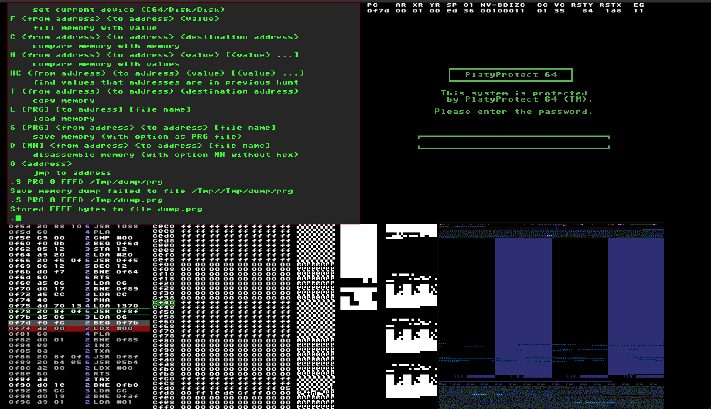
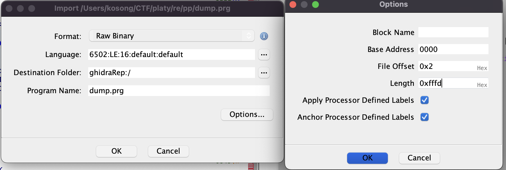
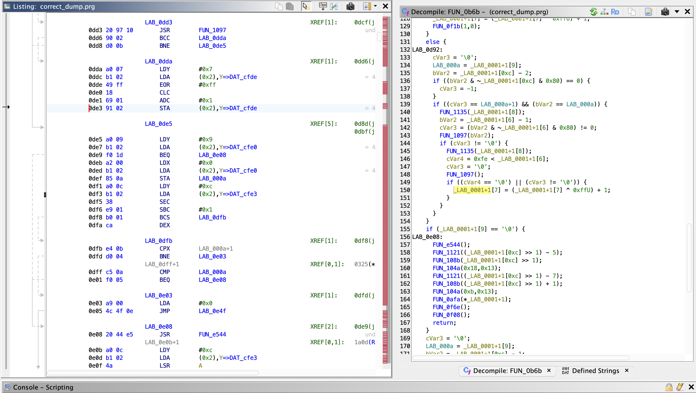

# Reverse Engineering

<!-- challenge-index: 8ac647484147a893 -->

| Challenge | Topic |
| --- | --- |
| [PlatyProtect 64 (936 pts)](#platyprotect-64-936-pts) | Commodore 64, Cartridge Unpacking |

<!-- /challenge-index -->

## PlatyProtect 64 (936 pts)

### Description

Rummaging through the attic I found an old Commodore 64. It still had a cartridge inserted, so I plugged it in and booted it up. To my surprise it still worked! But the program appears to be protected by *PlatyProtect 64*. A quick Google search revealed an old website which still hosts a version of the program. Can you tell me the password?

Further notes:

* The password is the flag. To submit it you’ll have to wrap the password with the format, i.e. you submit `PP{<password>}`.
* Any C64 emulator should work, but the program was tested with the [VICE](https://vice-emu.sourceforge.io/) emulator, which additionally provides helpful features like a monitor. With VICE installed you can run the program like so `x64sc ./pp64.prg`.

### Solution

Given .prg file, in some cases there are protection of .prg file that make the disassembler and decompiler produce the wrong results. To defeat this, we can use debugger then dump the memory.&#x20;

* Open c64 debugger
* drag n drop the .prg file
* Press ctrl + f8
* execute S PRG 0 fffd /tmp/dump.prg
  \*

  <figure><figcaption></figcaption></figure>
* Open ghidra and import new file with below options
  \*

  <figure><figcaption></figcaption></figure>
* Select all block then disassemble, now we've the same address and instruction like in the debugger
  \*

  <figure><figcaption></figcaption></figure>

\----TBU-----

Flag: PP{petscii-vs-ascii::Gtr5u8JPycCw}
