# Reverse Engineering

<!-- challenge-index: f8b2e00200a00dfa -->

| Challenge | Topic |
| --- | --- |
| [F is for Flag](#f-is-for-flag) | C++ Lambdas, Custom Cipher |
| [Jump](#jump) | AArch64, Input Validation |
| [Reaction](#reaction) | MT19937, Game State Reconstruction |

<!-- /challenge-index -->

## F is for Flag

### Description

\-

### Solution

Given ELF file, open it using IDA. Through dynamic analysis we able to recover some of the function names.

<figure>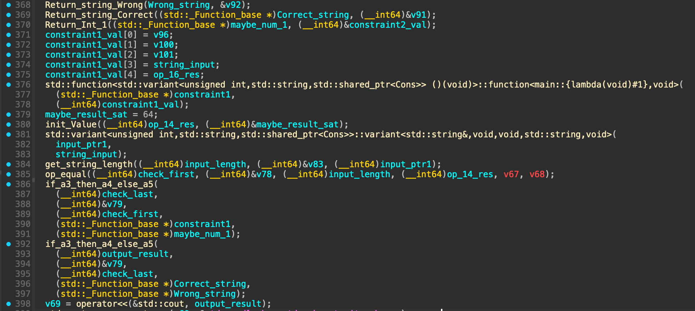<figcaption></figcaption></figure>

Above code basically doing validation for the result from function `std::function<std::variant<unsigned int,std::string,std::shared_ptr<Cons>> ()(void)>::function<main::{lambda(void)#1},void>(`. To take a look on the actual code from lambda function we can follow below pattern

* Click lambda function
  * Click function next to (a1 + 3) or \_M\_invoke
    * Click `__invoke__` function
      * Click `__invoke__` function
        * Click operator()

We will see below code as the main process&#x20;

<figure>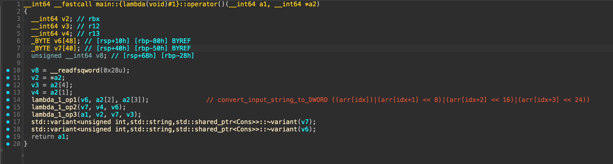<figcaption></figcaption></figure>

#### **lambda\_1\_op1**

This function do conversion from input string to dword.

```python
res = ((arr[idx])|(arr[idx+1] << 8)|(arr[idx+2] << 16)|(arr[idx+3] << 24))
```

#### **lambda\_1\_op2**

* Click function with the most argument `lambda_op2_wrapper(a1, a2, v4, v8, v9);`
  * Choose function that processed function\_if\_false
  * 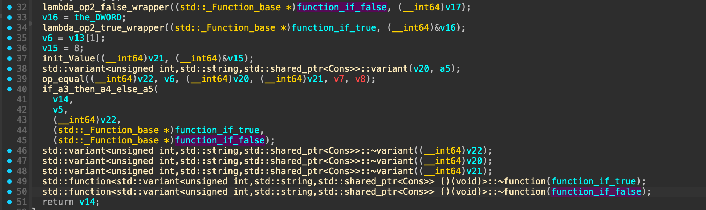
    * Click function next to (a1 + 3) or \_M\_invoke
    * Then do the same flow like the first lambda function

lambda\_1\_op1 actual code will be look like below

<figure>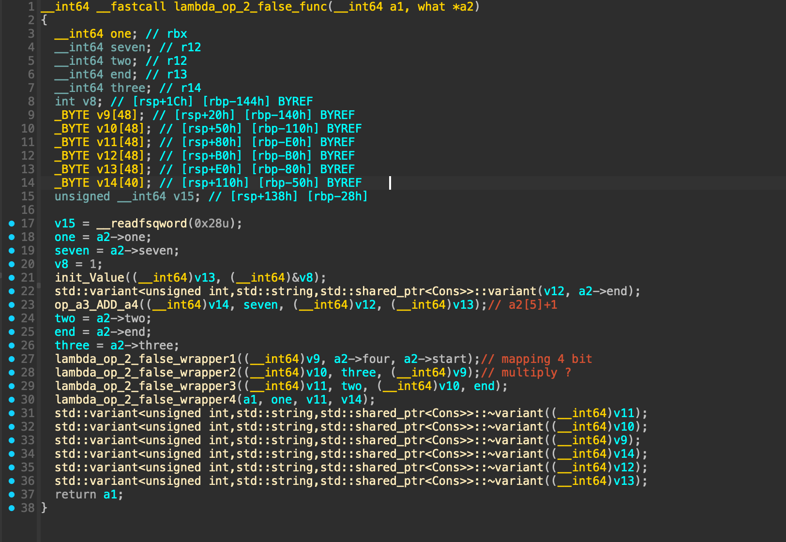<figcaption></figcaption></figure>

To take a look on the actual code for each wrapper we can do the same approach. During the competition we analyze it dynamically and make conclusion for each wrapper

* lambda\_op\_2\_false\_wrapper1
  * mapping 4 bit
* lambda\_op\_2\_false\_wrapper2
  * multiplication with 0x4e6a44b9
* lambda\_op\_2\_false\_wrapper3
  * process input with xor and rol
* lambda\_op\_2\_false\_wrapper4
  * should be looping

#### **lambda\_1\_op3**

Do validation for processed input and static values

<figure>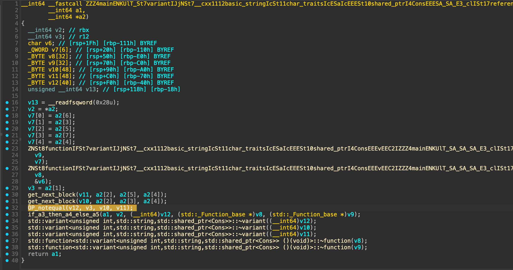<figcaption></figcaption></figure>

After getting all the algorithm we reconstruct the whole process in python.

```python
def print_hex(arr):
    tmp = []
    for i in arr:
        tmp.append(hex(i))
    print(tmp)

w='0123456789abcdef'
x='3e1a49568bf2dc07'
rev_mapper={}
mapper={}
mul=0x4e6a44b9
for i in range(16):
    rev_mapper[x[i]]=w[i]
    mapper[w[i]]=x[i]

def mpp(byt):
    return int.from_bytes(bytes.fromhex(''.join([mapper[c] for c in byt])),"little")

ROL = lambda val, r_bits, max_bits: \
    (val << r_bits%max_bits) & (2**max_bits-1) | \
    ((val & (2**max_bits-1)) >> (max_bits-(r_bits%max_bits)))

ROR = lambda val, r_bits, max_bits: \
    ((val & (2**max_bits-1)) >> r_bits%max_bits) | \
    (val << (max_bits-(r_bits%max_bits)) & (2**max_bits-1))


p=b"ABCDEFGHIJKLMNOPQRSTUVWXYZabcdefghijklmnopqrstuvwxyz0123456789{}"
BLOCK=[p[i:i+4].hex() for i in range(0,len(p),4)]


ctr=12

for _ in range(8):
    BLOCK=[mpp(BLOCK[i]) for i in range(len(BLOCK))]
    res=[]
    counter = 0
    for a4 in range(ctr,ctr-13,-1):
        res=[ROL(BLOCK[((a4+3)%16)],29,32)^ROL(BLOCK[((a4+2)%16)],17,32) ^ ROL(BLOCK[((a4+1)%16)],7,32) ^ BLOCK[(a4%16)]]+res
        counter += 1
    for i in range(len(res)):
        BLOCK[(i+_)%16]=res[i]
    BLOCK=[int.to_bytes(i,4,'little').hex() for i in BLOCK]
    ctr=ctr+1
print(ctr)
```

Last, reverse the algorithm

* create res variable
* recover block one by one, because there are 3 blocks unmodified

```python
block[12] = rol(block[15]) ^ rol(block[14]) ^ rol(block[13]) ^ res[0]
block[11] = rol(block[14]) ^ rol(block[13]) ^ rol(block[12]) ^ res[1]
block[10] = rol(block[13]) ^ rol(block[12]) ^ rol(block[11]) ^ res[2]
```

* brute the original value for multiplication (because the result was wrapped to 32 bit)
* unmap the value
* do 8 times

```c
#include <stdio.h>
#include <stdint.h>
#include <stdlib.h>

void find_x(uint32_t y, uint32_t multiplier) {
    for (uint32_t x = 0; ; x++) {
        if (x * multiplier == y) {
            printf("%08x\n", x);
        }

        if (x == UINT32_MAX) {
            break;
        }
    }
}

int main(int argc, char *argv[]) {
    if (argc != 2) {
        printf("Usage: %s <result_y>\n", argv[0]);
        return 1;
    }

    uint32_t y = strtoul(argv[1], NULL, 0);
    uint32_t multiplier = 0x4e6a44b9;

    find_x(y, multiplier);

    return 0;
}
```

```python
import os

def print_hex(arr):
    tmp = []
    for i in arr:
        tmp.append(hex(i))
    print(tmp)

def get_val(a1):
    return os.popen(f"./a.out {a1}").read().strip()

def unmm(a1):
    test = a1
    outt = []

    for i in range(len(test)):
        tmp_out = ''
        test[i] = test[i].zfill(8)
        for j in range(len(test[i])):
            tmp_out += rev_mapper[test[i][j].lower()]
        print(tmp_out)
        tmp_out = hex(int.from_bytes(bytes.fromhex(tmp_out), "little"))[2:]
        outt.append(tmp_out)
    return outt

w='0123456789abcdef'
x='3e1a49568bf2dc07'
rev_mapper={}
mapper={}
mul=0x4e6a44b9
for i in range(16):
    rev_mapper[x[i]]=w[i]
    mapper[w[i]]=x[i]

def mpp(byt):
    return int.from_bytes(bytes.fromhex(''.join([mapper[c] for c in byt])),"little")

ROL = lambda val, r_bits, max_bits: \
    (val << r_bits%max_bits) & (2**max_bits-1) | \
    ((val & (2**max_bits-1)) >> (max_bits-(r_bits%max_bits)))

ROR = lambda val, r_bits, max_bits: \
    ((val & (2**max_bits-1)) >> r_bits%max_bits) | \
    (val << (max_bits-(r_bits%max_bits)) & (2**max_bits-1))


BLOCK  = ['13307911','9becd288','ddcc0c2c','69f8ae97','607cbc34','d7826cf8','d95b7b92','8c9a68d5','1a151f45','4a9c380f','afd5c1d2','f41c8482','5a7718bd','4dfe8abe','52c60419','a4a2e9b7']

ctr = 19
import tqdm

for _ in range(ctr - 12, -1, -1):
    print(ctr)
    
    for i in range(len(BLOCK)):
        BLOCK[i] = int.from_bytes(bytes.fromhex(BLOCK[i].zfill(8)),  "little")
    
    res = [0 for _ in range(13)]
    
    for i in range(len(res)):
        res[i] = BLOCK[(i+_)%16]
    
    
    for i in range(13):
        BLOCK[(ctr-i) % 16] = ROL(BLOCK[(ctr + 3 - i) % 16],29,32)^ROL(BLOCK[(ctr + 2 - i) % 16],17,32) ^ ROL(BLOCK[(ctr + 1 - i) % 16],7,32) ^ res[12-i]
    
    for i in tqdm.tqdm(range(len(BLOCK))):
        BLOCK[i] = get_val(BLOCK[i])
    
    BLOCK = unmm(BLOCK)
    print(BLOCK)
    ctr -= 1

print(BLOCK)
```

```python
# flaggg.py
a = ['53454343', '4f4e7b66', '556e4374', '31306e34', '6c5f7052', '6f477234', '6d4d316e', '365f3173', '5f705234', '63376943', '346c4c79', '5f615f70', '5572335f', '30626675', '35633454', '316f4e7d']
flag = b""
for i in a:
	flag += bytes.fromhex(i)
print(flag) 
```

<figure>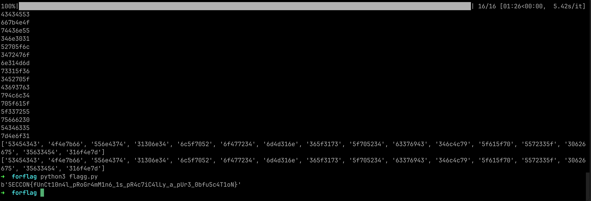<figcaption></figcaption></figure>

Flag: `SECCON{fUnCt10n4l_pRoGr4mM1n6_1s_pR4c7iC4lLy_a_pUr3_0bfu5c4T1oN}`

## Jump

### Description

### Solution

Given ELF file with architecture aarch64. Open it using IDA.

<figure>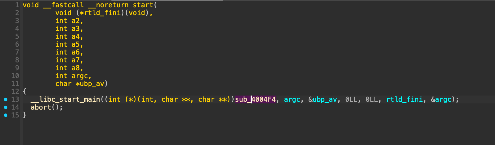<figcaption></figcaption></figure>

Looking at start function, we will see sub\_4004f4 which will act as main function. Going deeper. we will found the argument length check and if it is not 2 it will printout incorrect string. &#x20;

<figure>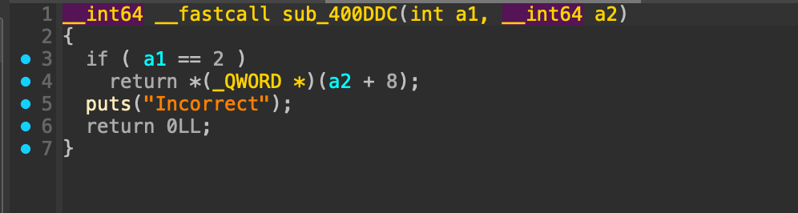<figcaption></figcaption></figure>

So basically this program is a flag checker, through analyzing each function we found interesting function that do validation.

<figure>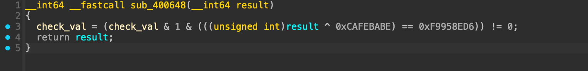<figcaption></figcaption></figure>

All of the functions has the same pattern which is it uses check\_val (global variable) to store the result. So we can get all of the check function by looking at its xref.

```python
from idaapi import *
import idautils
import idc

def print_hex(a1):
    tmp = []
    for i in a1:
        tmp.append(hex(i))
    print(tmp)

address = 0x412030
list_addr = []
for i in idautils.XrefsTo(address):
    f = ida_funcs.get_func(i.frm)
    if f.start_ea not in list_addr:
        list_addr.append(f.start_ea)

print_hex(list_addr)
```

Below is the output

```python
['0x400648', '0x4006ac', '0x400710', '0x400774', '0x4007fc', '0x400884', '0x40090c', '0x400964', '0x400c48']
```

Set breakpoint on all logic/arithmetic operation on that function except the last one (0x400c48). Then trigger the input, check the input validated, and bypass the validation.

```python
#!/usr/bin/python3

import string

class SolverEquation(gdb.Command):
    def __init__ (self):
        super (SolverEquation, self).__init__ ("solve-equation",gdb.COMMAND_OBSCURE)

    def invoke (self, arg, from_tty):
        
        gdb.execute("del")
        
        list_bp = ["0x4006D0","0x40066C","0x400734","0x4007BC","0x0400844","0x4008CC","0x400930","0x4009AC"]

        for i in list_bp:
            gdb.execute(f"b *{hex(int(i,16))}")
        
        gdb.execute("run SECCON{0123456789abcdefghijklmnopqrstuv}")

        list_ins = []
        list_val = []
        list_cmp = []
        
        arch = gdb.selected_frame().architecture()
        
        for i in range(3):
            print(i)
            current_pc = addr2num(gdb.selected_frame().read_register("pc"))
            disa = arch.disassemble(current_pc)[0]
            list_ins.append(f"{hex(disa['addr'])} : {disa['asm']} ")

            w8 = addr2num(gdb.selected_frame().read_register("w8"))
            w9 = addr2num(gdb.selected_frame().read_register("w9"))
            list_val.append([w8, w9])

            for _ in range(100):
                current_pc = addr2num(gdb.selected_frame().read_register("pc"))
                disa = arch.disassemble(current_pc)[0]
                if "cset" in disa["asm"]:
                    w9 = addr2num(gdb.selected_frame().read_register("w9"))
                    list_cmp.append(w9)
                    gdb.execute("si")
                    gdb.execute("set $w8 = 0x1")
                    gdb.execute("c")
                    break
                else:
                    gdb.execute("si")

        print(list_val)
        print(list_cmp)
        


def parse(f):
    f = f.split("\n")
    result = []
    for i in f:
        tmp = i.split("\t")
        for j in range(1,len(tmp)):
            result.append(int(tmp[j],16))
    return result

def addr2num(addr):
    try:
        return int(addr)
    except:
        return long(addr)

SolverEquation()
```

From trial and error we found that there are only 3 breakpoints hitted. &#x20;

<figure>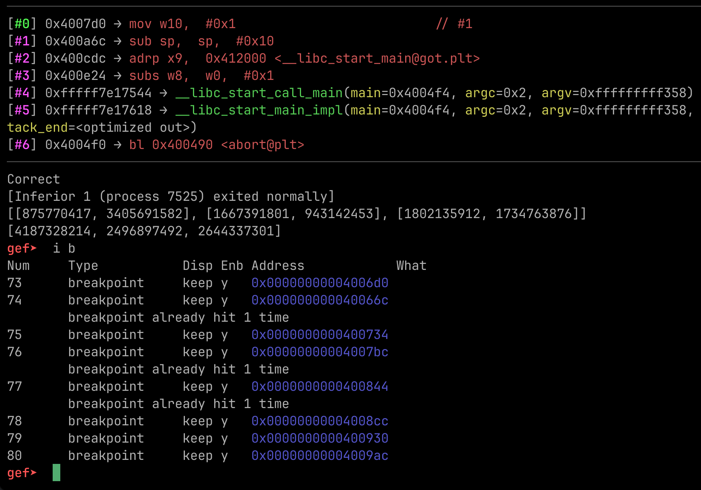<figcaption></figcaption></figure>

Each value compared it also from our input (except the validation that use 1 constant and 1 variable)

```python
from Crypto.Util.number import *

list_val = [[875770417, 3405691582], [1667391801, 943142453], [1802135912, 1734763876]]
list_cmp = [4187328214, 2496897492, 2644337301]

for i in list_val:
	print(long_to_bytes(i[0])[::-1], long_to_bytes(i[1])[::-1])
```

&#x20;

<figure>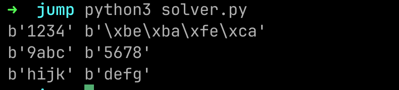<figcaption></figcaption></figure>

Now we know the pattern used, which is block\[i] block\[i-1] (which is same like in the code). But the problem is we dont know what is the value of i used on each function. So i decided to map each function manually.

```python
address  valid_input block
0x400930 SECC        -> 0
0x400734 ON{5        -> 1 
0x40066C h4k3        -> 2
0x4006D0 _1t_        -> 3
0x400844 ????????    -> 4 & 3
???????? ????????    -> 5 & 4
0x4007BC ????????    -> 6 & 5
???????? ????????    -> 7 & 6

```

So for validation that use one block, we can get the valid input by reversing the algorithm. But for the two blocks validation we cannot directly get the valid input but we can use the previous known input and do a little bruteforce recursively.

```python
from Crypto.Util.number import *
from itertools import product
import string

def rec(known, arr, opr, leaked, prev):
	if len(leaked) == 16:
		print(flag + leaked)
		return
	
	for i in range(len(arr)):
		for val in arr[i]:
			for j in opr[i]:
				if "+" == j:
					tmp = long_to_bytes((val + known) & 0xffffffff)[::-1]
					if all(c in list_char for c in tmp):
						if tmp != prev:
							leaked += tmp
							known2 = bytes_to_long(tmp[::-1])
							rec(known2, arr[1:], opr[1:], leaked, long_to_bytes(known)[::-1])
				else:
					tmp = long_to_bytes((val - known) & 0xffffffff)[::-1]
					if all(c in list_char for c in tmp):
						if tmp != prev:
							leaked += tmp
							known2 = bytes_to_long(tmp[::-1])
							rec(known2, arr[1:], opr[1:], leaked, long_to_bytes(known)[::-1])


list_char = list(string.printable.encode())

flag = b"SECC"
flag += long_to_bytes(0xDEADBEEF ^ 0xEBD6F0A0)[::-1]
flag += long_to_bytes(0xCAFEBABE ^ 0xF9958ED6)[::-1]
flag += long_to_bytes(0xC0FFEE ^ 0x5FB4CEB1)[::-1]

arr = [[0x94D3A1D4], [0x9D9D6295, 0x47CB363B], [0x9D949DDD], [0x9D9D6295, 0x47CB363B]]
opr = [["+", "-"] for _ in range(4)]

known = bytes_to_long(flag[-4:][::-1])
leaked = b""

rec(known, arr, opr, leaked, b"")
	
```

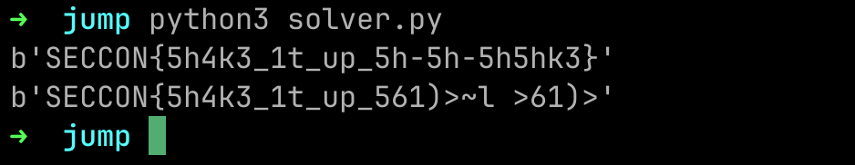

Flag: `SECCON{5h4k3_1t_up_5h-5h-5h5hk3}`

## Reaction

### Description

\-

### Solution

Given ELF, open using IDA. Look at main function.&#x20;

<figure>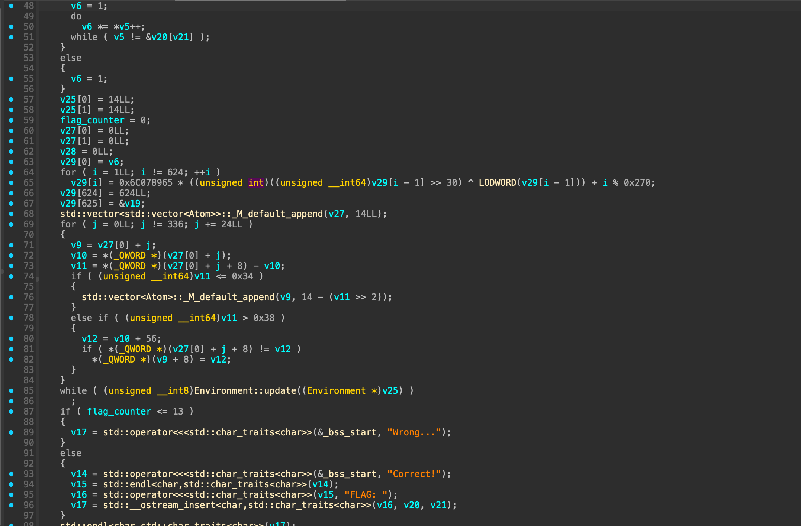<figcaption></figcaption></figure>

Code above basically do 3 things

* Generate seed using flag and use Mersenne Twister to generate random
* Call Environment::update which consist almost all of the algorithm in the code
* Validate flag\_counter (which processed in Environment::update), if flag\_counter > 13 it will produce flag

So lets take a look on Environment::update

<figure>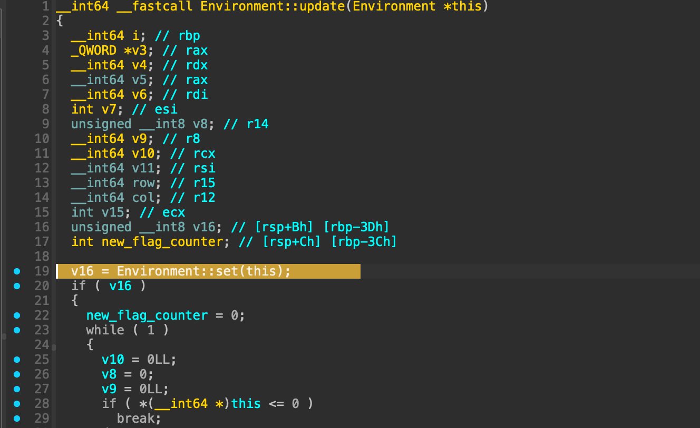<figcaption></figcaption></figure>

Our input received at Environment::set, each input consist of 2 bytes value.&#x20;

<figure>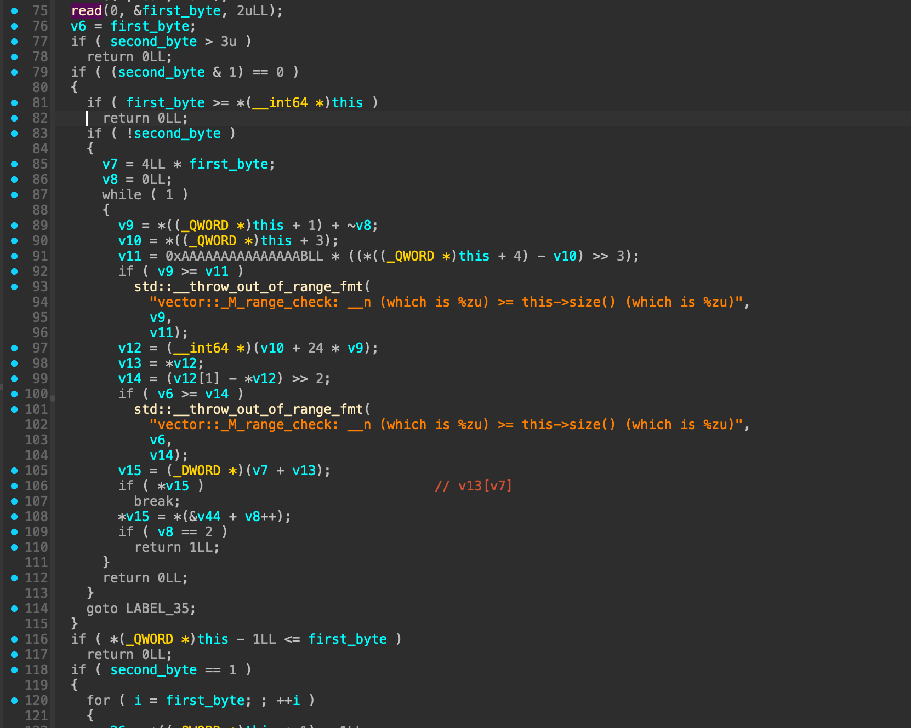<figcaption></figcaption></figure>

From code above we can see that the second byte can be only 0,1,2, or 3. And the first value is limited to < 0xe (which is the same size like maximum index of array initialized in main function). After having this information we tried to debug it and take a look on each data processed.

```python
===================
inp[1] == 0
inp[0] < 0xe

loop 2 times
*(0x55555556d930 + inp[0]*4) != 0 return 0
*(0x55555556d8f0 + inp[0]*4) != 0 return 0

===================
inp[1] == 1
inp[0] < 0xe

loop 2 times
*(0x55555556d930 + inp[0] * 4) != 0 return 0
*(0x55555556d930 + (inp[0] + 1) * 4) != 0 return 0

===================
inp[1] == 2
inp[0] < 0xe

loop 2 times
*(0x55555556d8f0 + inp[0]*4) != 0 return 0
*(0x55555556d930 + inp[0]*4) != 0 return 0

===================
inp[1] == 3
inp[0] < 0xe

loop 2 times
*(0x55555556d930 + (inp[0] + 1) * 4) != 0 return 0
*(0x55555556d930 + inp[0] * 4) != 0 return 0
```

At first i though it was a maze direction, so i tried to findout where is the random generated. The generated random actually in the same function which is Environment::set, below is the code to generate the random number.

&#x20;

<figure>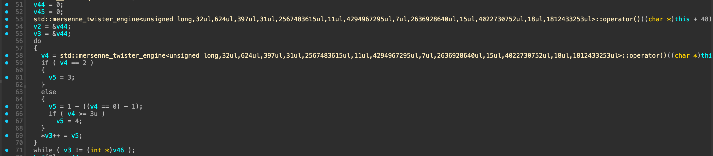<figcaption></figcaption></figure>

After found it, i convert the whole random number generation process.

```python
# coefficients for MT19937
(w, n, m, r) = (32, 624, 397, 31)
a = 0x9908B0DF
(u, d) = (11, 0xFFFFFFFF)
(s, b) = (7, 0x9D2C5680)
(t, c) = (15, 0xEFC60000)
l = 18
f = 1812433253


# make a arry to store the state of the generator
MT = [0 for i in range(n)]
index = n+1
lower_mask = 0x7FFFFFFF #(1 << r) - 1 // That is, the binary number of r 1s
upper_mask = 0x80000000 #lowest w bits of (not lower_mask)


# initialize the generator from a seed
def mt_seed(seed):
    # global index
    # index = n
    MT[0] = seed
    for i in range(1, n):
        temp = f * (MT[i-1] ^ (MT[i-1] >> (w-2))) + i
        MT[i] = temp & 0xffffffff


# Extract a tempered value based on MT[index]
# calling twist() every n numbers
def extract_number():
    global index
    if index >= n:
        twist()
        index = 0

    y = MT[index]
    y = y ^ ((y >> u) & d)
    y = y ^ ((y << s) & b)
    y = y ^ ((y << t) & c)
    y = y ^ (y >> l)

    index += 1
    return y & 0xffffffff


# Generate the next n values from the series x_i
def twist():
    for i in range(0, n):
        x = (MT[i] & upper_mask) + (MT[(i+1) % n] & lower_mask)
        xA = x >> 1
        if (x % 2) != 0:
            xA = xA ^ a
        MT[i] = MT[(i + m) % n] ^ xA


WRAP_32 = 2**32 - 1
flag = b"SECCON{abcdefghijklmnopqrs}"
v6 = 1
for i in range(len(flag)):
    v6 *= flag[i]
v6 &= WRAP_32
mt_seed(v6)

list_blocks = []

inp = b"abcdefgh"
for i in range(99):
    lol = extract_number()
    block = []
    for _ in range(2):
        v4 = extract_number() & 3
        if v4 == 2:
            v5 = 3
        else:
            v5 = 1 - ((1 if v4 == 0 else 0) - 1) # 1 or 2
            if v4 >= 3:
                v5 = 4
        block.append(v5)
    list_blocks.append(block)
print(list_blocks)
```

Output:

```python
[[1, 4], [4, 1], [2, 1], [4, 4], [1, 1], [2, 2], [3, 1], [3, 4], [1, 1], [1, 3], [3, 1], [4, 3], [4, 3], [2, 2], [3, 3], [1, 4], [3, 3], [3, 4], [2, 3], [3, 3], [3, 1], [1, 1], [4, 2], [2, 1], [4, 2], [1, 4], [2, 2], [4, 1], [3, 3], [1, 3], [4, 1], [3, 1], [3, 1], [2, 1], [1, 2], [4, 1], [4, 1], [1, 3], [4, 3], [2, 4], [2, 1], [2, 1], [1, 2], [3, 4], [4, 4], [4, 1], [2, 1], [4, 2], [4, 2], [2, 2], [2, 4], [1, 3], [3, 1], [2, 1], [1, 2], [4, 1], [1, 2], [1, 2], [2, 4], [2, 3], [2, 3], [3, 2], [1, 2], [2, 2], [1, 1], [1, 3], [4, 3], [1, 4], [1, 2], [1, 1], [2, 3], [2, 2], [3, 3], [3, 3], [1, 3], [1, 1], [3, 3], [4, 1], [4, 2], [1, 1], [4, 2], [4, 1], [4, 2], [4, 1], [3, 4], [1, 3], [4, 2], [1, 1], [1, 4], [4, 1], [2, 2], [3, 4], [1, 3], [1, 2], [3, 3], [2, 1], [1, 4], [3, 4], [2, 1]]
```

The output doesnt look like a value in maze. So i continue to analyze the algorithm that will process above values. Our objective is to findout a way to make the flag\_counter > 13 and i found that Environment::react will affect the flag\_counter.

&#x20;

<figure>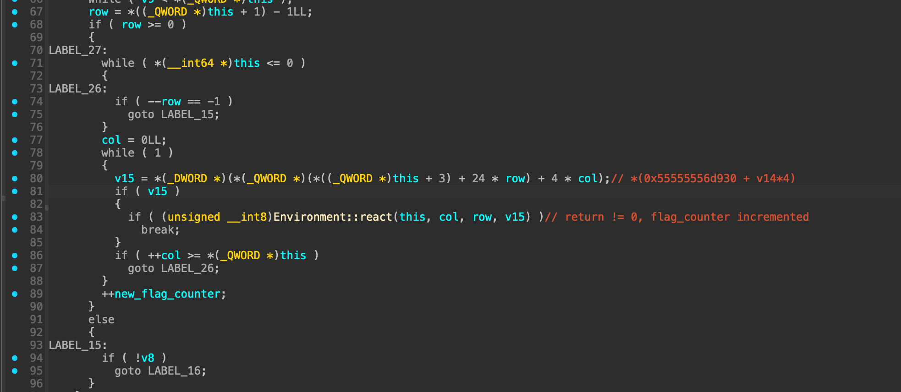<figcaption></figcaption></figure>

From analysis we found that Environment::react process information based on column and row. The total of column and row is 14x14 and it is the same address like we got from the Environment::set. So in this step we tried to dump the table to know the mapping for our input.

```python
#!/usr/bin/python3

def write_payload(data):
    f = open("payload", "wb")
    f.write(data)
    f.close()

def print_hex(arr):
    tmp = []
    for i in arr:
        tmp.append(hex(i))
    print(tmp)


class SolverEquation(gdb.Command):
    def __init__ (self):
        super (SolverEquation, self).__init__ ("solve-equation",gdb.COMMAND_OBSCURE)

    def invoke (self, arg, from_tty):
        payload =  b"\x00\x00"
        payload += b"\x00\x03"

        write_payload(payload)

        known_addr = ['0x55555556d930', '0x55555556d8f0', '0x55555556d8b0', '0x55555556d870', '0x55555556d830', '0x55555556d7f0', '0x55555556d7b0', '0x55555556d770', '0x55555556d730', '0x55555556d6f0', '0x55555556d6b0', '0x55555556d670', '0x55555556d630', '0x55555556d5f0']

        gdb.execute("del")
        gdb.execute("b *0x555555557B81") # envset
        gdb.execute("r < payload")
        all_mapp = []
        
        block =  [[1, 4], [4, 1], [2, 1], [4, 4], [1, 1], [2, 2], [3, 1], [3, 4], [1, 1], [1, 3], [3, 1], [4, 3], [4, 3], [2, 2], [3, 3], [1, 4], [3, 3], [3, 4], [2, 3], [3, 3], [3, 1], [1, 1], [4, 2], [2, 1], [4, 2], [1, 4], [2, 2], [4, 1], [3, 3], [1, 3], [4, 1], [3, 1], [3, 1], [2, 1], [1, 2], [4, 1], [4, 1], [1, 3], [4, 3], [2, 4], [2, 1], [2, 1], [1, 2], [3, 4], [4, 4], [4, 1], [2, 1], [4, 2], [4, 2], [2, 2], [2, 4], [1, 3], [3, 1], [2, 1], [1, 2], [4, 1], [1, 2], [1, 2], [2, 4], [2, 3], [2, 3], [3, 2], [1, 2], [2, 2], [1, 1], [1, 3], [4, 3], [1, 4], [1, 2], [1, 1], [2, 3], [2, 2], [3, 3], [3, 3], [1, 3], [1, 1], [3, 3], [4, 1], [4, 2], [1, 1], [4, 2], [4, 1], [4, 2], [4, 1], [3, 4], [1, 3], [4, 2], [1, 1], [1, 4], [4, 1], [2, 2], [3, 4], [1, 3], [1, 2], [3, 3], [2, 1], [1, 4], [3, 4], [2, 1]]
        
        for j in range((len(payload) // 2) + 1):
            mapp = []
            for i in known_addr:
                mapp.append(parse(gdb.execute(f"x/14wx {i}", to_string=True)))
            all_mapp.append(mapp)
            gdb.execute("c")
        all_mapp = all_mapp[1:]

        for i in range(len(all_mapp)):
            
            col = payload[2*i]
            direct = payload[2*i + 1]
            if direct == 0:
                block_print = [[block[i][0]], [block[i][1]]]
            elif direct == 1:
                block_print = [block[i][0], block[i][1]]
            elif direct == 2:
                block_print = [[block[i][1]], [block[i][0]]]
            else:
                block_print = [block[i][1], block[i][0]]

            for j in all_mapp[i]:
                print(j)
            print()


def parse(f):
    f = f.split("\n")
    result = []
    for i in f:
        tmp = i.split("\t")
        for j in range(1,len(tmp)):
            result.append(int(tmp[j],16))
    return result


def addr2num(addr):
    try:
        return int(addr)  # Python 3
    except:
        return long(addr) # Python 2

SolverEquation()
```

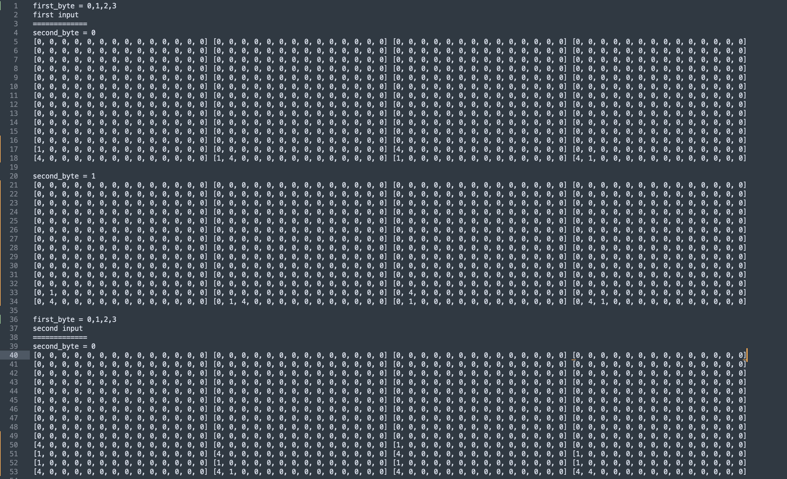

I dont know what kind of puzzle is this, so i just shared it to the discord and my teammate found that it was a `puyo puyo`. So the next step i did is trying to find out how to get the block and then i realize that the block was leaked from the response. To get the block i just send the most possible combinations that can be made if there is no block explodes.

```python
from pwn import *

r = remote("reaction.seccon.games", 5000)

for i in range(8):
	for j in range(0xe):
		r.send(bytes([i * 2]) + b"\x01")
tmp = r.recvuntil(b"Wrong...")

tmp = tmp.strip(b"Wrong...")

block = []
for i in range(0, len(tmp), 2):
	block.append(list(tmp[i:i+2]))

print(block)
```

After that my teammate tried to solve it manually, he has experience with this kind of puzzle/game.

To solve, I (zafirr) played puyo puyo manually on google sheets :grin: and recorded the moves. This is the state of the board before the last move. It results in a 15 chain&#x20;

<figure>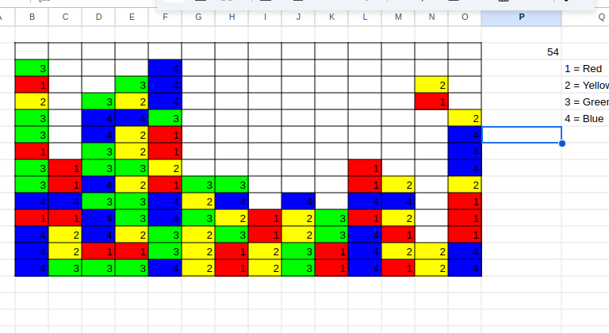<figcaption></figcaption></figure>

During the solving process, after he found the solution there is a little step missing, so i decide to do a modification on my gdb script to help him to find out the actual map of the block. To do that, basically i change the value written to the map with the value from the server. Below is the updated gdb script.

```python
#!/usr/bin/python3

def write_payload(data):
    f = open("payload", "wb")
    f.write(data)
    f.close()

def print_hex(arr):
    tmp = []
    for i in arr:
        tmp.append(hex(i))
    print(tmp)


class SolverEquation(gdb.Command):
    def __init__ (self):
        super (SolverEquation, self).__init__ ("solve-equation",gdb.COMMAND_OBSCURE)

    def invoke (self, arg, from_tty):
        payload = b'\x00\x00'
        payload += b'\x00\x02'
        write_payload(payload)

        known_addr = ['0x55555556d930', '0x55555556d8f0', '0x55555556d8b0', '0x55555556d870', '0x55555556d830', '0x55555556d7f0', '0x55555556d7b0', '0x55555556d770', '0x55555556d730', '0x55555556d6f0', '0x55555556d6b0', '0x55555556d670', '0x55555556d630', '0x55555556d5f0']

        gdb.execute("del")
        gdb.execute("b *0x5555555569EF") # map
        gdb.execute("b *0x555555557B81") # envset
        gdb.execute("r < payload")
        all_mapp = []
        
        block =  [[0, 0], [4, 4], [3, 2], [1, 3], [2, 4], [1, 4], [3, 3], [1, 4], [4, 4], [4, 4], [4, 3], [4, 3], [3, 1], [1, 3], [1, 2], [3, 3], [3, 2], [2, 2], [4, 4], [1, 1], [4, 3], [3, 2], [3, 2], [3, 2], [2, 4], [4, 3], [1, 2], [2, 3], [1, 1], [4, 3], [1, 2], [2, 2], [1, 2], [2, 3], [1, 1], [4, 4], [4, 3], [3, 1], [1, 3], [4, 4], [4, 3], [4, 1], [1, 2], [1, 1], [3, 2], [4, 2], [1, 2], [1, 3], [3, 2], [3, 1], [1, 2], [4, 2], [4, 4], [4, 2], [1, 2], [4, 1], [4, 2], [1, 2], [4, 3], [4, 2], [2, 2], [3, 2], [2, 1], [1, 4], [1, 1], [3, 1], [3, 3], [2, 2], [1, 4], [2, 4], [3, 1], [4, 1], [2, 2], [3, 4], [1, 1], [4, 4], [4, 2], [3, 2], [1, 3], [3, 1], [4, 3], [2, 2], [4, 4], [3, 1], [2, 3], [4, 2], [1, 1], [4, 3], [4, 3], [1, 2], [3, 2], [2, 3], [3, 2], [3, 1], [3, 4], [2, 3], [2, 1], [2, 2], [4, 1], [1, 3]]
        arr = [[4, 4], [3, 2], [1, 3], [2, 4], [1, 4], [3, 3], [1, 4], [4, 4], [4, 4], [4, 3], [4, 3], [3, 1], [1, 3], [1, 2], [3, 3], [3, 2], [2, 2], [4, 4], [1, 1], [4, 3], [3, 2], [3, 2], [3, 2], [2, 4], [4, 3], [1, 2], [2, 3], [1, 1], [4, 3], [1, 2], [2, 2], [1, 2], [2, 3], [1, 1], [4, 4], [4, 3], [3, 1], [1, 3], [4, 4], [4, 3], [4, 1], [1, 2], [1, 1], [3, 2], [4, 2], [1, 2], [1, 3], [3, 2], [3, 1], [1, 2], [4, 2], [4, 4], [4, 2], [1, 2], [4, 1], [4, 2], [1, 2], [4, 3], [4, 2], [2, 2], [3, 2], [2, 1], [1, 4], [1, 1], [3, 1], [3, 3], [2, 2], [1, 4], [2, 4], [3, 1], [4, 1], [2, 2], [3, 4], [1, 1], [4, 4], [4, 2], [3, 2], [1, 3], [3, 1], [4, 3], [2, 2], [4, 4], [3, 1], [2, 3], [4, 2], [1, 1], [4, 3], [4, 3], [1, 2], [3, 2], [2, 3], [3, 2], [3, 1], [3, 4], [2, 3], [2, 1], [2, 2], [4, 1], [1, 3]]

        for j in range((len(payload) // 2) + 1):
            mapp = []
            for i in known_addr:
                mapp.append(parse(gdb.execute(f"x/14wx {i}", to_string=True)))
            all_mapp.append(mapp)
            gdb.execute("c")
            gdb.execute(f"set $edx={arr[j][0]}") # block[0]
            gdb.execute("c")
            gdb.execute(f"set $edx={arr[j][1]}") # block[1]
            gdb.execute("c")
        
        for i in range(len(all_mapp)):
            print(f"{i} - Curr : {block[i]}, Next: {block[i+1]}")
            print()
            print([i for i in range(14)])
            for j in all_mapp[i]:
                print(j)
            print()


def parse(f):
    f = f.split("\n")
    result = []
    for i in f:
        tmp = i.split("\t")
        for j in range(1,len(tmp)):
            result.append(int(tmp[j],16))
    return result


def addr2num(addr):
    try:
        return int(addr)  # Python 3
    except:
        return long(addr) # Python 2

SolverEquation()
```

Below is the example of the output to debug the puyo puyo

&#x20;

<figure>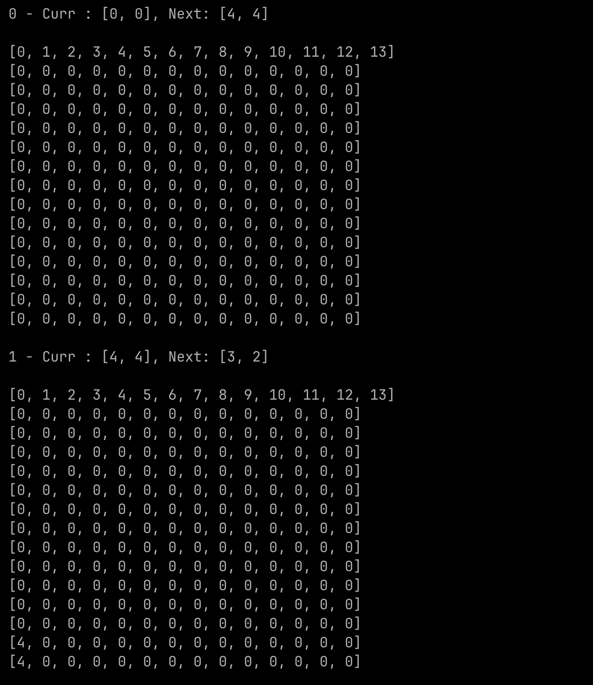<figcaption></figcaption></figure>

Last step, just send the moves and solved:

```py
from pwn import *

# context.log_level = 'debug'
r = remote("reaction.seccon.games", 5000)

moves = ['4,4 1', '2,3 2', '1,3 3', '4.2 1', '4,1 1', '3,3 1', '4,1 2', '4,4 3', '4,4 14', '4,3 3', '3.4 4', '1.3 2', '1.3 2', '2,1 4', '3,3 4', '3,2 4', '2,2 4', '4.4 3', '1,1 14', '3,4 3', '3,2 4', '3.2 5', '3.2 5', '4.2 5', '4.3 5', '1.2 5', '2.3 5', '1,1 5', '4,3 5', '1.2 7', '2,2 13', '1.2 7', '2,3 7', '1,1 8', '4,4 5', '3,4 7', '3.1 9', '3.1 9', '4,4 11', '3.4 10', '4,1 11', '2,1 12', '1,1 11', '2.3 9', '4,2 9', '2,1 12', '3,1 1', '2,3 1', '3,1 1', '2,1 14', '2,4 12', '4,4 14', '2,4 14', '2,1 13']
puyoes = [[4, 4], [3, 2], [1, 3], [2, 4], [1, 4], [3, 3], [1, 4], [4, 4], [4, 4], [4, 3], [4, 3], [3, 1], [1, 3], [1, 2], [3, 3], [3, 2], [2, 2], [4, 4], [1, 1], [4, 3], [3, 2], [3, 2], [3, 2], [2, 4], [4, 3], [1, 2], [2, 3], [1, 1], [4, 3], [1, 2], [2, 2], [1, 2], [2, 3], [1, 1], [4, 4], [4, 3], [3, 1], [1, 3], [4, 4], [4, 3], [4, 1], [1, 2], [1, 1], [3, 2], [4, 2], [1, 2], [1, 3], [3, 2], [3, 1], [1, 2], [4, 2], [4, 4], [4, 2], [1, 2], [4, 1], [4, 2], [1, 2], [4, 3], [4, 2], [2, 2], [3, 2], [2, 1], [1, 4], [1, 1], [3, 1], [3, 3], [2, 2], [1, 4], [2, 4], [3, 1], [4, 1], [2, 2], [3, 4], [1, 1], [4, 4], [4, 2], [3, 2], [1, 3], [3, 1], [4, 3], [2, 2], [4, 4], [3, 1], [2, 3], [4, 2], [1, 1], [4, 3], [4, 3], [1, 2], [3, 2], [2, 3], [3, 2], [3, 1], [3, 4], [2, 3], [2, 1], [2, 2], [4, 1], [1, 3]]

f = open("payload", "wb")
for i in range(len(moves)):
    move = moves[i]
    orientation, column = move.split(" ")
    puyo = puyoes[i]
    print(move, puyo)

    if orientation[1] == ',':
        a,b = list(map(int, orientation.split(',')))
        if(a == puyo[0]):
            direction = 0
        else:
            direction = 2
    if orientation[1] == '.':
        a,b = list(map(int, orientation.split('.')))
        if(a == puyo[0]):
            direction = 1
        else:
            direction = 3
    payload = bytes([int(column)-1]) + bytes([direction])
    f.write(payload)
    print(payload)
    r.send(payload)
    sleep(0.1)
```

&#x20;

<figure>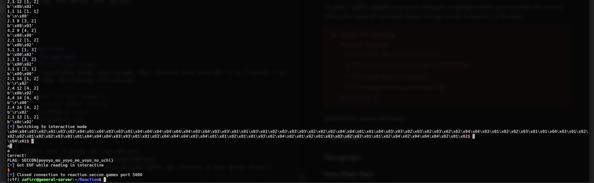<figcaption></figcaption></figure>

FLAG: `SECCON{puyoyo_mo_yoyo_mo_yoyo_no_uchi}`
