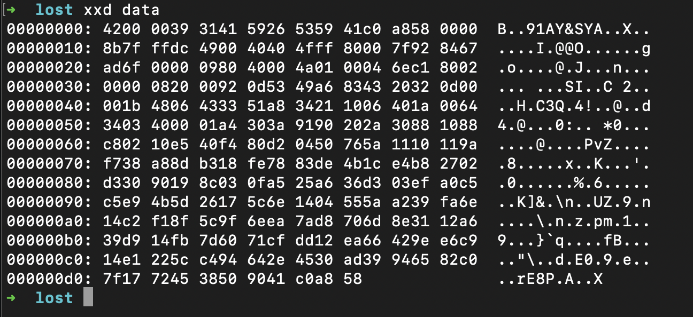
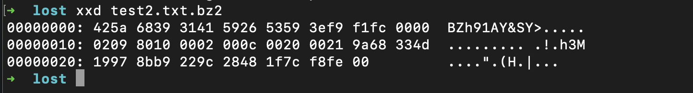
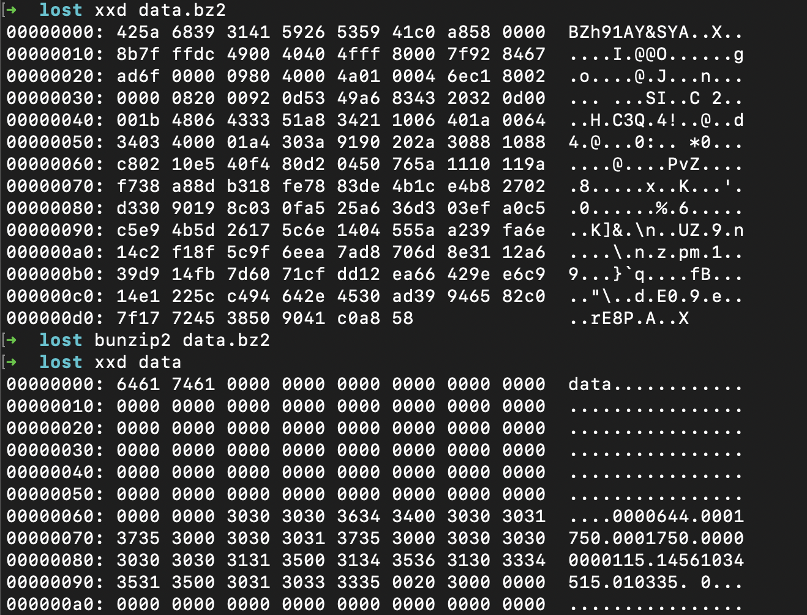
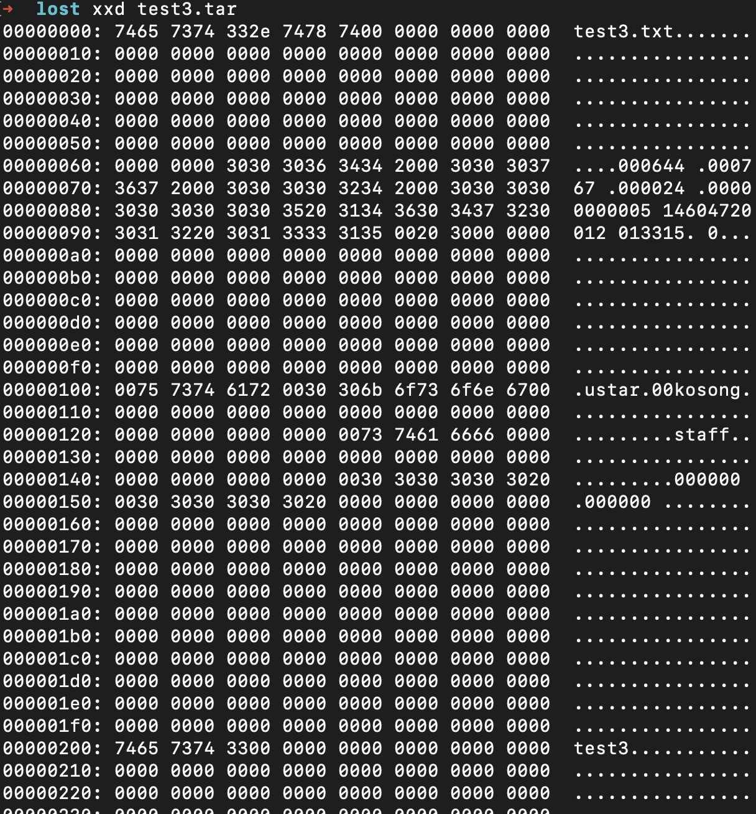
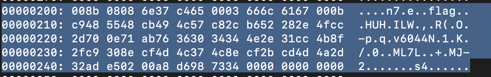
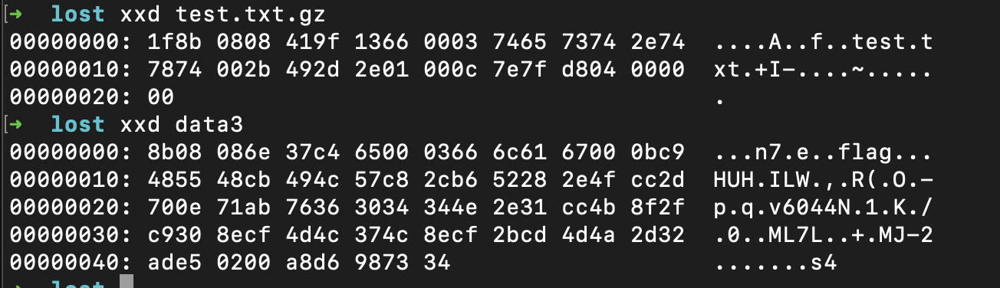
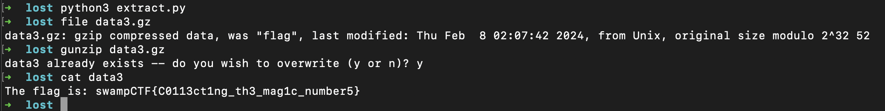

# Misc

<!-- challenge-index: 94ffd36ae31b1044 -->

| Challenge | Topic |
| --- | --- |
| [Lost Some Magic (92 pts)](#lost-some-magic-92-pts) | File Signatures, Nested Compression |

<!-- /challenge-index -->

## Lost Some Magic (92 pts)

### Description

Our SOC analysts saw some strange DNS traffic. Wanted you to figure out what was exfiltated , can you check it and sum it up ?

### Solution

Given file with unknown type, lets check the contents.

<figure><figcaption></figcaption></figure>

There is no extension with header signature 4200. Based on the description it should be kind of compression so lets try to check another compressed file.

<figure><figcaption></figcaption></figure>

bz2 header looks similar with 2 bytes value nulled. So rewrite those null bytes to 5a68 and do bz2 decompress.

<figure><figcaption></figcaption></figure>

Okay, lets check the next part.&#x20;

<figure><figcaption></figcaption></figure>

Looks like it similar with tar archive, tar doesn't compress the value. So just take directly the value from xxd.

<figure><figcaption></figcaption></figure>

```python
f = open("data2.tar", "rb").read()
data = bytes.fromhex("8b08086e37c4650003666c6167")
index = f.index(data)
val = f[index:index+73]

g = open("data3", "wb")
g.write(val)
```

<figure><figcaption></figcaption></figure>

Looks like data3 is gz archive with removed header and trailer. Lets add header and trailer and try to decompress it.

```python
f = open("data2.tar", "rb").read()
data = bytes.fromhex("8b08086e37c4650003666c6167")
index = f.index(data)
val = f[index:index+73]
new_val = b"\x1f" + val + b"\x00" * 3

g = open("data3.gz", "wb")
g.write(new_val)
```

<figure><figcaption></figcaption></figure>

Flag: swampCTF{C0113ct1ng\_th3\_mag1c\_number5}
