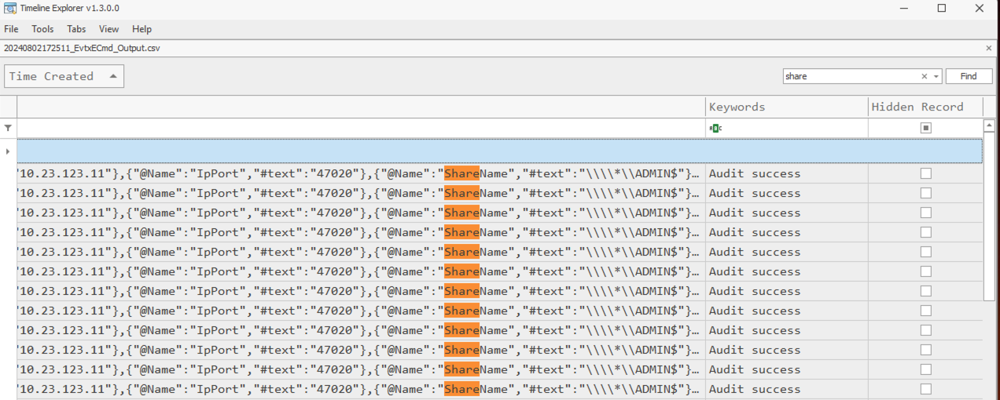
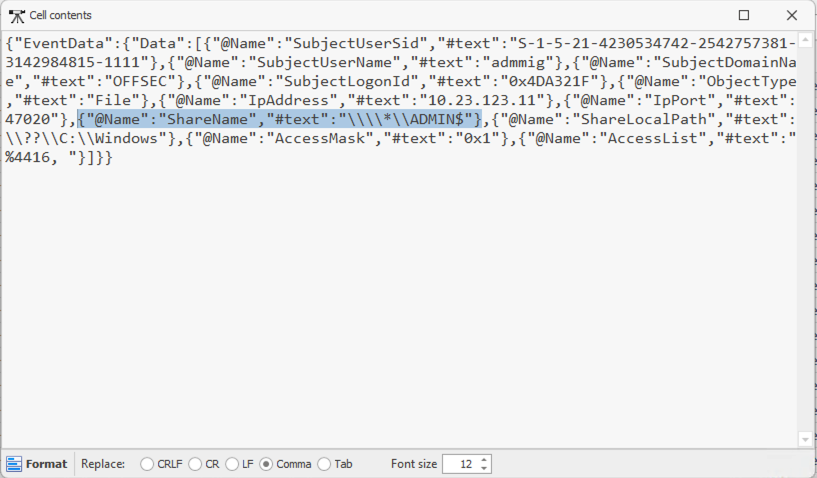
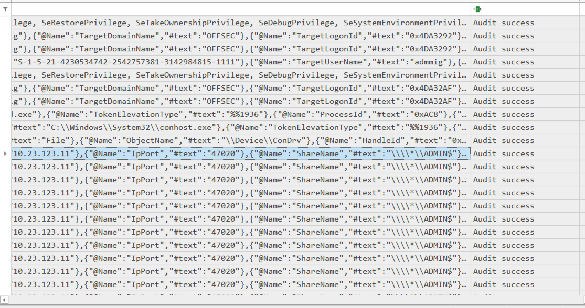
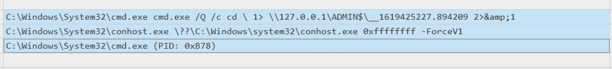
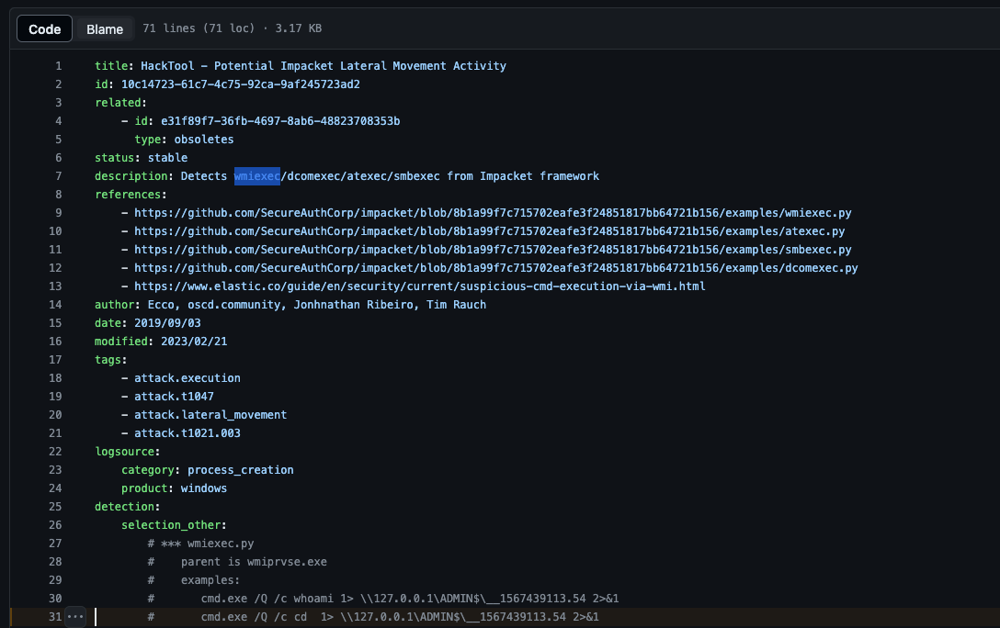

# Forensic

<!-- challenge-index: d14161e778493736 -->

| Challenge | Topic |
| --- | --- |
| [SM WHAT?! (360 pts)](#sm-what-360-pts) | Windows Event Logs, SMB |

<!-- /challenge-index -->

## SM WHAT?! (360 pts)

### Description

An attacker managed to gain foothold in our network, but we managed to capture the connection to our server. Analyze the file and identify the tool used to connect, the service it connected to, its IP address, and the shared resources folder.

Flag format: TFCCTF{tool\_service\_ip\_share}

Example: TFCCTF{ntlmrelayx\_rdp\_192.168.0.1\_logs$}

Note: The flag is in all lowercase (except for TFCCTF).

### Solution

Download the artifact which is evtx file. Use EvtxECmd to parse the evtx file and open it using TimelineExplorer. One of the objective is finding the share name so my assumption is the service attacked related to SMB. So lets try to search string "share" in TimelineExplorer.

<figure><figcaption></figcaption></figure>

From the result we know that there are access to SMB in 04/26/2021 so we can narrow the date to 04/26/2021. Double click one of the data we will know the information about share folder accessed.

<figure><figcaption></figcaption></figure>

The sharename is ADMIN$ and the remote IP Address is 10.23.123.11, delete the filter and group it by date. Try to find event before the shared folder accessed.

<figure><figcaption></figcaption></figure>

Looking at event above that line i saw suspicious executable information&#x20;

&#x20;

<figure><figcaption></figcaption></figure>

Gather some information from above command line in github i found some code that consist of "cmd.exe /Q /c cd "

* <https://github.com/search?q=%22cmd.exe+%2FQ+%2Fc+cd+%22&type=code>

<figure><figcaption></figcaption></figure>

We can see that the tools used is wmiexec, now we've all the data but it still failed when i submit TFCCTF{wmiexec\_smb\_10.23.123.11\_admin$}. The only IP address existing in the time near incident other than 10.23.123.11 is 127.0.0.1. Changing the IP address to 127.0.0.1 we found the correct flag.

Flag: TFCCTF{wmiexec\_smb\_127.0.0.1\_admin$}
