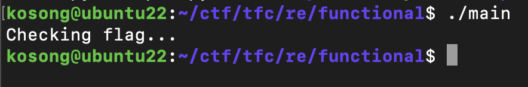
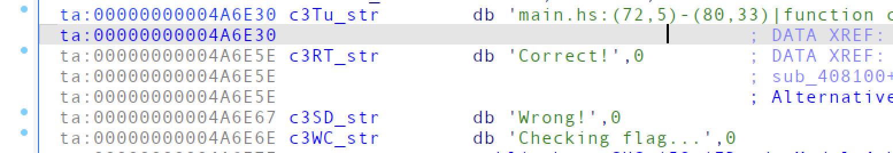
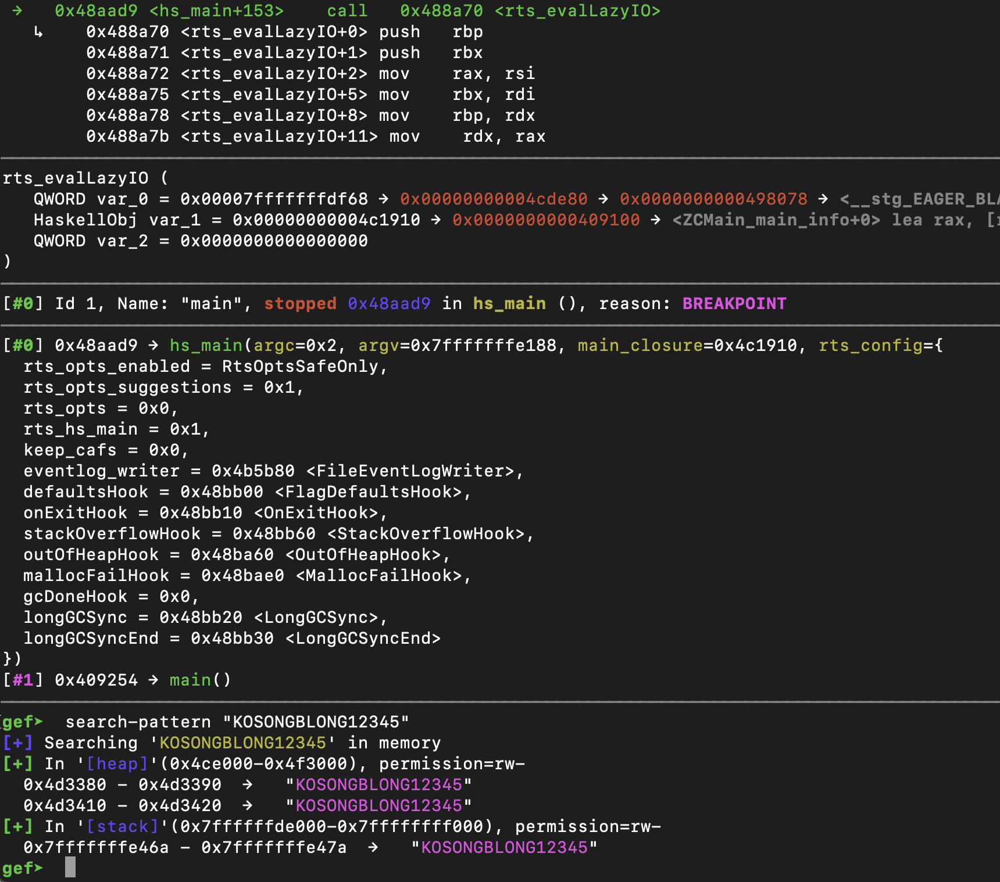
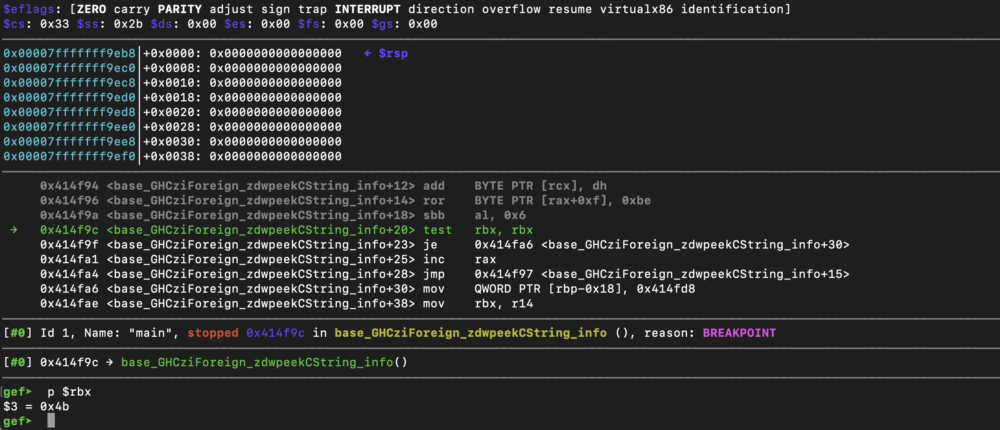
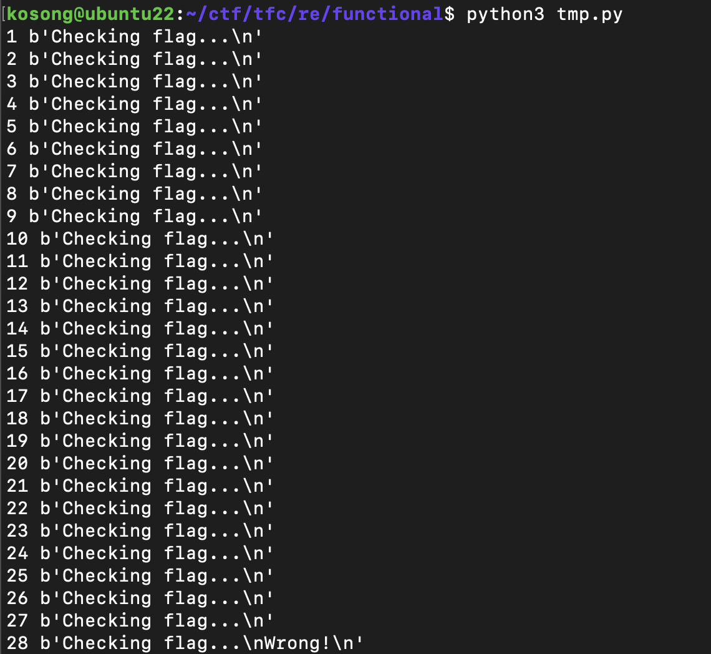
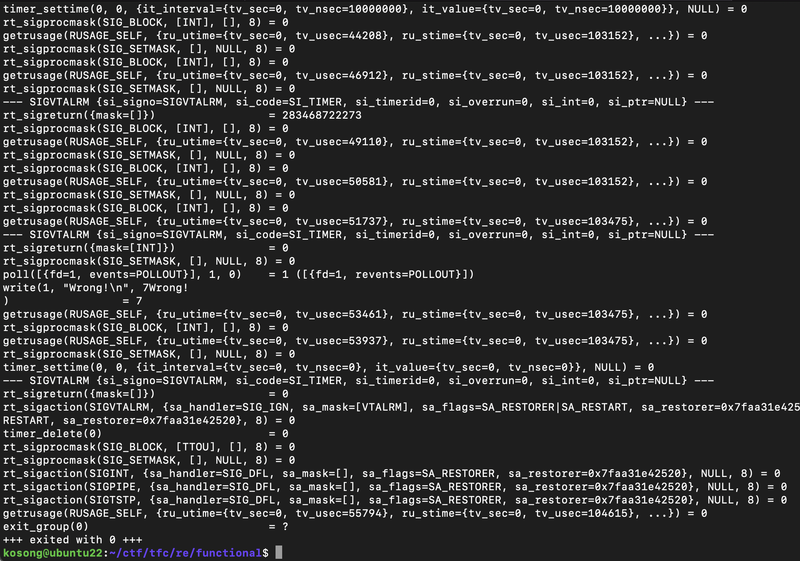
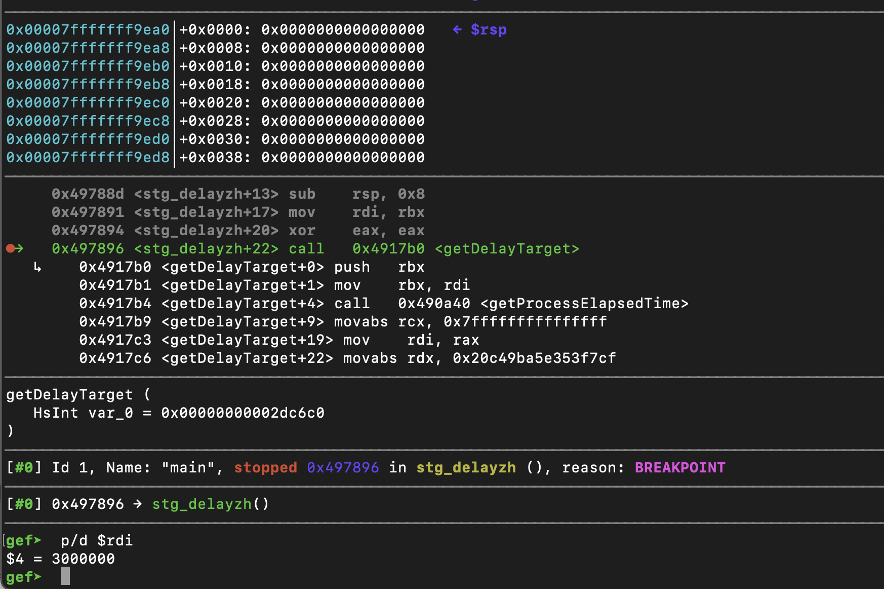
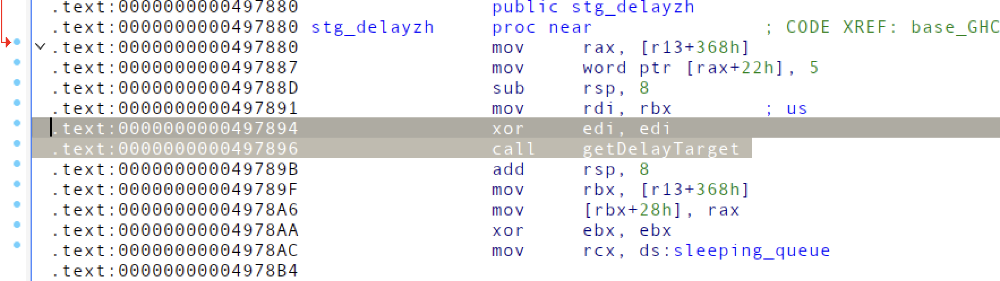
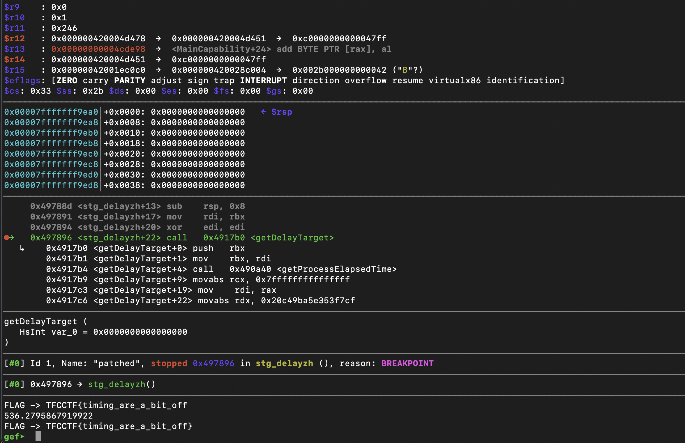

# Reverse Engineering

<!-- challenge-index: fa79005cbbfe9784 -->

| Challenge | Topic |
| --- | --- |
| Signal (50 pts) | Reverse Engineering |
| License (50pts) | Reverse Engineering |
| Brave Traveler (191 pts) | Reverse Engineering |
| Virtual Rev (360 pts) | Reverse Engineering |
| x8 (360 pts) | Reverse Engineering |
| [Functional (476 pts) 🥇](#functional-476-pts) | Haskell, GDB |
| [Mcknight (487 pts) 🥈](#mcknight-487-pts) | PyArmor, Python Bytecode |

*Unlinked challenges do not have a published write-up here.*

<!-- /challenge-index -->

## Functional (476 pts)

### Description

It functions.

### Solution

Given program compiled with ghc, lets try to run it.

<figure><figcaption></figcaption></figure>

It only shows "Checking flag..." and there is no process that receive our input when we run the program. Decompile it using IDA. Searching for "Checking flag..." string we will see another string in near the address of "Checking flag..."

<figure><figcaption></figcaption></figure>

Based on information above the program should produce "Wrong!" output if we input incorrect value. Previously i've been reversed program compiled with ghc too in this [writeup](https://blog.ryukk.dev/ctfs/write-up/2023/hsctf/reverse-engineering#re-cursed-4-solves).  So the next step i did is debugging using GDB. Set breakpoint on instruction that call res\_evalLazyIO.

```
b *0x48AAD9
```

Run the program with argument, in this case i tried to check wether our argument is used or not as the input.

<figure><figcaption></figcaption></figure>

Set hardware read breakpoint on 0x4d3410 then continue the program

```
rwatch *0x4d3410
```

<figure><figcaption></figcaption></figure>

From image above we know that our input processed and it passed to function base\_GHCziForeign\_zdwpeekCString\_info which is ghc internal function.  Continue the program and we will see again that the next index will be processed also. Continue until the program exited we still dont receive any "Wrong" output. In this step i assume that the length should be correct, so lets just bruteforce it.

```python
from subprocess import *

for i in range(1, 100):
	command = "./main " + "A"*i
	target = Popen(command, stdout=PIPE, stdin=PIPE, stderr=STDOUT, shell=True)
	target_output, _ = target.communicate()
	print(i, target_output)
```

<figure><figcaption></figcaption></figure>

We can see that there is Wrong output when i == 28 , so our input length should be 28. Lets strace the program. Try with argument "A"\*28 , "T"  + "A"\*27 , "TF" + A\*26.&#x20;

<figure><figcaption></figcaption></figure>

All of the trial give different length of  total instruction executed

* "A" \* 28 -> 262
* "T" + "A"\*27 -> 386
* "TF" + "A"\*26 -> 508

All of the trial also delayed for each index, especially if it is correct value. So for example

* A -> delay n seconds
* TA -> delay 2\*n seconds
* TFA -> delay 3\*n seconds

If i do bruteforce based on time or instruction it can be solved but would take a long time since basically if we do brute force for index 2 it will take 3\*n for each character tested. So my approach is trying to find out which function that trigger the delay. During the competition i did some approach but not limited to tracing the "thread", "input", sleeping\_queue, etc. In the end i found that there is function getDelayTarget that will make the program delayed based on its argument, in this challenge it will delayed 3 seconds.

* <https://github.com/ghc/ghc/blob/8b2f70a202ec0913515bf4945de789e959ff8cac/rts/posix/Select.c#L69>

<figure><figcaption></figcaption></figure>

If the value is correct it will execute `call getDelayTarget` so we can trace the correct value by counting the executed times on 0x497896. Lets patch instruction so it will always do getDelayTarget(0)

<figure><figcaption></figcaption></figure>

The easiest way is jut by changing xor eax,eax to xor edi, edi. After that just do gdb scripting to get the flag.

```python
#!/usr/bin/python3
import string
import time

class SolverEquation(gdb.Command):
    def __init__ (self):
        super (SolverEquation, self).__init__ ("solve-equation",gdb.COMMAND_OBSCURE)

    def invoke (self, arg, from_tty):
        static_val = []
        
        gdb.execute("del")
        gdb.execute("b *0x497896") # call getDelayTarget
        gdb.execute("b *0x48AB0C") # call shutdownHaskellAndExit
        flag = "TFCCTF{"
        list_char = "_" + string.printable[:-6]
        start = time.time()
        for _ in range(20):
            for i in list_char:
                tmp = "A"*(27 - len(flag))
                gdb.execute(f"run {flag + i + tmp}")
                counter = 0
                for _ in range(len(flag) + 1):
                    gdb.execute("c")
                    val = addr2num(gdb.selected_frame().read_register("rip"))
                if val == 4814998:
                    flag += i
                    break
            print(f"FLAG -> {flag}")
        end = time.time()
        print(end-start)
        print(f"FLAG -> {flag}}}")

def addr2num(addr):
    try:
        return int(addr)  # Python 3
    except:
        return long(addr) # Python 2
SolverEquation()
```

<figure><figcaption></figcaption></figure>

Flag : TFCCTF{timing\_are\_a\_bit\_off}

## Mcknight (487 pts)

### Description

Knights wear armour, but does it protect them from dragons? Flag format: TFCCTF{sha256(password)}

### Solution
