# Network

<!-- challenge-index: c9a4c809a743b422 -->

| Challenge | Topic |
| --- | --- |
| [sums-up (282 pts)](#sums-up-282-pts) | PCAP, Checksum Steganography |
| [secure-communications (450 pts)](#secure-communications-450-pts) | TLS Decryption, Key Logs |

<!-- /challenge-index -->

## sums-up (282 pts)

### Description

Our SOC analysts saw some strange DNS traffic. Wanted you to figure out what was exfiltated , can you check it and sum it up ?

### Solution

Given PCAP file, open it using wireshark. Looking at each packet i found suspicious printable characters.

<figure>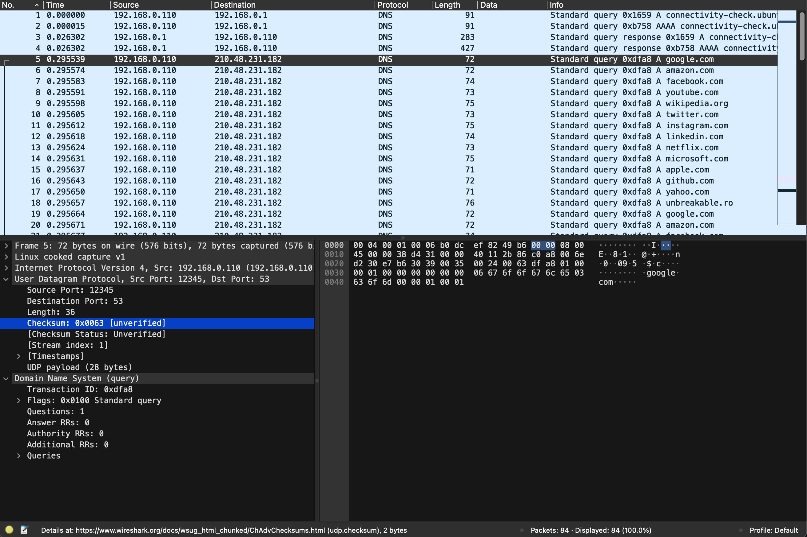<figcaption></figcaption></figure>

<figure>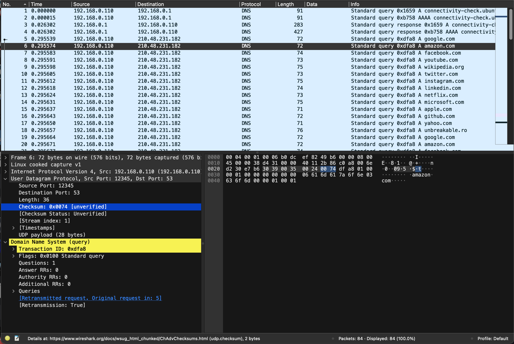<figcaption></figcaption></figure>

If we go to next packet we will see printable character at the same location. Those printable character are stored at Checksum identifier on each packet. To simplify the process, i apply checksum as column then export the packets.

<figure>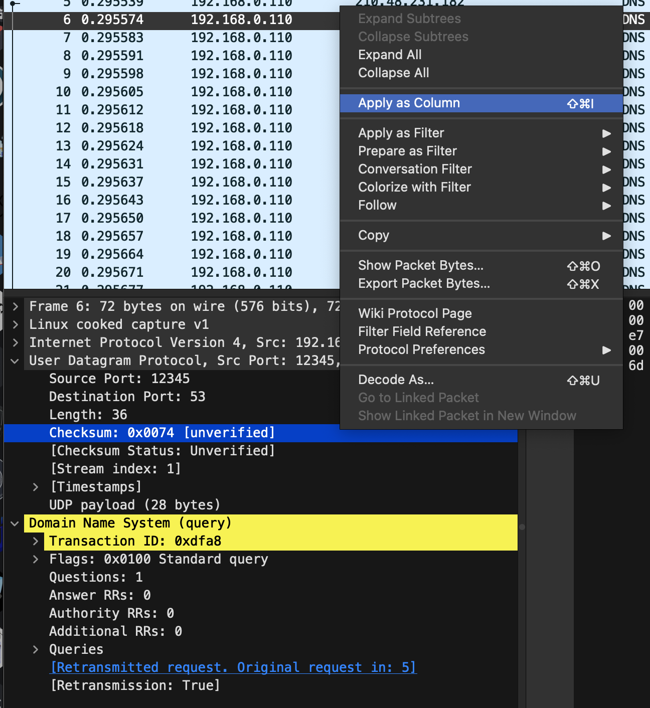<figcaption></figcaption></figure>

<figure>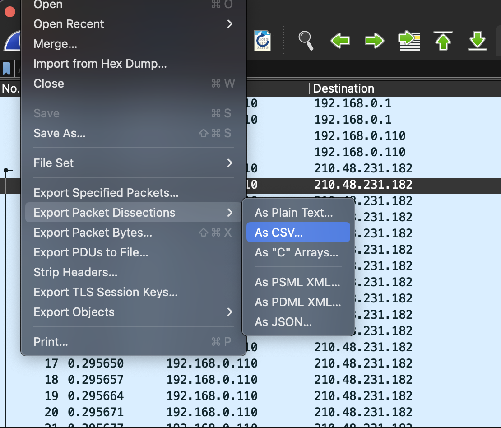<figcaption></figcaption></figure>

Last, just create simple script to get the checksum value.

```python
import string

f = open("exported.csv", "r").read()
flag = b""
for i in f.split("\n"):
	try:
		flag += bytes([int(i.split('","Standard query')[0].split('"')[-1], 16)])
	except Exception as e:
		continue
print(flag)
```

<figure>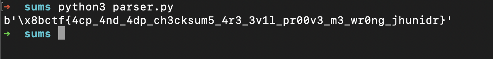<figcaption></figcaption></figure>

Flag: ctf{4cp\_4nd\_4dp\_ch3cksum5\_4r3\_3v1l\_pr00v3\_m3\_wr0ng\_jhunidr}

## secure-communications (450 pts)

### Description

We captured some pretty bizzare looking communications, but part of them are encrypted.

Can you help?

Flag Format: CTF{sha256}

### Solution

Given PCAP file, open it using wireshark. We can see that there are TLS/HTTPS packets and HTTP packets.

<figure>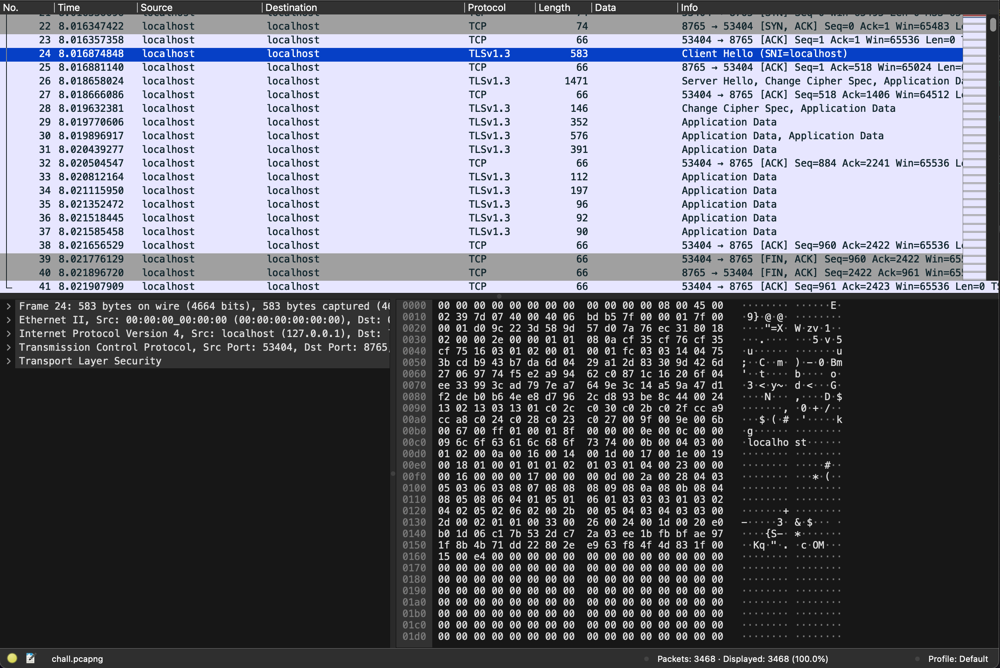<figcaption></figcaption></figure>

<figure>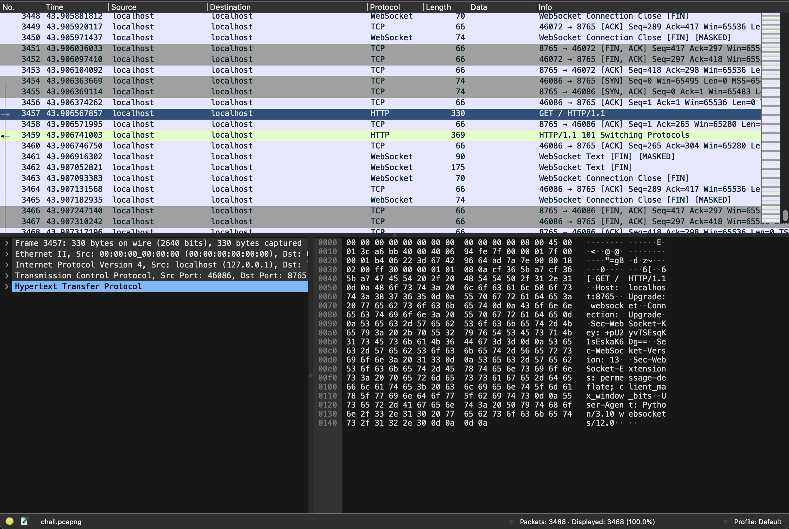<figcaption></figcaption></figure>

Lets take a look on one of HTTP request

<figure>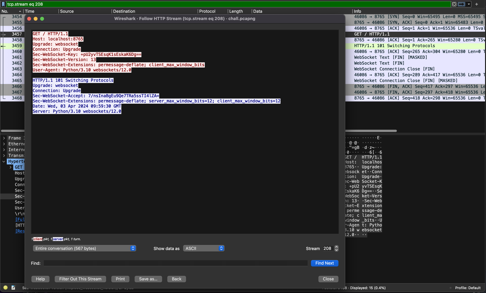<figcaption></figcaption></figure>

From HTTP request above we can see that it switch the protocol to websocket and we can see websocket packet on the same TCP stream.

<figure>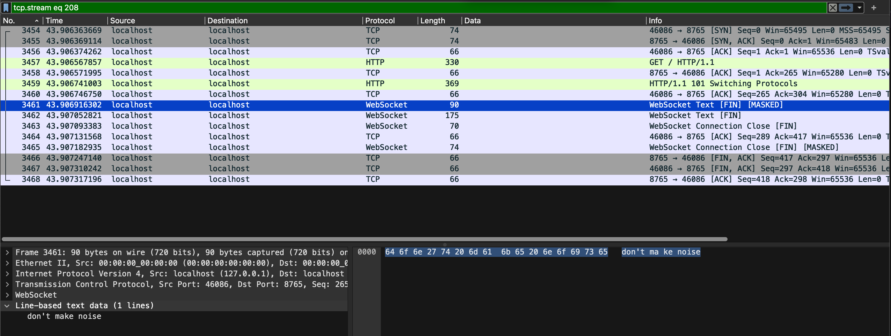<figcaption></figcaption></figure>

<figure>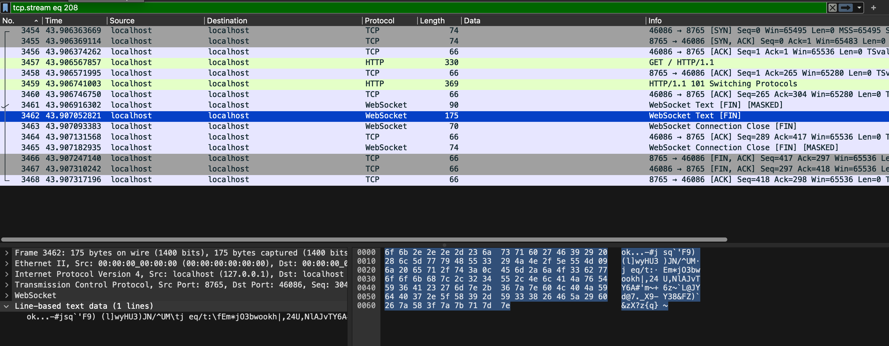<figcaption></figcaption></figure>

Sorting the packet, i tried to inspect packet based on its kind.

<figure>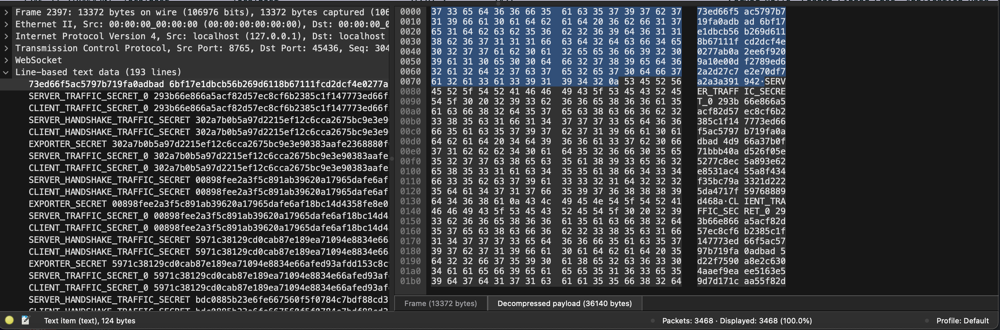<figcaption></figcaption></figure>

<figure>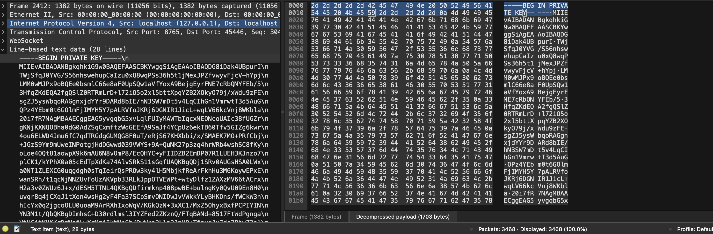<figcaption></figcaption></figure>

There are two interesting data, private key and ssl-keys log. At first i tried to add private key but nothing happen.

<figure>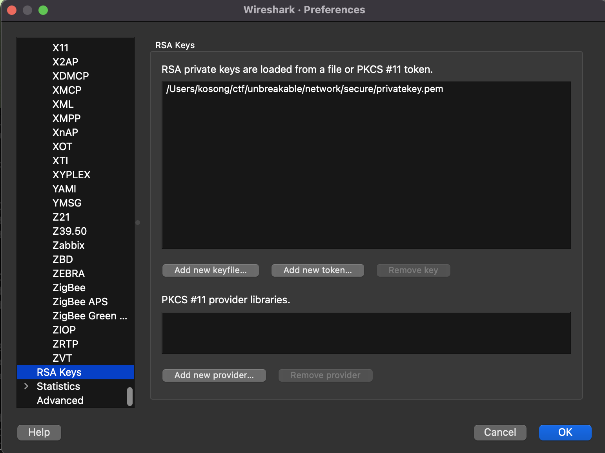<figcaption></figcaption></figure>

So the next step is try to add ssl-keys.log to Preferences > Protocols > TLS > (Pre)-Master-Secret log filename.

<figure>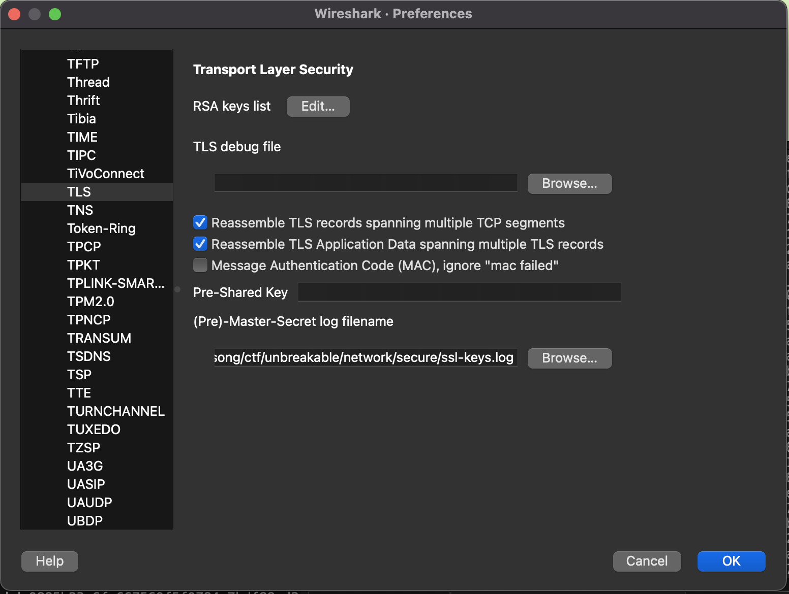<figcaption></figcaption></figure>

Take a look on recorded packets again, there are some TLS packets decrypted and there is one packet (frame 1631) that consist of another part of the ssl-keys.log.

<figure>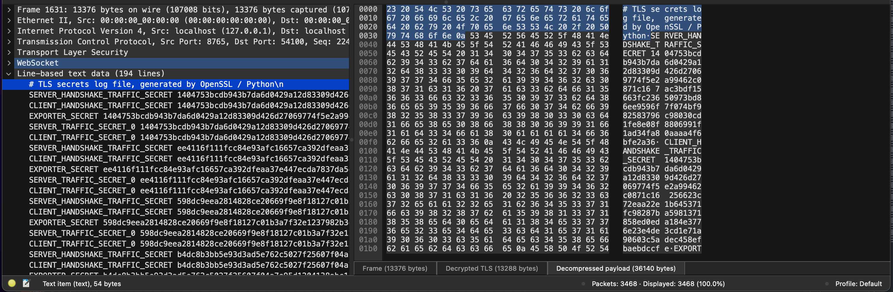<figcaption></figcaption></figure>

Next, combine that data and store on new file (new-keys.log). After that change the (Pre)-Master-Secret log to the new new-keys.log

<figure>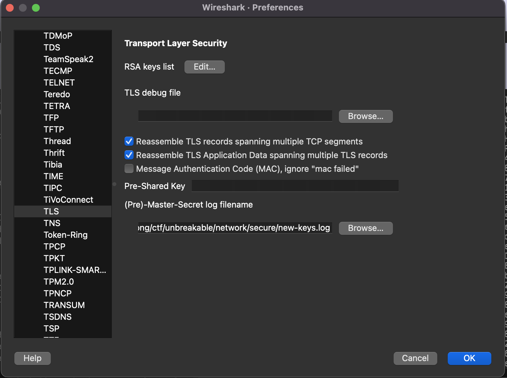<figcaption></figcaption></figure>

Inspecting each packet again and you'll see flag at frame 557.

<figure>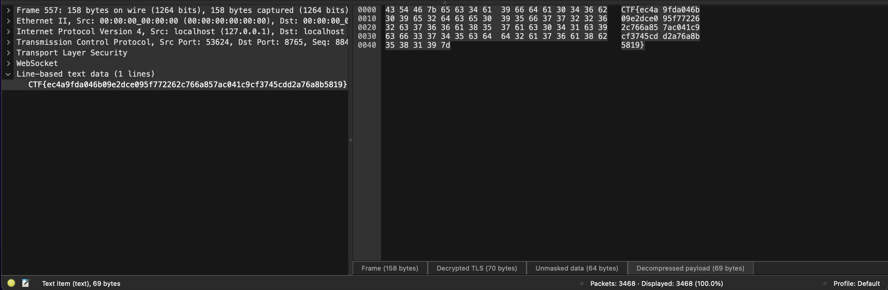<figcaption></figcaption></figure>

Flag: CTF{ec4a9fda046b09e2dce095f772262c766a857ac041c9cf3745cdd2a76a8b5819}
