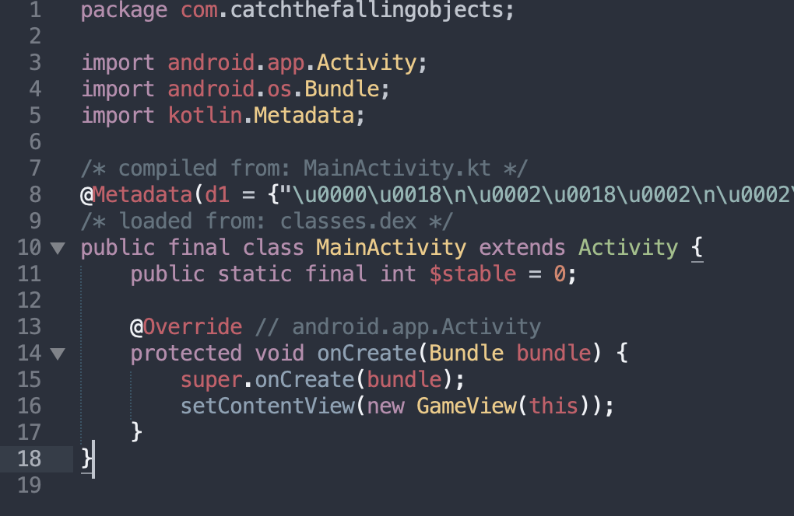
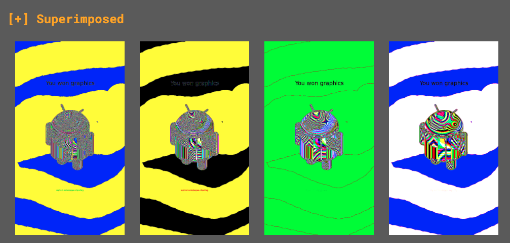
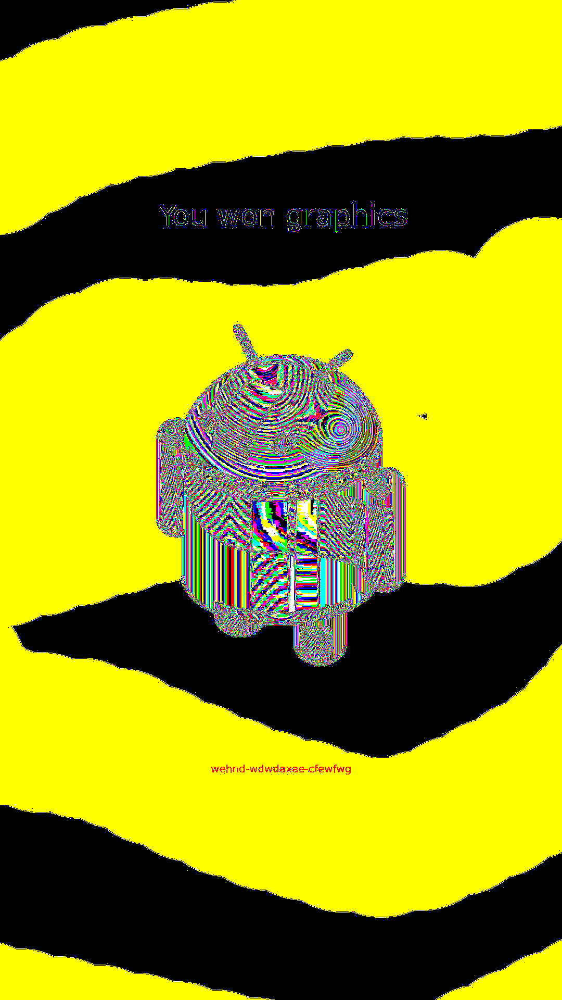

# Reverse Engineering

<!-- challenge-index: afc223a668c214a6 -->

| Challenge | Topic |
| --- | --- |
| [wicked-game (457 pts)](#wicked-game-457-pts) | Android Game, Steganography |

<!-- /challenge-index -->

## wicked-game (457 pts)

### Description

This game drives me crazy. It asks for an impossible score. Can you help me out? You need to catch the Android inside.

### Solution

Given APK file, open it using jadx-gui and save the decompiled code.&#x20;

<figure><figcaption></figcaption></figure>

MainActivity create new GameView object. So take a look on GameView.



```java
...

public GameView(Context context) {
        super(context);
        this.handler = new Handler();
        this.paint = new Paint(1);
        this.FRAME_RATE = 30;
        this.MAX_SCORE = 10;
        this.DESIRED_SCORE = 1400;
        this.ballRadius = 50.0f;
        this.ballX = 50.0f + 100.0f;
        this.ballY = 50.0f + 100.0f;
        this.ballVelocityX = 20.0f;
        this.ballVelocityY = 15.0f;
        this.score = 0;
        this.barWidth = 300.0f;
        this.barHeight = 40.0f;
        this.barMoveSpeed = 40.0f;
        this.isBallFalling = true;
        this.runnable = new Runnable() { // from class: com.catchthefallingobjects.GameView.1
            @Override // java.lang.Runnable
            public void run() {
                GameView.this.invalidate();
            }
        };
        this.graphicsBitmap = BitmapFactory.decodeResource(getResources(), R.drawable.graphics);
        setFocusable(true);
        setFocusableInTouchMode(true);
    }


protected void onDraw(Canvas canvas) {
        super.onDraw(canvas);
        canvas.drawColor(ViewCompat.MEASURED_STATE_MASK);
        if (this.score >= 1400) {
            canvas.drawBitmap(this.graphicsBitmap, (getWidth() - this.graphicsBitmap.getWidth()) / 2.0f, (getHeight() - this.graphicsBitmap.getHeight()) / 2.0f, (Paint) null);
            return;
        }
        this.barX = Math.max(0.0f, Math.min(this.barX, getWidth() - this.barWidth));
        this.barY = (getHeight() - this.barHeight) - 50.0f;
        this.paint.setColor(-65281);
        canvas.drawCircle(this.ballX, this.ballY, this.ballRadius, this.paint);
        this.paint.setColor(SupportMenu.CATEGORY_MASK);
        float f = this.barX;
        float f2 = this.barY;
        canvas.drawRect(f, f2, f + this.barWidth, f2 + this.barHeight, this.paint);
        updateBallPosition();
        this.paint.setColor(-1);
        this.paint.setTextSize(40.0f);
        canvas.drawText("Score: " + this.score, 50.0f, 150.0f, this.paint);
        canvas.drawText("Max score is 10, but the desired score is 1400", 50.0f, 200.0f, this.paint);
        if (this.score < 10) {
            this.handler.postDelayed(this.runnable, 33L);
            return;
        }
        this.paint.setTextSize(100.0f);
        canvas.drawText("Game Over", 100.0f, 500.0f, this.paint);
    }
...
```



From code above we can summarize:

* Desired score is 1400
  * if score >= 1400 there will a drawbitmap process
* If current score < 10 it will continue
  * if current score >= 10 it will game over
* Value added to current score is one (this.score++)

By playing the game we cannot win (trigger drawbitmap process), so my approach is patching the game by modifying the smali code. The idea is changing constant on score validation to lower value such as from 1400 to 1.

<pre class="language-smali" data-title="GameView.smali" data-line-numbers><code class="lang-smali">...
.method protected onDraw(Landroid/graphics/Canvas;)V
    .locals 9

    .line 49
    invoke-super {p0, p1}, Landroid/view/View;->onDraw(Landroid/graphics/Canvas;)V

    const/high16 v0, -0x1000000

    .line 50
    invoke-virtual {p1, v0}, Landroid/graphics/Canvas;->drawColor(I)V

    iget v0, p0, Lcom/catchthefallingobjects/GameView;->score:I

<strong>    const/16 v1, 0x1
</strong>
    if-lt v0, v1, :cond_0

    .line 53
    invoke-virtual {p0}, Lcom/catchthefallingobjects/GameView;->getWidth()I

    move-result v0

    iget-object v1, p0, Lcom/catchthefallingobjects/GameView;->graphicsBitmap:Landroid/graphics/Bitmap;

    invoke-virtual {v1}, Landroid/graphics/Bitmap;->getWidth()I

    move-result v1

    sub-int/2addr v0, v1

    int-to-float v0, v0

    const/high16 v1, 0x40000000    # 2.0f
...
</code></pre>

* Line 15: change from 0x578 to 0x1

Compile the APK again and sign the new APK.

```bash
apktool b wicked-game
uber-apk-signer --allowResig -a wicked-game/dist/wicked-game.apk
```

Run the APK and it will show android image after the score changed to 1.

<figure><figcaption></figcaption></figure>

Basically the program only run the game and check the score. Win condition is showing image above, based on the description there is something with the image (catch android inside). So lets try to do some guess on the image. Image loaded through getResources function and R.drawable.graphics constant, so the location is in wicked-game/res/drawable/graphics.jpg. Upload graphics.jpg to well known [online steganography solver](https://www.aperisolve.com/6a3f42ad4d97dd568de676f99a1cc5f0) and there will be a flag.

<figure><figcaption></figcaption></figure>

<figure><figcaption></figcaption></figure>

Flag: wehnd-wdwdaxae-cfewfwg
