# Final

<table><thead><tr><th width="347">Challenge</th><th>Topic</th></tr></thead><tbody><tr><td><a href="#kepiting-cirebon">Kepiting Cirebon</a></td><td>Frida, dex dump, z3</td></tr><tr><td><a href="#qengine">qengine</a> 🥇</td><td>QuickJS</td></tr></tbody></table>

## Kepiting Cirebon

### Description

\-

### Solution

Given an APK file, decompile it with jadx. From `com.kepitingcirebon.shell.ProxyComponentFactory` and `com.kepitingcirebon.shell.ProxyApplication` classes, we can see that there's a process for dynamically loading Android components.

By leveraging generative AI, we obtain the following information from the list of functions in `libkepiting.so` used in the shell via `JniBridge`:

* Initialize native environment (a(), ia(), cbde())
* Discover real app components (rcf(), rapn())
* Create and delegate to real application (ra(), craa(), craoc())

So the next step is to hook the class loader or dex loader function, but it turns out there's a Frida detection. However, we can bypass the `anti-Frida` with a universal script bypass.

```javascript
try {
    var p_pthread_create = Module.findExportByName("libc.so", "pthread_create");
    var pthread_create = new NativeFunction(p_pthread_create, "int", ["pointer", "pointer", "pointer", "pointer"]);
    Interceptor.replace(p_pthread_create, new NativeCallback(function(ptr0, ptr1, ptr2, ptr3) {
        if (ptr1.isNull() && ptr3.isNull()) {
            console.log("Possible thread creation for checking. Disabling it");
            return -1;
        } else {
            return pthread_create(ptr0, ptr1, ptr2, ptr3);
        }
    }, "int", ["pointer", "pointer", "pointer", "pointer"]));
} catch (error) {
    console.log("Error", error)
}
```

The next idea is to trace with `frida-trace` several commonly used functions because if we look at the assets there is a file whose function we don't know yet, namely `linggisjawa`.

```bash
frida-trace -U -f com.anyujin.kepiting_cirebon \
  -S bypass.js \
  -i 'libc.so!open*' \
  -i 'libc.so!read' \
  -i 'libc.so!mmap*' \
  -j '*!*File*' 
```

<figure>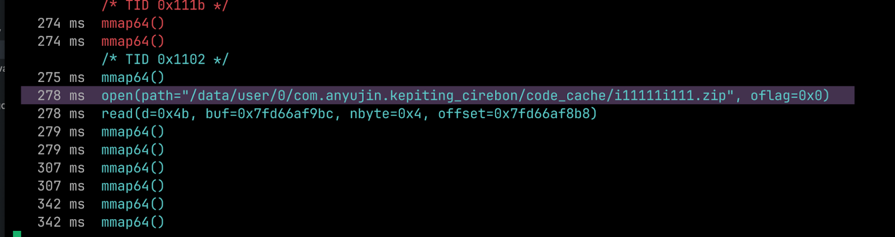<figcaption></figcaption></figure>

From the output above, we know that there is a file in the code\_cache, namely `i11111i111.zip`. After unzipping, there are two files: `classes.dex` and `classes2.dex`. We tried decompiling them with `jadx`.

<figure>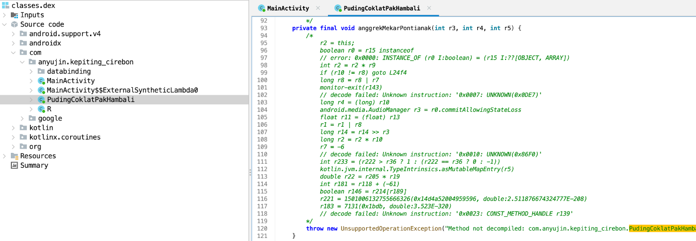<figcaption></figcaption></figure>

The decompile results show that the dex file's code is still `encrypted`, so the next step is to try dumping the dex file while the application is running. Here, we'll use `frida-dexdump`. Because there's anti-frida, we'll try running frida-dexdump on a `running process`, assuming the anti-frida check is performed at the `start of the application`.

```bash
frida-dexdump -p 5267 -U
```

<figure>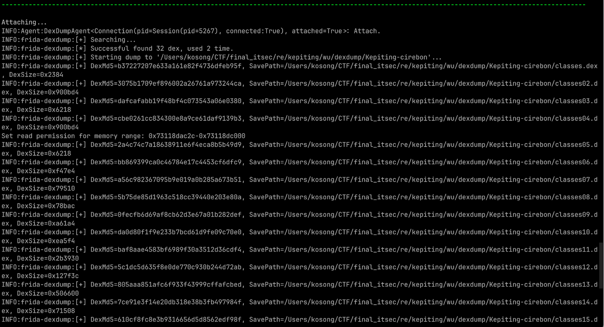<figcaption></figcaption></figure>

Next we try grep with keyword `PudingCoklatPakHambali`.&#x20;

<figure>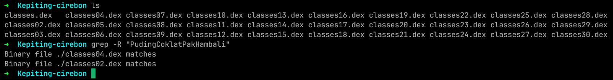<figcaption></figcaption></figure>

After obtaining the two dex files, we tried decompiling each dex file. We found that `classes02.dex` is the same dex file as the one in the .zip (still encrypted), and `classes04.dex` cannot be decompiled with jadx. The next step is to convert it to jar and then decompile it again.

```bash
d2j-dex2jar classes04.dex
```

And it turns out we can decompile it, so the next step is to understand the code of the program.

<figure>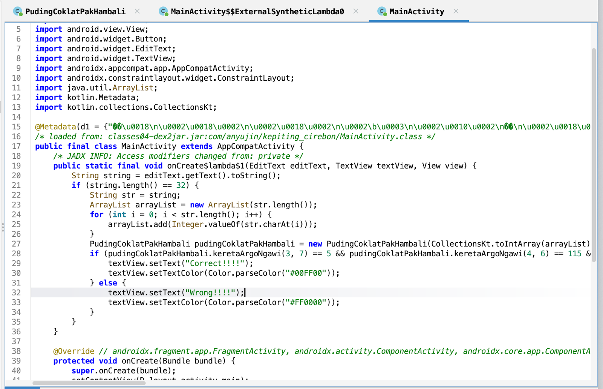<figcaption></figcaption></figure>

By hooking each existing function with the script below and looking at the source code, we can see that `keretaArgoNgawi` actually performs an `xor` operation from index `arg1` to index `arg2` and then `compares` it with the static value.

```javascript
Java.perform(function() {
    var target_class = Java.use("com.anyujin.kepiting_cirebon.PudingCoklatPakHambali");
   
    target_class.ahmadUlatSagu.overload().implementation = function() {
        console.log("[*] Hooking ahmadUlatSagu ");
        console.log("[*] return ", this.ahmadUlatSagu());
        return this.ahmadUlatSagu();
    }

    target_class.$init.overload('[I').implementation = function(arg1) {
        console.log("[*] Hooking PudingCoklatPakHambali ");
        stacktrace();
        console.log("[*] Integer array argument:", JSON.stringify(arg1));
        var ret = this.$init(arg1);

console.log("[*] After constructor - Field values:");
        try {
            console.log("[*] input array:", JSON.stringify(this.input.value));
            console.log("[*] n value:", this.n.value);
            console.log("[*] tree array:", JSON.stringify(this.tree.value));
        } catch (e) {
            console.log("[*] Error reading fields:", e);
        }
        return ret;
    }

    target_class.anggrekMekarPontianak.overload('int', 'int', 'int').implementation = function(arg1, arg2, arg3) {
        console.log("[*] Hooking anggrekMekarPontianak ");
        console.log("[*] arg1 ", arg1);
        console.log("[*] arg2 ", arg2);
        console.log("[*] arg3 ", arg3);
        var ret = this.anggrekMekarPontianak(arg1, arg2, arg3);
        console.log("[*] ret ", ret);
        return ret;
    }

    target_class.keretaArgoNgawi.overload('int', 'int').implementation = function(arg1, arg2) {
        // stacktrace();
        console.log("[*] Hooking keretaArgoNgawi ");
        console.log("[*] arg1 ", arg1);
        console.log("[*] arg2 ", arg2);
        var ret = this.keretaArgoNgawi(arg1, arg2);
        console.log("[*] ret ", ret);
        return ret
    }

    target_class.kipasAnginMasHarditNyitNyit.overload('int', 'int', 'int', 'int', 'int').implementation = function(arg1, arg2, arg3, arg4, arg5) {
        console.log("[*] Hooking kipasAnginMasHarditNyitNyit ");
        // stacktrace();
        console.log("[*] arg1 ", arg1);
        console.log("[*] arg2 ", arg2);
        console.log("[*] arg3 ", arg3);
        console.log("[*] arg4 ", arg4);
        console.log("[*] arg5 ", arg5);
        var ret = this.kipasAnginMasHarditNyitNyit(arg1, arg2, arg3, arg4, arg5);
        console.log("[*] ret ", ret);
        return ret;
    }


});

function stacktrace() {
    Java.perform(function() {
        let AndroidLog = Java.use("android.util.Log");
        let ExceptionClass = Java.use("java.lang.Exception");
        console.warn(AndroidLog.getStackTraceString(ExceptionClass.$new()));
    });
}


try {
    var p_pthread_create = Module.findExportByName("libc.so", "pthread_create");
    var pthread_create = new NativeFunction(p_pthread_create, "int", ["pointer", "pointer", "pointer", "pointer"]);
    Interceptor.replace(p_pthread_create, new NativeCallback(function(ptr0, ptr1, ptr2, ptr3) {
        if (ptr1.isNull() && ptr3.isNull()) {
            console.log("Possible thread creation for checking. Disabling it");
            return -1;
        } else {
            return pthread_create(ptr0, ptr1, ptr2, ptr3);
        }
    }, "int", ["pointer", "pointer", "pointer", "pointer"]));
} catch (error) {
    console.log("Error", error)
}
```

So the next step is to create a solver using `z3`.

```python
from z3 import *
import string
import hashlib

def all_smt(s, initial_terms):
    def block_term(s, m, t):
        s.add(t != m.eval(t, model_completion=True))
    def fix_term(s, m, t):
        s.add(t == m.eval(t, model_completion=True))
    def all_smt_rec(terms):
        if sat == s.check():
          m = s.model()
          yield m
          for i in range(len(terms)):
              s.push()
              block_term(s, m, terms[i])
              for j in range(i):
                  fix_term(s, m, terms[j])
              yield from all_smt_rec(terms[i:])
              s.pop()  
    yield from all_smt_rec(list(initial_terms))

s = Solver()

input_vars = [BitVec(f'input_{i}', 8) for i in range(32)]

list_char = string.printable[:-6]
list_char = list_char.replace("=", "")

for i in input_vars:
    s.add(z3.Or(*[ord(j) == i for j in list_char]))

def xor_range(start, end):
    result = BitVecVal(0, 8)
    for i in range(start, end + 1):
        result = result ^ input_vars[i]
    return result

s.add(xor_range(3, 7) == 5)
s.add(xor_range(4, 6) == 115)

expected_values = [65, 105, 61, 62, 110, 8, 85, 89, 95, 110, 45, 67, 0, 108, 45, 95, 49, 45, 67, 25, 59]

pairs = [[0,1], [3,3], [2,3], [3,5], [4,4], [4,6], [3,7]]

value_index = 0
for i in [8, 16, 24]:
    for start, end in pairs:
        s.add(xor_range(start + i, end + i) == expected_values[value_index])
        value_index += 1

s.add(input_vars[0] == 73)
s.add(input_vars[1] == 84)
s.add(input_vars[2] == 83)
s.add(input_vars[3] == 69)
s.add(input_vars[4] == 67)
s.add(input_vars[5] == 123)
s.add(input_vars[31] == 125)

s.add(input_vars[8] == ord('p'))
s.add(input_vars[16] == ord('5'))

for model in all_smt(s, input_vars):
    init = []
    for j in input_vars:
        init.append(model[j].as_long())
    nice = bytes(init)
    if hashlib.md5(nice).hexdigest() == "1932b746f4b7c349c089bc4aad3a7234":
        print(nice)
```

<figure>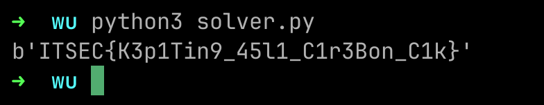<figcaption></figcaption></figure>

Flag: ITSEC{K3p1Tin9\_45l1\_C1r3Bon\_C1k}<br>

## qengine

### Description

\-

### Solution

We have 2 solutions for this challenge as shown in the table below

<table><thead><tr><th width="347">Method</th><th>Link</th></tr></thead><tbody><tr><td>Understanding behavior through dynamic analysis</td><td><a href="#understanding-behavior-through-dynamic-analysis">Click</a></td></tr><tr><td>Dumping the opcode by modifying QuickJS code</td><td><a href="#dumping-the-opcode-by-modifying-quickjs-code">Click</a></td></tr></tbody></table>

#### Understanding behavior through dynamic analysis

Given `emu.py` and ELF files

```python
from qiling import Qiling

global flag
flag = input("Input your flag >> ")
flag = flag.encode()
if len(flag) != 36:
print("Flag's length should be 36 bytes.")
exit(0)

def patch(ql: Qiling):
    addr = 0x57b0b3
    ql.mem.write(addr, flag)

'''
- Download rootfs from https://github.com/qilingframework/rootfs/tree/master/x8664_linux
- Place v9 challenge in bin folder of the rootfs
'''
ql = Qiling(["rootfs/x8664_linux/bin/v9"], rootfs="rootfs/x8664_linux")
patch(ql)
ql.run()
```

From the code above, we know that the program writes a flag to address `0x57b0b3` and we know that the binary validates the flag that is hardcoded at a specific address.

Next, decompiling it with IDA will reveal some information from the `strings`.

<figure>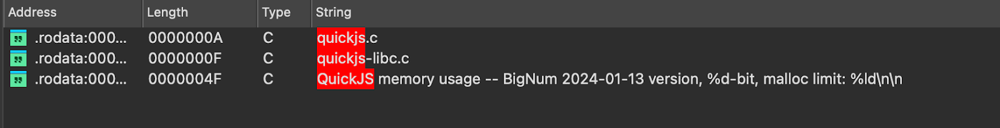<figcaption></figcaption></figure>

Searching for `quickjs` reveals two repositories: `quickjs-ng` and `bellard`. We initially compiled quickjs-ng and noticed that the structure of the available functions `differed significantly` from the provided ones. So, we compiled it from the bellard repository, first downloading the version corresponding to the one listed in the strings, `2024-01-13`.

* <https://bellard.org/quickjs/quickjs-2024-01-13.tar.xz>

Do a build for quickjs and create an independent executable for our own script as we did to generate v9.

```bash
./qjsc -e -o chall.c chall.js
gcc -O2 -g -fno-stack-protector chall.c quickjs.c quickjs-libc.c cutils.c libregexp.c libunicode.c libbf.c -I. -DCONFIG_BIGNUM=0 -D_GNU_SOURCE -lm -ldl -lpthread -DCONFIG_VERSION=\"2024-01-13\" -o test_program
```

Next, when we decompile `test_program`, we'll see a code structure similar to the original. So, we create a signature for the `test_program` executable, but when we load it in v9, we find many mismatches.

<figure>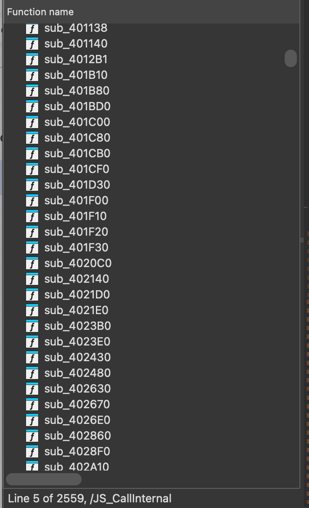<figcaption></figcaption></figure>

So the next step is to manually recover the function name based on the `code structure` and `error strings` present in the function.

<figure>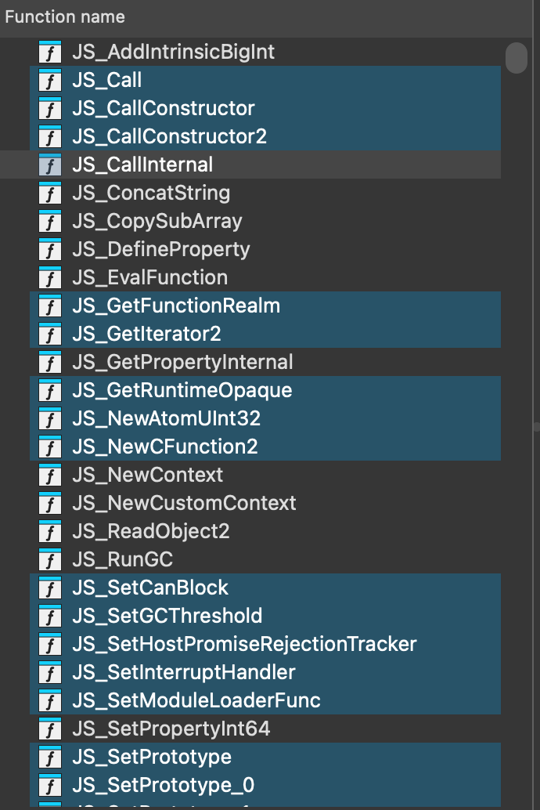<figcaption></figcaption></figure>

For example, as in the image above, the function name with a `blue` background is the result of the signature, and the `black` background is the function we renamed ourselves. So, the next step is dynamic analysis. After performing dynamic analysis, we obtained the following information.

* There is a conversion from decimal to binary
* There is a conversion from binary to hex
* There is a conversion from hex to decimal
* There are several operations that change the value for each index
* There is an array construction

Here are some `breakpoints` that I utilize for debugging.

```python
0x401EAB (maybe_main+8F)
0x409B80 (js_strict_eq2)
0x40A2D0 (js_compare_bigfloat)
0x40E5A0 (JS_CallInternal)
0x40EB3E (JS_CallInternal+59E)
0x40EB78 (JS_CallInternal+5D8)
0x4154DA (JS_CallInternal+6F3A)
0x422F70 (js_string_to_bigint)
0x42C4C0 (array_related)
0x4306B0 (JS_ConcatString)
0x432270 (js_bigint_toString)
0x4322EF (js_bigint_toString+7F)
0x44CC10 (js_call_c_function)
0x45D9F3 (maybe_js_array_push+163)
0x46A920 (js_add_slow)
0x46AA60 (js_add_slow+140)
0x46D469 (js_parseInt+99)
0x46DDF0 (sub_46DDF0)
0x4A9220 (bf_cmp)
0x4A95E0 (bf_logic_op)
0x4AA5A0 (sub_4AA5A0)
0x4B3310 (sub_4B3310)
0x4B6340 (sub_4B6340)
```

From this information we can do a dump for each process, here we can set a breakpoint on the `js_string_to_bigint` and `js_array_push` functions, so that the following output is obtained.



```python
input = b"ITSEC{0123456789abcdefghijklmnopqrs}"
[164, 170, 41, 162, 161, 189, 152, 24, 153, 25, 154, 26, 155, 27, 156, 28, 176, 177, 49, 178, 50, 179, 51, 180, 52, 181, 53, 182, 54, 183, 55, 184, 56, 185, 57, 190]
[255, 170, 146, 231, 234, 43, 84, 134, 92, 192, 248, 131, 205, 222, 82, 128, 97, 188, 6, 255, 48, 162, 170, 252, 167, 186, 0, 249, 54, 164, 172, 246, 173, 176, 10, 245]
[9, 42, 116, 0, 4, 118, 254, 87, 251, 245, 43, 86, 48, 121, 123, 82, 216, 55, 170, 20, 179, 187, 255, 16, 125, 50, 175, 17, 182, 190, 250, 31, 114, 61, 160, 27]
[132, 234, 225, 148, 29, 5, 129, 238, 143, 90, 17, 105, 51, 13, 198, 105, 61, 121, 208, 138, 241, 46, 0, 10, 202, 254, 87, 13, 118, 169, 135, 130, 66, 118, 223, 130]
[207, 202, 62, 202, 8, 207, 65, 139, 65, 162, 182, 73, 177, 195, 37, 207, 42, 144, 151, 91, 146, 241, 0, 157, 38, 212, 211, 31, 214, 181, 68, 209, 234, 24, 31, 215]
[33, 122, 142, 59, 23, 224, 225, 220, 104, 38, 66, 249, 114, 106, 183, 186, 54, 141, 115, 98, 64, 193, 128, 65, 60, 235, 21, 4, 38, 167, 230, 43, 150, 65, 191, 168]
[51, 209, 209, 19, 33, 112, 224, 249, 122, 141, 29, 209, 68, 250, 182, 159, 36, 38, 44, 74, 118, 81, 129, 100, 46, 64, 74, 44, 16, 55, 231, 14, 132, 234, 224, 128]
[113, 36, 205, 101, 14, 177, 35, 65, 170, 193, 152, 35, 160, 47, 217, 235, 73, 60, 202, 142, 247, 210, 129, 230, 87, 150, 96, 36, 93, 120, 43, 89, 168, 105, 159, 208]
```





```python
input = b"ITSEC{zyxwvutsrqponmlkjihgfedcba987}"
[164, 170, 41, 162, 161, 189, 189, 60, 188, 59, 187, 58, 186, 57, 185, 56, 184, 55, 183, 54, 182, 53, 181, 52, 180, 51, 179, 50, 178, 49, 177, 48, 156, 156, 27, 190]
[255, 170, 146, 231, 234, 43, 99, 48, 107, 115, 201, 51, 252, 109, 101, 54, 109, 121, 195, 57, 246, 103, 111, 60, 103, 127, 197, 63, 240, 97, 105, 58, 91, 135, 185, 245]
[9, 42, 116, 0, 4, 118, 210, 58, 215, 159, 130, 62, 25, 19, 215, 63, 210, 144, 141, 49, 22, 28, 216, 48, 221, 149, 136, 52, 19, 25, 221, 53, 255, 17, 202, 155]
[132, 234, 225, 148, 29, 5, 187, 181, 53, 5, 236, 181, 14, 210, 60, 50, 178, 141, 100, 61, 134, 90, 180, 186, 58, 10, 227, 186, 1, 221, 51, 61, 137, 204, 128, 66]
[207, 202, 62, 202, 8, 207, 102, 253, 38, 210, 181, 123, 146, 243, 34, 185, 98, 158, 121, 183, 94, 63, 238, 117, 174, 90, 61, 243, 26, 123, 170, 49, 196, 127, 111, 247]
[33, 122, 142, 59, 23, 224, 213, 17, 60, 238, 64, 82, 64, 194, 179, 119, 90, 132, 234, 248, 234, 104, 25, 221, 240, 34, 140, 158, 140, 14, 127, 187, 175, 21, 119, 152]
[51, 209, 209, 19, 33, 112, 212, 52, 46, 69, 31, 122, 118, 82, 178, 82, 72, 47, 181, 208, 220, 248, 24, 248, 226, 137, 211, 182, 186, 158, 126, 158, 189, 190, 40, 176]
[113, 36, 205, 101, 14, 177, 126, 22, 87, 153, 159, 222, 247, 215, 212, 188, 253, 38, 96, 33, 8, 40, 43, 67, 2, 204, 202, 139, 162, 130, 129, 233, 227, 148, 199, 128]
```



While there may be something missing from each process, we can at least see a pattern from the known process. From the final value, it is known that the values for the first 6 indexes are the same, namely `113, 36, 205, 101, 14, 177` , but if we look at the next index, the values are different. If we look at the value at the last index, it can be seen that the values are different even though our input has the same final value, which is `}` .&#x20;

From here we can see that each input is actually not processed completely independently but there is still a relationship between index-i and index-i+1 or at least we can see in the first array that the 0th index has 1 bit of value from the last input index. From this we can conclude that we can do `bruteforce per byte`. So the idea is to take the final value of the entire process, then check it with the correct value. The question is, where is the correct value? So we checked the bytecode that we had dumped and found an `interesting sequence`

<figure>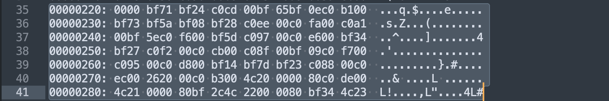<figcaption></figcaption></figure>

From there, we realized that the correct final value was hardcoded. So, we tried dumping it and validating it with `qjsc`.

```python
buf = open("bytecode.bin", "rb").read()

arr = []
for i in range(len(buf)):
	if buf[i] == 0xc0:
		arr.append(buf[i+1])
	elif buf[i] == 0xbf:
		arr.append(buf[i+1])

print(arr[arr.index(0x71):arr.index(0x71)+36])
```

Create file `test.js` as following



```javascript
a = [113, 36, 205, 101, 14, 177, 115, 90, 8, 40, 238, 250, 161, 94, 246, 93, 151, 230, 52, 39, 242, 203, 143, 9, 247, 149, 216, 20, 125, 35, 136, 236, 179, 222, 44, 52]
```



and compile it with qjsc

```bash
./qjsc -e -o test.c test.js
```

<figure>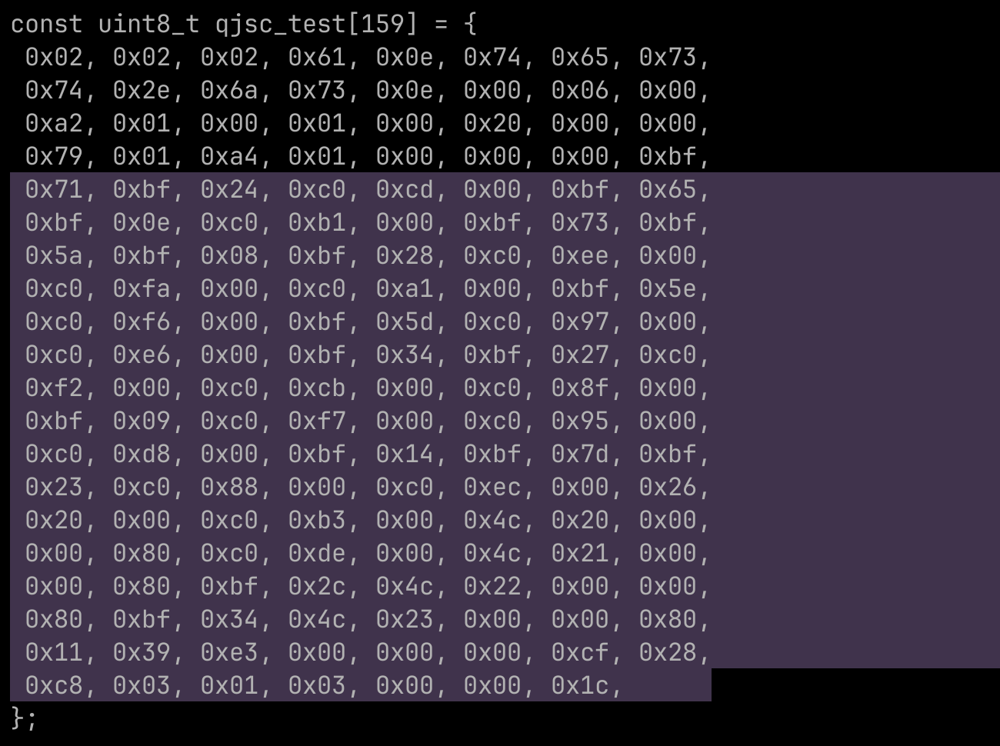<figcaption></figcaption></figure>

And we can see the results are the same as those in bytecode.bin or the question bytecode. The final step, because I forgot this was a Linux problem, i used `idapython` to automate the solution, which of course took longer than using `gdb scripting`. Here's our solver

```python
import ida_dbg
import string

def delete_all_bp():
    bp_count = ida_dbg.get_bpt_qty()
    
    if bp_count == 0:
        print("No breakpoints to delete")
        return
    deleted = 0
    while deleted != bp_count:
        bpt = ida_dbg.bpt_t()
        if ida_dbg.getn_bpt(0, bpt):
            if ida_dbg.del_bpt(bpt.ea):
                deleted += 1
            else:
                print(f"Failed to delete breakpoint at {hex(bpt.ea)}")
    
    print(f"[+] Deleted {deleted} breakpoint(s)")

def overwrite_flag(flag):
	start = 0x057B0B3
	for i in range(36):
		val = get_bytes(start+i, 1)
		new_val = flag[i]
		patch_byte(start+i, new_val)


target_flag = [113, 36, 205, 101, 14, 177, 115, 90, 8, 40, 238, 250, 161, 94, 246, 93, 151, 230, 52, 39, 242, 203, 143, 9, 247, 149, 216, 20, 125, 35, 136, 236, 179, 222, 44, 52]


list_addr = [
0x401EAB,
0x422F70, # string to bigint
]

# init_flag = list(b"ITSEC{0123456789abcdefghijklmnopqrs}")
# index_target = 6

init_flag = list(b"ITSEC{t123456789abcdefghijklmnopqrs}")
index_target = 7

list_char = list(("_" + string.printable[:-6]).encode())

while index_target != len(init_flag) - 1:
	for bf in list_char:
		delete_all_bp()
		for addr in list_addr:
			ida_dbg.add_bpt(addr, 1, ida_idd.BPT_DEFAULT)
		
		ida_dbg.start_process("", "", "")
		idaapi.wait_for_next_event(idaapi.WFNE_SUSP, -1)
		
		
		init_flag[index_target] = bf
		overwrite_flag(init_flag)
		# print(bytes(init_flag))
		for _ in range(6):
			idaapi.continue_process()
			idaapi.wait_for_next_event(idaapi.WFNE_SUSP, -1)
		
		ida_dbg.add_bpt(0x45D9F3, 1, ida_idd.BPT_DEFAULT)
		
		# now in set properties
		idaapi.continue_process()
		idaapi.wait_for_next_event(idaapi.WFNE_SUSP, -1)
		
		for i in range(36*2):
		    idaapi.continue_process()
		    idaapi.wait_for_next_event(idaapi.WFNE_SUSP, -1)
		
		
		for i in range(index_target):
			idaapi.continue_process()
			idaapi.wait_for_next_event(idaapi.WFNE_SUSP, -1)
		
		idaapi.get_reg_val('RAX', rv)
		rax = rv.ival
		
		print(bytes(init_flag), rax)

		if rax == target_flag[index_target]:
			init_flag[index_target] = bf
			index_target += 1
			print(bytes(init_flag))
			ida_dbg.exit_process()
			idaapi.wait_for_next_event(idaapi.WFNE_SUSP, -1)
			break
		else:
			ida_dbg.exit_process()
			idaapi.wait_for_next_event(idaapi.WFNE_SUSP, -1)
```

<figure>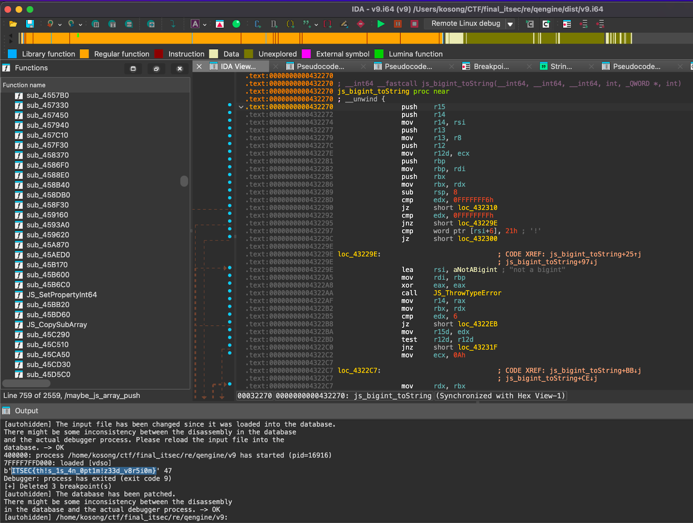<figcaption></figcaption></figure>

Flag: ITSEC{th!s\_1s\_4n\_0pt1m!z33d\_v8r5i0n}

#### Dumping the opcode by modifying QuickJS code

Open `quickjs.c` and we can see that there is function named `js_dump_function_bytecode` as following



```cpp
static __maybe_unused void js_dump_function_bytecode(JSContext *ctx, JSFunctionBytecode *b)
{
    int i;
    char atom_buf[ATOM_GET_STR_BUF_SIZE];
    const char *str;

    if (b->has_debug && b->debug.filename != JS_ATOM_NULL) {
        str = JS_AtomGetStr(ctx, atom_buf, sizeof(atom_buf), b->debug.filename);
        printf("%s:%d: ", str, b->debug.line_num);
    }

    str = JS_AtomGetStr(ctx, atom_buf, sizeof(atom_buf), b->func_name);
    printf("function: %s%s\n", &"*"[b->func_kind != JS_FUNC_GENERATOR], str);
    if (b->js_mode) {
        printf("  mode:");
        if (b->js_mode & JS_MODE_STRICT)
            printf(" strict");
#ifdef CONFIG_BIGNUM
```



If we find reference to that function, we will see following code in function `js_create_function`

```c
#if defined(DUMP_BYTECODE) && (DUMP_BYTECODE & 1)
    if (!(fd->js_mode & JS_MODE_STRIP)) {
        js_dump_function_bytecode(ctx, b);
    }
#endif
```

By looking at `js_dump_function_bytecode` and its reference we know that this function used for dumping the opcode of quickjs, this function is called by default if we run a javascript through `qjs` and enable the `DUMP_BYTECODE` option during compilation. So let's try to modify the Makefile and create `qjs-debug` binary.



```diff
123c123
< CFLAGS_DEBUG=$(CFLAGS) -O0
---
> CFLAGS_DEBUG=$(CFLAGS) -O0 -DDUMP_BYTECODE
```



Then run command below

```bash
make qjs-debug
```

After compilation successful, create a javascript file such as coba.js with following contents



```javascript
console.log(123);
```



When we run that javascript file with qjs-debug we will see the following output

<figure>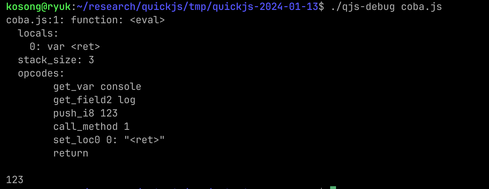<figcaption></figcaption></figure>

Okay now we can confirm that we able to dump the `opcode` of `quickjs`, now the question is how to dump the opcodes of the given challenge? during the competition we also try to just create our own `quickjs` wrapper and compile the code and run the executable but the result is failed, we got `segmentation fault` by running it.

When we take a look on the error, we can see following error

```c
AddressSanitizer:DEADLYSIGNAL
=================================================================
==48335==ERROR: AddressSanitizer: SEGV on unknown address 0x000000000000 (pc 0x608297edc50b bp 0x7ffd09a76c60 sp 0x7ffd09a76c20 T0)
==48335==The signal is caused by a READ memory access.
==48335==Hint: address points to the zero page.
    #0 0x608297edc50b in free_bytecode_atoms /home/kosong/ctf/final_itsec/re/qengine/quickjs_2/quickjs-2024-01-13/quickjs.c:29369
    #1 0x608297ef63fe in free_function_bytecode /home/kosong/ctf/final_itsec/re/qengine/quickjs_2/quickjs-2024-01-13/quickjs.c:33366
    #2 0x608297e34eda in free_gc_object /home/kosong/ctf/final_itsec/re/qengine/quickjs_2/quickjs-2024-01-13/quickjs.c:5468
    #3 0x608297e3501d in free_zero_refcount /home/kosong/ctf/final_itsec/re/qengine/quickjs_2/quickjs-2024-01-13/quickjs.c:5490
    #4 0x608297e3533c in __JS_FreeValueRT /home/kosong/ctf/final_itsec/re/qengine/quickjs_2/quickjs-2024-01-13/quickjs.c:5534
    #5 0x608297e354fe in __JS_FreeValue /home/kosong/ctf/final_itsec/re/qengine/quickjs_2/quickjs-2024-01-13/quickjs.c:5575
    #6 0x608297e19150 in JS_FreeValue /home/kosong/ctf/final_itsec/re/qengine/quickjs_2/quickjs-2024-01-13/quickjs.h:651
    #7 0x608297f09f61 in JS_ReadFunctionTag /home/kosong/ctf/final_itsec/re/qengine/quickjs_2/quickjs-2024-01-13/quickjs.c:36081
    #8 0x608297f0ca89 in JS_ReadObjectRec /home/kosong/ctf/final_itsec/re/qengine/quickjs_2/quickjs-2024-01-13/quickjs.c:36472
    #9 0x608297f09d34 in JS_ReadFunctionTag /home/kosong/ctf/final_itsec/re/qengine/quickjs_2/quickjs-2024-01-13/quickjs.c:36071
    #10 0x608297f0ca89 in JS_ReadObjectRec /home/kosong/ctf/final_itsec/re/qengine/quickjs_2/quickjs-2024-01-13/quickjs.c:36472
    #11 0x608297f0db53 in JS_ReadObject /home/kosong/ctf/final_itsec/re/qengine/quickjs_2/quickjs-2024-01-13/quickjs.c:36612
    #12 0x608297fa981a in js_std_eval_binary /home/kosong/ctf/final_itsec/re/qengine/quickjs_2/quickjs-2024-01-13/quickjs-libc.c:3976
    #13 0x608297e1755b in main /home/kosong/ctf/final_itsec/re/qengine/quickjs_2/quickjs-2024-01-13/chall.c:38
    #14 0x7ca23002a1c9 in __libc_start_call_main ../sysdeps/nptl/libc_start_call_main.h:58
    #15 0x7ca23002a28a in __libc_start_main_impl ../csu/libc-start.c:360
    #16 0x608297e17344 in _start (/home/kosong/ctf/final_itsec/re/qengine/quickjs_2/quickjs-2024-01-13/test_program_debug+0x30344) (BuildId: d6897c7f0366acf053aab4b972668b2cbe9cb75f)

AddressSanitizer can not provide additional info.
SUMMARY: AddressSanitizer: SEGV /home/kosong/ctf/final_itsec/re/qengine/quickjs_2/quickjs-2024-01-13/quickjs.c:29369 in free_bytecode_atoms
==48335==ABORTING
```

We can see that the error is on `free_bytecode_atoms`, so something about atoms!

If we look closer to the `js_dump_function_bytecode` we will see some information, not only `bytecode`. There is `atom`, `vardefs`, `closure`, `cpool`, and etc. We can simplify those terminology as following

* atom
  * something like dictionary, used by quickjs as part of optimization technique
* vardefs
  * variable declaration of current function/scope
* closure
  * variable from outside function
* cpool
  * constant pool, store values used in function
* bytecode
  * byte that represent the logic of code/opcode

So the previous issue caused by atom, most likely because the atom is mismatch, something like we want to free atom in index 0x1337 but there is no key 0x1337 in it, so what should we free?

Until this step we know the urgency of atom and bytecode, but for vardefs, closure, and cpool actually we can fake it. How we can fake it? we know that js\_dump\_function\_bytecode is called when we run qjs binary and we know also that the dumped opcode are derived from the given javascript file which is in previous step is coba.js. So if we provide a valid coba.js with fake vardefs, closure, and cpool then it will still produce valid opcode but with "generic" information about variables.&#x20;

Now we need to dump the `bytecode` and `atom` first, let's back to the original binary. Through diffing the binary with our compiled quickjs, we will found the right address to dump the bytecode

<pre class="language-c" data-title="JS_CallInternal"><code class="lang-c">      v25 = (__m128i *)(v137 + 16 * v19);
      v26 = v134[15].m128i_i64[1];
<strong>      v27 = *(_BYTE **)(v135 + 32); // v135 == rcx (@ 0x40e75c)
</strong>      v28 = *(_QWORD *)(v135 + 72);
      v123 = v25;
      v138[0] = v26;
      v134[15].m128i_i64[1] = (__int64)v138;
      v133 = v138;
      goto LABEL_11;
</code></pre>

<pre class="language-nasm"><code class="lang-nasm">.text:000000000040E74B                 mov     rcx, [rbp+var_118]
.text:000000000040E752                 add     rbx, rax
.text:000000000040E755                 mov     rax, [rsi+0F8h]
<strong>.text:000000000040E75C                 mov     r14, [rcx+20h]
</strong>.text:000000000040E760                 mov     r15, [rcx+48h]
.text:000000000040E764                 mov     [rbp+var_180], rbx
.text:000000000040E76B                 mov     [rbp+var_80], rax
.text:000000000040E76F                 lea     rax, [rbp+var_80]
.text:000000000040E773                 mov     [rsi+0F8h], rax
.text:000000000040E77A                 mov     [rbp+var_128], rax
</code></pre>

* v27 is a pointer to bytecode

Looking at `JSFunctionBytecode` struct from our compiled binary, we can see that the `length` is at `0x28` and the `bytecode` is at `0x20`

```c
00000000 struct JSFunctionBytecode // sizeof=0x80
00000000 {
00000000     JSGCObjectHeader header;
00000018     uint8_t js_mode;
00000019     // padding byte
0000001A     // padding byte
0000001B     // padding byte
0000001C     // padding byte
0000001D     // padding byte
0000001E     // padding byte
0000001F     // padding byte
00000020     uint8_t *byte_code_buf;
00000028     int byte_code_len;
0000002C     JSAtom func_name;
00000030     JSVarDef *vardefs;
00000038     JSClosureVar *closure_var;
00000040     uint16_t arg_count;
00000042     uint16_t var_count;
00000044     uint16_t defined_arg_count;
00000046     uint16_t stack_size;
00000048     JSContext *realm;
00000050     JSValue *cpool;
00000058     int cpool_count;
0000005C     int closure_var_count;
00000060     JSFunctionBytecode::$FB708F24FC1CACA8EAB68685978F9B6F debug;
00000080 };
```

By setting up breakpoint at `0x40E75C`, we can get 2 values directly which is `*(rcx+0x20)` for `bytecode buffer` and `*(rcx+0x28)` for `bytecode length`. Let's create gdb script to automatically dump it



```python
#!/usr/bin/python3
import string
import json

def write_payload(data):
    f = open("payload.txt", "wb")
    f.write(bytes(data))
    f.close()

def write_to_file(data):
    with open('out.txt', 'w') as f:
        f.write(json.dumps(data))

class SolverEquation(gdb.Command):
    def __init__ (self):
        super (SolverEquation, self).__init__ ("solve-equation",gdb.COMMAND_OBSCURE)

    def invoke (self, arg, from_tty):
        gdb.execute("del")

        gdb.execute("b *0x40e75c")
        gdb.execute("b *0x401EE5")

        gdb.execute("run")
        list_bytecode = []
        d = {}
        list_trace = []
        while True:
            pc = addr2num(gdb.selected_frame().read_register("pc"))
            if pc == 0x401EE5:
                break
            rcx = addr2num(gdb.selected_frame().read_register("rcx"))
            bytecode_addr = parse(gdb.execute(f"x/gx {rcx+0x20}",to_string=True))[0]
            bytecode_len = parse(gdb.execute(f"x/wx {rcx+0x28}",to_string=True))[0]
            bytecode_val = parse(gdb.execute(f"x/{bytecode_len}bx {bytecode_addr}",to_string=True))
            if bytecode_val not in list_bytecode:
                list_bytecode.append(bytecode_val)
                # d[bytecode_addr] = bytecode_val

            list_trace.append(bytecode_addr)
            gdb.execute("c")
        print(list_bytecode)
        # print(d)
        # print(list_trace)

def addr2num(addr):
    try:
        return int(addr)
    except:
        return long(addr)

def parse(f):
    f = f.split("\n")
    result = []
    for i in f:
        tmp = i.split("\t")
        for j in range(1,len(tmp)):
            result.append(int(tmp[j],16))
    return result

SolverEquation()
```



After get list of `bytecodes`, we need to dump the atoms also. Looking at `quickjs.c` we've following function



```c
const char *JS_AtomToCString(JSContext *ctx, JSAtom atom)
{
    JSValue str;
    const char *cstr;

    str = JS_AtomToString(ctx, atom);
    if (JS_IsException(str))
        return NULL;
    cstr = JS_ToCString(ctx, str);
    JS_FreeValue(ctx, str);
    return cstr;
}
```



`JS_AtomToCString` can be used to printout atom value by providing `index` and `JSContext`, so we need to findout where is `JS_AtomToCString` in target binary and where we can find valid `JSContext` pointer.

Previously we've recover function name for JS\_AtomToValue by looking at debug/error strings `"__JS_AtomToValue"`. Looking at the XREF to `JS_AtomToValue` we can easily find which one is `JS_AtomToCString` function and we found that `0x433660` is the valid one.&#x20;

Back to `JS_CallInternal`, we know that the first argument is valid `pointer` for `JSContext`, but which one is it? just take a look on function definition and we can see that `arg1` is `RDI`. Set breakpoint at initial call of `JS_CallInternal` put all the needed data to print the atoms.



```python
#!/usr/bin/python3

class SolverEquation(gdb.Command):
    def __init__ (self):
        super (SolverEquation, self).__init__ ("solve-equation",gdb.COMMAND_OBSCURE)

    def invoke (self, arg, from_tty):
        gdb.execute("del")
        gdb.execute("b *0x40e5c4")
        gdb.execute("run")
        atom_val = {}
        for i in range(0x1000):
            try:
                rdi = addr2num(gdb.selected_frame().read_register("rdi"))
                result = gdb.execute(f'call ((const char* (*)(void*, int)) 0x433660)({rdi}, {i})', to_string=True)
                return_val = result.strip().split(" \"")[-1][:-1]
                atom_val[i] = return_val
                # print(f"{i}: {return_val}")
            except gdb.error as e:
                print("error",e)
                break
        print(atom_val)

def addr2num(addr):
    try:
        return int(addr)
    except:
        return long(addr)

SolverEquation()
```



Now we have all the atoms, back to source code because we gonna patch it.



```diff
1285a1286,1346
> static uint32_t g_old_atoms[] = {0, 1, 2, 3, 4, 5, 6, 7, 8, 9, 10, 11, 12, 13, 14, 15, 16, 17, 18, 19, 20, 21, 22, 23, 24, 25, 26, 27, 28, 29, 30, 31, 32, 33, 34, 35, 36, 37, 38, 39, 40, 41, 42, 43, 44, 45, 46, 47, 48, 49, 50, 51, 52, 53, 54, 55, 56, 57, 58, 59, 60, 61, 62, 63, 64, 65, 66, 67, 68, 69, 70, 71, 72, 73, 74, 75, 76, 77, 78, 79, 80, 81, 82, 83, 84, 85, 86, 87, 88, 89, 90, 91, 92, 93, 94, 95, 96, 97, 98, 99, 100, 101, 102, 103, 104, 105, 106, 107, 108, 109, 110, 111, 112, 113, 114, 115, 116, 117, 118, 119, 120, 121, 122, 123, 124, 125, 126, 127, 128, 129, 130, 131, 132, 133, 134, 135, 136, 137, 138, 139, 140, 141, 142, 143, 144, 145, 146, 147, 148, 149, 150, 151, 152, 153, 154, 155, 156, 157, 158, 159, 160, 161, 162, 163, 164, 165, 166, 167, 168, 169, 170, 171, 172, 173, 174, 175, 176, 177, 178, 179, 180, 181, 182, 183, 184, 185, 186, 187, 188, 189, 190, 191, 192, 193, 194, 195, 196, 197, 198, 199, 200, 201, 202, 203, 204, 205, 206, 207, 208, 209, 210, 211, 212, 213, 214, 215, 216, 217, 218, 219, 220, 221, 222, 223, 224,225, 226, 227, 228, 229, 230, 231, 232, 233, 234, 235, 236, 237, 238, 239, 240, 241, 242, 243, 244, 245, 246, 247, 248, 249, 250, 251, 252, 253, 254, 255, 256, 257, 258, 259, 260, 261, 262, 263, 264, 265, 266, 267, 268, 269, 270, 271, 272, 273, 274, 275, 276, 277, 278, 279, 280, 281, 282, 283, 284, 285, 286, 287, 288, 289, 290, 291, 292, 293, 294, 295, 296, 297, 298, 299, 300, 301, 302, 303, 304, 305, 306, 307, 308, 309, 310, 311, 312, 313, 314, 315, 316, 317, 318, 319, 320, 321, 322, 323, 324, 325, 326, 327, 328, 329, 330, 331, 332, 333, 334, 335, 336, 337, 338, 339, 340, 341, 342, 343, 344, 345, 346, 347, 348, 349, 350, 351, 352, 353, 354, 355, 356, 357, 358, 359, 360, 361, 362, 363, 364, 365, 366, 367, 368, 369, 370, 371, 372, 373, 374, 375, 376, 377, 378, 379, 380, 381, 382, 383, 384, 385, 386, 387, 388, 389, 390, 391, 392, 393, 394, 395, 396, 397, 398, 399, 400, 401, 402, 403, 404, 405, 406, 407, 408, 409, 410, 411, 412, 413, 414, 415, 416, 417, 418, 419, 420, 421, 422, 423, 424, 425, 426, 427, 428, 429, 430, 431, 432, 433, 434,435, 436, 437, 438, 439, 440, 441, 442, 443, 444, 445, 446, 447, 448, 449, 450, 451, 452, 453, 454, 455, 456, 457, 458, 459, 460, 461, 462, 463, 464, 465, 466, 467, 468, 469, 470, 471, 472, 473, 474, 475, 476, 477, 478, 479, 480, 481, 482, 483, 484, 485, 486, 487, 488, 489, 490, 491, 492, 493, 494, 495, 496, 497, 498, 499, 500, 501, 502, 503, 504, 505, 506, 507, 508, 509, 510, 511, 512, 513, 514, 515, 516, 517, 518, 519, 520, 521, 522, 523, 524, 525, 526};
> static const char* g_correct_names[] = {"", "null", "false", "true", "if", "else", "return", "var", "this", "delete", "void", "typeof", "new", "in", "instanceof", "do", "while", "for", "break", "continue", "switch", "case", "default", "throw", "try", "catch", "finally", "function", "debugger", "with", "class", "const", "enum", "export", "extends", "import", "super", "implements", "interface", "let", "package", "private", "protected", "public", "static", "yield", "await", "", "length", "fileName", "lineNumber", "message", "cause", "errors", "stack", "prepareStackTrace", "name", "toString", "toLocaleString", "valueOf", "eval", "prototype", "constructor", "configurable", "writable", "enumerable", "value", "get", "set", "of", "__proto__", "undefined", "number", "boolean", "string", "object", "symbol", "integer", "unknown", "arguments", "callee", "caller", "<eval>", "<ret>", "<var>", "<arg_var>", "<with>", "lastIndex", "target", "index", "input", "defineProperties", "apply", "join", "concat", "split", "construct", "getPrototypeOf", "setPrototypeOf", "isExtensible", "preventExtensions", "has", "deleteProperty", "defineProperty", "getOwnPropertyDescriptor", "ownKeys", "add", "done", "next", "values", "source", "flags", "global", "unicode", "raw", "new.target", "this.active_func", "<home_object>", "<computed_field>", "<static_computed_field>", "<class_fields_init>", "<brand>", "#constructor", "as", "from", "meta", "*default*", "*", "Module", "then", "resolve", "reject", "promise", "proxy", "revoke", "async", "exec", "groups", "indices", "status", "reason", "globalThis", "bigint", "bigfloat", "bigdecimal", "roundingMode", "maximumSignificantDigits", "maximumFractionDigits", "not-equal", "timed-out", "ok", "toJSON", "Object", "Array", "Error", "Number", "String", "Boolean", "Symbol", "Arguments", "Math", "JSON", "Date", "Function", "GeneratorFunction", "ForInIterator", "RegExp", "ArrayBuffer", "SharedArrayBuffer", "Uint8ClampedArray", "Int8Array", "Uint8Array", "Int16Array", "Uint16Array", "Int32Array", "Uint32Array", "BigInt64Array", "BigUint64Array", "Float32Array", "Float64Array", "DataView", "BigInt", "BigFloat", "BigFloatEnv", "BigDecimal", "OperatorSet", "Operators", "Map", "Set", "WeakMap", "WeakSet", "Map Iterator", "Set Iterator", "Array Iterator", "String Iterator", "RegExp String Iterator", "Generator", "Proxy", "Promise", "PromiseResolveFunction", "PromiseRejectFunction", "AsyncFunction", "AsyncFunctionResolve", "AsyncFunctionReject", "AsyncGeneratorFunction", "AsyncGenerator", "EvalError", "RangeError", "ReferenceError", "SyntaxError", "TypeError", "URIError", "InternalError", "<brand>", "Symbol.toPrimitive", "Symbol.iterator", "Symbol.match", "Symbol.matchAll", "Symbol.replace", "Symbol.search", "Symbol.split", "Symbol.toStringTag", "Symbol.isConcatSpreadable", "Symbol.hasInstance", "Symbol.species", "Symbol.unscopables", "Symbol.asyncIterator", "Symbol.operatorSet", "AggregateError", "create", "getOwnPropertyNames", "getOwnPropertySymbols", "groupBy", "keys", "entries", "getOwnPropertyDescriptors", "is", "assign", "seal", "freeze", "isSealed", "isFrozen", "__getClass", "fromEntries", "hasOwn", "hasOwnProperty", "isPrototypeOf", "propertyIsEnumerable", "get __proto__", "set __proto__", "__defineGetter__", "__defineSetter__", "__lookupGetter__", "__lookupSetter__", "call", "bind", "get fileName", "get lineNumber", "at", "every", "some", "forEach", "map", "filter", "reduce", "reduceRight", "fill", "find", "findIndex", "findLast", "findLastIndex", "indexOf", "lastIndexOf", "includes", "pop", "push", "shift", "unshift", "reverse", "toReversed", "sort", "toSorted", "slice", "splice", "toSpliced", "copyWithin", "flatMap", "flat", "isArray", "get [Symbol.species]", "parseInt", "parseFloat", "isNaN", "isFinite", "decodeURI", "decodeURIComponent", "encodeURI", "encodeURIComponent", "escape", "unescape", "Infinity", "NaN", "toExponential", "toFixed", "toPrecision", "isInteger", "isSafeInteger", "MAX_VALUE", "MIN_VALUE", "NEGATIVE_INFINITY", "POSITIVE_INFINITY", "EPSILON", "MAX_SAFE_INTEGER", "MIN_SAFE_INTEGER", "fromCharCode", "fromCodePoint", "charCodeAt", "charAt", "codePointAt", "isWellFormed", "toWellFormed", "endsWith", "startsWith", "match", "matchAll", "search", "substring", "substr", "repeat", "replace", "replaceAll", "padEnd", "padStart", "trim", "trimEnd", "trimRight", "trimStart", "trimLeft", "__quote", "localeCompare", "toLowerCase", "toUpperCase", "toLocaleLowerCase", "toLocaleUpperCase", "anchor", "big", "blink", "bold", "fixed", "fontcolor", "fontsize", "italics", "link", "small", "strike", "sub", "sup", "Reflect", "description", "get description", "keyFor", "toPrimitive", "iterator", "toStringTag", "isConcatSpreadable", "hasInstance", "species", "unscopables", "asyncIterator", "operatorSet", "toUTCString", "toGMTString", "toISOString", "toDateString", "toTimeString", "toLocaleDateString", "toLocaleTimeString", "getTimezoneOffset", "getTime", "getYear", "getFullYear", "getUTCFullYear", "getMonth", "getUTCMonth", "getDate", "getUTCDate", "getHours", "getUTCHours", "getMinutes", "getUTCMinutes", "getSeconds", "getUTCSeconds", "getMilliseconds", "getUTCMilliseconds", "getDay", "getUTCDay", "setTime", "setMilliseconds", "setUTCMilliseconds", "setSeconds", "setUTCSeconds", "setMinutes", "setUTCMinutes", "setHours", "setUTCHours", "setDate", "setUTCDate", "setMonth", "setUTCMonth", "setYear", "setFullYear", "setUTCFullYear", "now", "parse", "UTC", "normalize", "get flags", "get source", "get global", "ignoreCase", "get ignoreCase", "multiline", "get multiline", "dotAll", "get dotAll", "get unicode", "sticky", "get sticky", "hasIndices", "get hasIndices", "compile", "test", "revocable", "clear", "size", "get size", "byteLength", "get byteLength", "isView", "get length", "buffer", "get buffer", "byteOffset", "get byteOffset", "get [Symbol.toStringTag]", "subarray", "TypedArray", "BYTES_PER_ELEMENT", "getInt8", "getUint8", "getInt16", "getUint16", "getInt32", "getUint32", "getBigInt64", "getBigUint64", "getFloat32", "getFloat64", "setInt8", "setUint8", "setInt16", "setUint16", "setInt32", "setUint32", "setBigInt64", "setBigUint64", "setFloat32", "setFloat64", "all", "allSettled", "any", "race", "withResolvers", "asUintN", "asIntN", "tdiv", "fdiv", "cdiv", "ediv", "tdivrem", "fdivrem", "cdivrem", "edivrem", "sqrt", "sqrtrem", "floorLog2", "ctz", "log", "console", "scriptArgs", "print", "__loadScript", "i", "s", "n", "ppp", "sss", "rrr", "smh", "blv", "vlb", "flag", "result", "ITSEC{0123456789abcdefghijklmnopqrs}", ":)", ":(", "chall.js", "_0x528cee", "_0x37266d", "_0x5c5f7d", "_0x2957fe", "_0x15f6c4", "_0x126073", "_0x412858", "_0x443846", "_0x26e0c8", "_0x29e093", "_0x4bf614", "0b", "_0x24bc72", "_0x115d42", "_0x1dcd3e", "_0x319b0c", "_0x233093", "_0x48c98c", "_0x96febc", "_0x4250aa"};
> static size_t g_atoms_count = 527;
> static const char *g_custom_bytecode_filename = NULL;
>
> void js_set_bytecode_filename(const char *filename) {
>     printf("DEBUG: js_set_bytecode_filename called with: '%s'\n",
>            filename ? filename : "(null)");
>     g_custom_bytecode_filename = filename;
>     printf("DEBUG: g_custom_bytecode_filename now set to: '%s'\n",
>            g_custom_bytecode_filename ? g_custom_bytecode_filename : "(null)");
> }
>
> static uint8_t* read_bytecode_from_file(const char* filename, size_t* size) {
>     if (!filename) {
>         fprintf(stderr, "Error: read_bytecode_from_file called with NULL filename\n");
>         return NULL;
>     }
>
>     printf("DEBUG: Attempting to read bytecode from: '%s'\n", filename);
>
>     FILE* file = fopen(filename, "rb");
>     if (!file) {
>         fprintf(stderr, "Error: Cannot open bytecode file '%s'\n", filename);
>         return NULL;
>     }
>
>     // Get file size
>     fseek(file, 0, SEEK_END);
>     long file_size = ftell(file);
>     fseek(file, 0, SEEK_SET);
>
>     if (file_size <= 0) {
>         fprintf(stderr, "Error: Invalid file size for bytecode file '%s'\n", filename);
>         fclose(file);
>         return NULL;
>     }
>
>     // Allocate memory for bytecode
>     uint8_t* bytecode = (uint8_t*)malloc(file_size);
>     if (!bytecode) {
>         fprintf(stderr, "Error: Memory allocation failed for bytecode\n");
>         fclose(file);
>         return NULL;
>     }
>
>     // Read the file
>     size_t bytes_read = fread(bytecode, 1, file_size, file);
>     fclose(file);
>
>     if (bytes_read != file_size) {
>         fprintf(stderr, "Error: Failed to read complete bytecode file '%s'\n", filename);
>         free(bytecode);
>         return NULL;
>     }
>
>     *size = file_size;
>     printf("DEBUG: Successfully read %zu bytes from '%s'\n", file_size, filename);
>     return bytecode;
> }
>
3279a3341,3356
> static const char* find_mapped_name(JSAtom atom) {
>     if (!g_old_atoms || !g_correct_names || g_atoms_count == 0) {
>         return NULL;  // No mapping available
>     }
>
>     // Search for atom in old_atoms array
>     for (size_t i = 0; i < g_atoms_count; i++) {
>         if (g_old_atoms[i] == (uint32_t)atom) {
>             return g_correct_names[i];
>         }
>     }
>
>     return NULL;  // No mapping found
> }
>
>
3285a3363,3369
>     const char *mapped_name = find_mapped_name(atom);
>
>     if (mapped_name) {
>         printf("%s", mapped_name);
>         return;
>     }
>
29468d29551
<             printf(";; %.*s", (int)(p - s), s);
29470,29471d29552
<                 if (p[-1] != '\n')
<                     printf("\n");
29793c29874
< static __maybe_unused void js_dump_function_bytecode(JSContext *ctx, JSFunctionBytecode *b)
---
> void js_dump_function_bytecode(JSContext *ctx, JSFunctionBytecode *b)
29795d29875
<     int i;
29799,29803d29878
<     if (b->has_debug && b->debug.filename != JS_ATOM_NULL) {
<         str = JS_AtomGetStr(ctx, atom_buf, sizeof(atom_buf), b->debug.filename);
<         printf("%s:%d: ", str, b->debug.line_num);
<     }
<
29805,29821c29880,29902
<     printf("function: %s%s\n", &"*"[b->func_kind != JS_FUNC_GENERATOR], str);
<     if (b->js_mode) {
<         printf("  mode:");
<         if (b->js_mode & JS_MODE_STRICT)
<             printf(" strict");
< #ifdef CONFIG_BIGNUM
<         if (b->js_mode & JS_MODE_MATH)
<             printf(" math");
< #endif
<         printf("\n");
<     }
<     if (b->arg_count && b->vardefs) {
<         printf("  args:");
<         for(i = 0; i < b->arg_count; i++) {
<             printf(" %s", JS_AtomGetStr(ctx, atom_buf, sizeof(atom_buf),
<                                         b->vardefs[i].var_name));
<         }
---
>
>     if (!strcmp(str, "main"))
>     {
>         size_t custom_len;
>         uint8_t* custom_bytecode = read_bytecode_from_file(g_custom_bytecode_filename, &custom_len);
>
>         uint8_t *original_buf = b->byte_code_buf;
>         int original_len = b->byte_code_len;
>
>         b->byte_code_buf = custom_bytecode;
>         b->byte_code_len = custom_len;
>
>         printf("  Opcode: \n");
>         dump_byte_code(ctx, 3, b->byte_code_buf, b->byte_code_len,
>                        b->vardefs, b->arg_count,
>                        b->vardefs ? b->vardefs + b->arg_count : NULL, b->var_count,
>                        b->closure_var, b->closure_var_count,
>                        b->cpool, b->cpool_count,
>                        b->has_debug ? b->debug.source : NULL,
>                        b->has_debug ? b->debug.line_num : -1, NULL, b);
>
>         b->byte_code_buf = original_buf;
>         b->byte_code_len = original_len;
29824,29860c29905
<     if (b->var_count && b->vardefs) {
<         printf("  locals:\n");
<         for(i = 0; i < b->var_count; i++) {
<             JSVarDef *vd = &b->vardefs[b->arg_count + i];
<             printf("%5d: %s %s", i,
<                    vd->var_kind == JS_VAR_CATCH ? "catch" :
<                    (vd->var_kind == JS_VAR_FUNCTION_DECL ||
<                     vd->var_kind == JS_VAR_NEW_FUNCTION_DECL) ? "function" :
<                    vd->is_const ? "const" :
<                    vd->is_lexical ? "let" : "var",
<                    JS_AtomGetStr(ctx, atom_buf, sizeof(atom_buf), vd->var_name));
<             if (vd->scope_level)
<                 printf(" [level:%d next:%d]", vd->scope_level, vd->scope_next);
<             printf("\n");
<         }
<     }
<     if (b->closure_var_count) {
<         printf("  closure vars:\n");
<         for(i = 0; i < b->closure_var_count; i++) {
<             JSClosureVar *cv = &b->closure_var[i];
<             printf("%5d: %s %s:%s%d %s\n", i,
<                    JS_AtomGetStr(ctx, atom_buf, sizeof(atom_buf), cv->var_name),
<                    cv->is_local ? "local" : "parent",
<                    cv->is_arg ? "arg" : "loc", cv->var_idx,
<                    cv->is_const ? "const" :
<                    cv->is_lexical ? "let" : "var");
<         }
<     }
<     printf("  stack_size: %d\n", b->stack_size);
<     printf("  opcodes:\n");
<     dump_byte_code(ctx, 3, b->byte_code_buf, b->byte_code_len,
<                    b->vardefs, b->arg_count,
<                    b->vardefs ? b->vardefs + b->arg_count : NULL, b->var_count,
<                    b->closure_var, b->closure_var_count,
<                    b->cpool, b->cpool_count,
<                    b->has_debug ? b->debug.source : NULL,
<                    b->has_debug ? b->debug.line_num : -1, NULL, b);
---
>
29865d29909
<     printf("\n");
```



Following are explanation for each modification in `quickjs.c`

* Hook `print_atom` with our defined function with values from `dump_atom.py`
* Some `deletion` to ensure it only printout our target opcode
* Replace original buffer for `bytecode` with `target buffer`
  * It will called multiple times (our fake code - `coba.js` have multiple function), because we've fake variables and constant in main function so we will dump the code only when it processed main function

Continue to `qjs.c`



```diff
51a52,54
> static const char *g_bytecode_filename = NULL;
> extern void js_set_bytecode_filename(const char *filename);
>
394a398,406
>             if (!strcmp(longopt, "disassemble")) {
>                 if (optind >= argc) {
>                     fprintf(stderr, "qjs: missing filename after --disassemble\n");
>                     exit(2);
>                 }
>                 g_bytecode_filename = argv[optind++];
>                 printf("DEBUG: Set bytecode filename to: '%s'\n", g_bytecode_filename);
>                 continue;
>             }
443a456,460
>     }
>
>     if (g_bytecode_filename) {
>         printf("DEBUG: Calling js_set_bytecode_filename with: '%s'\n", g_bytecode_filename);
>         js_set_bytecode_filename(g_bytecode_filename);
```



* Add `option` to read bytecode from a file

Now, let's create `fake javascript code`. Following is example from me

```javascript
function func_a(arg1){
        return arg1+123
}

function func_b(arg1){
        return arg1+1337
}

function func_c(arg1){
        return arg1+1337
}

function func_d(arg1){
        return arg1+1337
}

function func_e(arg1){
        return arg1+1337
}

function func_f(arg1){
        return arg1+1337
}

function func_g(arg1){
        return arg1+1337
}

function func_h(arg1){
        return arg1+1337
}


function main(arg1, arg2, arg3, arg4, arg5, arg6, arg7){
        var var_1 = "kosong";
        let var_2 = func_d(func_c(func_b(func_a(123))));
        let var_3 = func_e(var_2);
        let var_4 = func_e(var_3);
        let var_5 = func_e(var_4);
        let var_6 = func_f(var_5);
        let var_7 = func_g(var_6);
        let var_8 = func_h(var_7);
        let var_9 = 1;
        let var_10 = 1;
        let var_11 = 1;
        let var_12 = 1;
        let var_13 = 1;
        let var_14 = 1;
        let var_15 = 1;
        let var_16 = 1;
        let var_17 = 1;
        let var_18 = 1;
        let var_19 = 1;
        let var_20 = 1;
        let var_21 = 1;
        let var_22 = 1;
        let var_23 = 1;
        let var_24 = 1;
        let var_25 = 1;
        let var_26 = 1;
        let var_27 = 1;
        let var_28 = 1;
        let var_29 = 1;
        let var_30 = 1;
        let var_31 = 1;
        let var_32 = 1;
        let var_33 = 1;
        let var_34 = 1;
        let var_35 = arg1 + arg2 + arg3 + arg4 + arg5 + arg6 + arg7;
        console.log(123);

}

main();
```

Previously we've got list of `bytecodes`, let's write it in dumps directory.

```python
bytecode_arrays = [
[63, 239, 1, 0, 0, 64, 63, 240, 1, 0, 0, 64, 63, 241, 1, 0, 0, 64, 63, 242, 1, 0, 0, 64, 63, 243, 1, 0, 0, 128, 63, 244, 1, 0, 0, 128, 63, 245, 1, 0, 0, 128, 63, 246, 1, 0, 0, 128, 63, 67, 1, 0, 0, 128, 194, 0, 64, 239, 1, 0, 0, 0, 194, 1, 64, 240, 1, 0, 0, 0, 194, 2, 64, 241, 1, 0, 0, 0, 194, 3, 64, 242, 1, 0, 0, 0, 62, 243, 1, 0, 0, 128, 62, 244, 1, 0, 0, 128, 62, 245, 1, 0, 0, 128, 62, 246, 1, 0, 0, 130, 62, 67, 1, 0, 0, 130, 191, 18, 192, 171, 0, 191, 95, 191, 40, 191, 54, 192, 144, 0, 184, 191, 37, 38, 8, 0, 58, 243, 1, 0, 0, 191, 113, 191, 36, 192, 205, 0, 191, 101, 191, 14, 192, 177, 0, 191, 115, 191, 90, 191, 8, 191, 40, 192, 238, 0, 192, 250, 0, 192, 161, 0, 191, 94, 192, 246, 0, 191, 93, 192, 151, 0, 192, 230, 0, 191, 52, 191, 39, 192, 242, 0, 192, 203, 0, 192, 143, 0, 191, 9, 192, 247, 0, 192, 149, 0, 192, 216, 0, 191, 20, 191, 125, 191, 35, 192, 136, 0, 192, 236, 0, 38, 32, 0, 192, 179, 0, 76, 32, 0, 0, 128, 192, 222, 0, 76, 33, 0, 0, 128, 191, 44, 76, 34, 0, 0, 128, 191, 52, 76, 35, 0, 0, 128, 58, 244, 1, 0, 0, 4, 247, 1, 0, 0, 4, 95, 0, 0, 0, 72, 195, 36, 1, 0, 4, 6, 1, 0, 0, 72, 194, 4, 36, 1, 0, 58, 245, 1, 0, 0, 56, 245, 1, 0, 0, 4, 26, 1, 0, 0, 72, 36, 0, 0, 58, 246, 1, 0, 0, 6, 203, 97, 1, 0, 183, 204, 98, 1, 0, 189, 164, 236, 77, 97, 3, 0, 97, 2, 0, 56, 240, 1, 0, 0, 56, 242, 1, 0, 0, 56, 239, 1, 0, 0, 56, 246, 1, 0, 0, 241, 241, 241, 205, 56, 241, 1, 0, 0, 98, 2, 0, 56, 243, 1, 0, 0, 242, 206, 56, 241, 1, 0, 0, 56, 246, 1, 0, 0, 98, 3, 0, 242, 17, 57, 246, 1, 0, 0, 203, 98, 1, 0, 146, 99, 1, 0, 14, 238, 174, 56, 246, 1, 0, 0, 4, 48, 0, 0, 0, 71, 56, 244, 1, 0, 0, 4, 48, 0, 0, 0, 71, 172, 17, 236, 18, 14, 56, 246, 1, 0, 0, 4, 3, 1, 0, 0, 72, 194, 5, 36, 1, 0, 58, 67, 1, 0, 0, 56, 232, 1, 0, 0, 4, 231, 1, 0, 0, 72, 56, 67, 1, 0, 0, 236, 8, 4, 248, 1, 0, 0, 238, 6, 4, 249, 1, 0, 0, 36, 1, 0, 207, 40],
[211, 4, 60, 1, 0, 0, 72, 183, 37, 1, 0],
[97, 2, 0, 97, 0, 0, 38, 0, 0, 203, 97, 1, 0, 211, 127, 238, 41, 204, 98, 0, 0, 4, 19, 1, 0, 0, 72, 98, 1, 0, 4, 57, 0, 0, 0, 72, 185, 36, 1, 0, 4, 76, 1, 0, 0, 72, 191, 8, 193, 0, 36, 2, 0, 36, 1, 0, 14, 130, 0, 236, 213, 14, 133, 98, 0, 0, 4, 93, 0, 0, 0, 72, 195, 36, 1, 0, 4, 95, 0, 0, 0, 72, 195, 36, 1, 0, 4, 6, 1, 0, 0, 72, 194, 1, 36, 1, 0, 205, 98, 2, 0, 40],
[211, 211, 4, 48, 0, 0, 0, 71, 184, 159, 71, 38, 1, 0, 4, 94, 0, 0, 0, 72, 211, 4, 26, 1, 0, 0, 72, 183, 211, 4, 48, 0, 0, 0, 71, 184, 159, 36, 2, 0, 37, 1, 0],
[97, 3, 0, 97, 2, 0, 97, 1, 0, 97, 0, 0, 56, 156, 0, 0, 0, 4, 58, 1, 0, 0, 72, 38, 0, 0, 183, 211, 82, 14, 24, 39, 0, 0, 203, 56, 181, 0, 0, 0, 4, 6, 2, 0, 0, 98, 0, 0, 158, 241, 204, 98, 1, 0, 4, 57, 0, 0, 0, 72, 191, 16, 36, 1, 0, 205, 98, 2, 0, 4, 48, 0, 0, 0, 71, 185, 157, 183, 173, 236, 12, 193, 0, 98, 2, 0, 158, 17, 99, 2, 0, 14, 38, 0, 0, 206, 97, 4, 0, 183, 197, 4, 98, 4, 0, 98, 2, 0, 4, 48, 0, 0, 0, 71, 164, 236, 54, 98, 3, 0, 4, 19, 1, 0, 0, 72, 56, 34, 1, 0, 0, 98, 2, 0, 4, 26, 1, 0, 0, 72, 98, 4, 0, 98, 4, 0, 185, 158, 36, 2, 0, 191, 16, 242, 36, 1, 0, 14, 98, 4, 0, 185, 158, 17, 99, 4, 0, 14, 238, 189, 98, 3, 0, 40],
[97, 0, 0, 38, 0, 0, 203, 97, 1, 0, 183, 204, 98, 1, 0, 211, 4, 48, 0, 0, 0, 71, 164, 236, 43, 98, 0, 0, 4, 19, 1, 0, 0, 72, 211, 98, 1, 0, 71, 212, 98, 1, 0, 212, 4, 48, 0, 0, 0, 71, 157, 71, 175, 36, 1, 0, 14, 98, 1, 0, 146, 99, 1, 0, 14, 238, 202, 98, 0, 0, 40],
[211, 56, 244, 1, 0, 0, 212, 71, 172, 40]
]


for i in range(len(bytecode_arrays)):
	out = open(f"dumps/function_{i}.bin", "wb")
	out.write(bytes(bytecode_arrays[i]))
```

build the executable using `make qjs-debug` and run with following command

```
./qjs-debug --disassemble dumps/function_1.bin coba.js
```

Just change target bytecode to disassemble another function, such as `dumps/function_2.bin` and so on. After dumping all bytecode, we will got following opcodes.

```javascript
function_0
        check_define_var ppp,64
        check_define_var sss,64
        check_define_var rrr,64
        check_define_var smh,64
        check_define_var blv,128
        check_define_var vlb,128
        check_define_var flag,128
        check_define_var result,128
        check_define_var match,128
        fclosure8 0:
        define_func ppp,0
        fclosure8 1:
        define_func sss,0
        fclosure8 2:
        define_func rrr,0
        fclosure8 3:
        define_func smh,0
        define_var blv,128
        define_var vlb,128
        define_var flag,128
        define_var result,130
        define_var match,130
        push_i8 18
        push_i16 171
        push_i8 95
        push_i8 40
        push_i8 54
        push_i16 144
        push_1 1
        push_i8 37
        array_from 8
        put_var_init blv
        push_i8 113
        push_i8 36
        push_i16 205
        push_i8 101
        push_i8 14
        push_i16 177
        push_i8 115
        push_i8 90
        push_i8 8
        push_i8 40
        push_i16 238
        push_i16 250
        push_i16 161
        push_i8 94
        push_i16 246
        push_i8 93
        push_i16 151
        push_i16 230
        push_i8 52
        push_i8 39
        push_i16 242
        push_i16 203
        push_i16 143
        push_i8 9
        push_i16 247
        push_i16 149
        push_i16 216
        push_i8 20
        push_i8 125
        push_i8 35
        push_i16 136
        push_i16 236
        array_from 32
        push_i16 179
        define_field "32"
        push_i16 222
        define_field "33"
        push_i8 44
        define_field "34"
        push_i8 52
        define_field "35"
        put_var_init vlb
        push_atom_value ITSEC{0123456789abcdefghijklmnopqrs}
        push_atom_value split
        get_array_el2
        push_empty_string
        call_method 1
        push_atom_value map
        get_array_el2
        fclosure8 4:
        call_method 1
        put_var_init flag
        get_var flag
        push_atom_value slice
        get_array_el2
        call_method 0
        put_var_init result
        undefined
        put_loc0 0: var_1
        set_loc_uninitialized 1: var_2
        push_0 0
        put_loc1 1: var_2
  316:  get_loc_check 1: var_2
        push_6 6
        lt
        if_false8 399
        set_loc_uninitialized 3: var_4
        set_loc_uninitialized 2: var_3
        get_var sss
        get_var smh
        get_var ppp
        get_var result
        call1 1
        call1 1
        call1 1
        put_loc2 2: var_3
        get_var rrr
        get_loc_check 2: var_3
        get_var blv
        call2 2
        put_loc3 3: var_4
        get_var rrr
        get_var result
        get_loc_check 3: var_4
        call2 2
        dup
        put_var result
        put_loc0 0: var_1
        get_loc_check 1: var_2
        post_inc
        put_loc_check 1: var_2
        drop
        goto8 316
  399:  get_var result
        push_atom_value length
        get_array_el
        get_var vlb
        push_atom_value length
        get_array_el
        strict_eq
        dup
        if_false8 442
        drop
        get_var result
        push_atom_value every
        get_array_el2
        fclosure8 5:
        call_method 1
  442:  put_var_init match
        get_var console
        push_atom_value log
        get_array_el2
        get_var match
        if_false8 472
        push_atom_value :)
        goto8 477
  472:  push_atom_value :(
  477:  call_method 1
        set_loc0 0: var_1
        return

function_1
        get_arg0 0: arg1
        push_atom_value charCodeAt
        get_array_el2
        push_0 0
        tail_call_method 1

function_2
        set_loc_uninitialized 2: var_3
        set_loc_uninitialized 0: var_1
        array_from 0
        put_loc0 0: var_1
        set_loc_uninitialized 1: var_2
        get_arg0 0: arg1
        for_of_start
        goto8 57
   17:  put_loc1 1: var_2
        get_loc_check 0: var_1
        push_atom_value push
        get_array_el2
        get_loc_check 1: var_2
        push_atom_value toString
        get_array_el2
        push_2 2
        call_method 1
        push_atom_value padStart
        get_array_el2
        push_i8 8
        push_const8 0:
        call_method 2
        call_method 1
        drop
   57:  for_of_next 0
        if_false8 17
        drop
        iterator_close
        get_loc_check 0: var_1
        push_atom_value join
        get_array_el2
        push_empty_string
        call_method 1
        push_atom_value split
        get_array_el2
        push_empty_string
        call_method 1
        push_atom_value map
        get_array_el2
        fclosure8 1:
        call_method 1
        put_loc2 2: var_3
        get_loc_check 2: var_3
        return

function_3
        get_arg0 0: arg1
        get_arg0 0: arg1
        push_atom_value length
        get_array_el
        push_1 1
        sub
        get_array_el
        array_from 1
        push_atom_value concat
        get_array_el2
        get_arg0 0: arg1
        push_atom_value slice
        get_array_el2
        push_0 0
        get_arg0 0: arg1
        push_atom_value length
        get_array_el
        push_1 1
        sub
        call_method 2
        tail_call_method 1

function_4
        set_loc_uninitialized 3: var_4
        set_loc_uninitialized 2: var_3
        set_loc_uninitialized 1: var_2
        set_loc_uninitialized 0: var_1
        get_var String
        push_atom_value fromCharCode
        get_array_el2
        array_from 0
        push_0 0
        get_arg0 0: arg1
        append
        drop
        perm3
        apply 0
        put_loc0 0: var_1
        get_var BigInt
        push_atom_value 0b
        get_loc_check 0: var_1
        add
        call1 1
        put_loc1 1: var_2
        get_loc_check 1: var_2
        push_atom_value toString
        get_array_el2
        push_i8 16
        call_method 1
        put_loc2 2: var_3
        get_loc_check 2: var_3
        push_atom_value length
        get_array_el
        push_2 2
        mod
        push_0 0
        strict_neq
        if_false8 92
        push_const8 0:
        get_loc_check 2: var_3
        add
        dup
        put_loc_check 2: var_3
        drop
   92:  array_from 0
        put_loc3 3: var_4
        set_loc_uninitialized 4: var_5
        push_0 0
        put_loc8 4: var_5


  102:  get_loc_check 4: var_5
        get_loc_check 2: var_3


        push_atom_value length
        get_array_el
        lt
        if_false8 170
        get_loc_check 3: var_4
        push_atom_value push
        get_array_el2
        get_var parseInt
        get_loc_check 2: var_3
        push_atom_value slice


        get_array_el2
        get_loc_check 4: var_5
        get_loc_check 4: var_5


        push_2 2
        add
        call_method 2
        push_i8 16
        call2 2
        call_method 1


        drop
        get_loc_check 4: var_5
        push_2 2
        add
        dup
        put_loc_check 4: var_5


        drop
        goto8 102
  170:  get_loc_check 3: var_4
        return

function_5
        set_loc_uninitialized 0: var_1
        array_from 0
        put_loc0 0: var_1
        set_loc_uninitialized 1: var_2
        push_0 0
        put_loc1 1: var_2
   12:  get_loc_check 1: var_2
        get_arg0 0: arg1
        push_atom_value length
        get_array_el
        lt
        if_false8 67
        get_loc_check 0: var_1
        push_atom_value push
        get_array_el2
        get_arg0 0: arg1
        get_loc_check 1: var_2
        get_array_el
        get_arg1 1: arg2
        get_loc_check 1: var_2
        get_arg1 1: arg2
        push_atom_value length
        get_array_el
        mod
        get_array_el
        xor
        call_method 1
        drop
        get_loc_check 1: var_2
        post_inc
        put_loc_check 1: var_2
        drop
        goto8 12
   67:  get_loc_check 0: var_1
        return

function_6
        get_arg0 0: arg1
        get_var vlb
        get_arg1 1: arg2
        get_array_el
        strict_eq
        return
```

Next, reconstruct the `javascript` code based on `quickjs` opcode.

```javascript
function function_1(arg1) {
    return arg1.charCodeAt(0);
}

function function_2(arg1) {
    let ret = [];
    for (let item of arg1) {
        ret.push(item.toString(2).padStart(8, '0'));
    }
    let combined = ret.join('');
    return combined.split('').map(x => parseInt(x));
}

function function_4(arg1) {
    let binaryStr = arg1.join('');
    while (binaryStr.length % 8 !== 0) {
        binaryStr = '0' + binaryStr;
    }
    
    let arr = [];
    for (let i = 0; i < binaryStr.length; i += 8) {
        let byte = binaryStr.slice(i, i + 8);
        arr.push(parseInt(byte, 2));
    }
    return arr;
}


function function_3(arg1) {
    return [arg1[arg1.length - 1]].concat(arg1.slice(0, arg1.length - 1));
}

function function_5(arg1, arg2) {
    let result = [];
    for (let i = 0; i < arg1.length; i++) {
        result.push(arg1[i] ^ arg2[i % arg2.length]);
    }
    return result;
}

// function_0
flag = "ITSEC{0123456789abcdefghijklmnopqrs}".split('').map(function_1);
blv = [18, 171, 95, 40, 54, 144, 1, 37];
let vlb = [113, 36, 205, 101, 14, 177, 115, 90, 8, 40, 238, 250, 161, 94, 246, 93, 151, 230, 52, 39, 242, 203, 143, 9, 247, 149, 216, 20, 125, 35, 136, 236];
vlb[32] = 179;
vlb[33] = 222;
vlb[34] = 44;
vlb[35] = 52;

result = flag.slice();

for (var i =  0 ; i < 6; i++) {
    binaryProcessed = function_2(result);
    tmp = function_3(binaryProcessed);
    tmp2 = function_4(tmp);
    tmp3 = function_5(tmp2, blv);
    result = function_5(result, tmp3);
}

console.log(result);
```

Last, we just need reverse the process. One round looping can be written as following equation

$$
y_{bits} = x_{bits} \oplus ROTR1(x_{bits}) \oplus k_{bits}
$$

With x is our input each round, y is output each round, and k is key. Our target is recovering x value, so let's `eliminate` k first

$$
y_{bits}  \oplus k_{bits} = x_{bits} \oplus ROTR1(x_{bits})
$$

Now only left operation on x, because the operation is xoring with rotate right 1 bit, basically by choosing the first bit we can generate the rest bit and only two values are possible which is 0 or 1. Example

```python
x = 101101, rotr(x) = 110110
y = x ^ rotr(x) -> 101101 ^ 110110 = 011011

if x_0 = 0
x_1 = y_1 ^ x_0 = 1
x_2 = y_2 ^ x_1 = 0
010... # wrong

if x_0 = 1
x_1 = y_1 ^ x_0 = 0
x_2 = y_2 ^ x_1 = 1 
101... # correct
```

So if there are `6 rounds`, there should be total `64 possibilities` and we can easily detect it. Following is my script to solve the challenge

```python
import string

def function_2(arg1):
    ret = []
    for item in arg1:
        ret.append(format(item, '08b'))
    
    combined = ''.join(ret)
    return [int(x) for x in combined]

def function_4(arg1):
    binary_str = ''.join(map(str, arg1))
    
    while len(binary_str) % 8 != 0:
        binary_str = '0' + binary_str
    
    arr = []
    for i in range(0, len(binary_str), 8):
        byte = binary_str[i:i+8]
        arr.append(int(byte, 2))
    
    return arr

def key_bits(length_bytes, blv):
    key = [blv[i % len(blv)] for i in range(length_bytes)]
    return function_2(key)

def invert_one_round(y_bytes, blv):
    y_bits = function_2(y_bytes)
    k_bits = key_bits(len(y_bytes), blv)
    z_bits = [a ^ b for a, b in zip(y_bits, k_bits)]

    M = len(z_bits)
    x_bits0 = [0] * M
    for i in range(1, M):
        x_bits0[i] = z_bits[i] ^ x_bits0[i-1]

    x0 = function_4(x_bits0)
    x_bits1 = [b ^ 1 for b in x_bits0]
    x1 = function_4(x_bits1)
    return x0, x1

def decrypt(encrypted_arr):
    blv = [18, 171, 95, 40, 54, 144, 1, 37]

    candidates = [encrypted_arr[:]]
    for _ in range(6):
        nxt = []
        for y in candidates:
            x0, x1 = invert_one_round(y, blv)
            nxt.append(x0); nxt.append(x1)
        tmp = {}
        for c in nxt:
            tmp[tuple(c)] = c
        candidates = list(tmp.values())


    list_char = list(string.printable[:-6].encode())
    for flag in candidates:
        if all(i in list_char for i in flag):
            nice = bytes(flag)
            if b"ITSEC{" == nice[:6]:
                return bytes(flag)


ct = [113, 36, 205, 101, 14, 177, 115, 90, 8, 40, 238, 250, 161, 94, 246, 93, 151, 230, 52, 39, 242, 203, 143, 9, 247, 149, 216, 20, 125, 35, 136, 236, 179, 222, 44, 52]
pt = decrypt(ct)

print(pt)
```

<figure>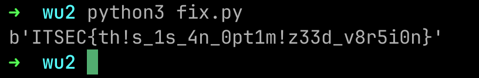<figcaption></figcaption></figure>

Flag: ITSEC{th!s\_1s\_4n\_0pt1m!z33d\_v8r5i0n}
