# Qualifications

<table><thead><tr><th width="347">Challenge</th><th>Topic</th></tr></thead><tbody><tr><td><a href="#nvm-easy">nvm-easy</a></td><td>VM</td></tr><tr><td><a href="#babyv8">BabyV8</a></td><td>NW.JS</td></tr><tr><td><a href="#nvm-hard">nvm-hard</a></td><td>VM</td></tr><tr><td><a href="#minesweeper">minesweeper</a> 🥇</td><td>Cheating Game</td></tr></tbody></table>

## nvm-easy

### Description

\-

### Solution

Two files are given: nvm.exe and easy.vm.bin. Based on the two files provided, it seems this problem refers to a `VM` problem. Run the `easy.vm.bin` file with `nvm.exe`.

<figure>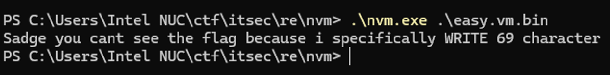<figcaption></figcaption></figure>

The output shows that easy.vm.bin only prints `69` characters, so the objective is to identify the characters that aren't printed. Debug and locate the function that executes the print, assuming the VM logic is in the same function or its `XREF`.  We found function `sub_140068CA0` is the one producing this output.

```cpp
      if ( v6 == *(_DWORD *)(v31 + 36) )
      {
        for ( j = 0; j < (int)v8; ++j )
        {
          v33 = sub_140068B90(a1);
          sub_140069850(v33);
        }
        sub_140069810();
      }
```

The code snippet above prints to the console, so to get the full output, we can change the `v8` value. First, set a breakpoint at function address `140068EA0` and change the value of `EDI` to something larger, like `0x100`. We'll end up with a stack underflow error because the exact length of the stack isn't `0x100`, but we still get the flag.

<figure>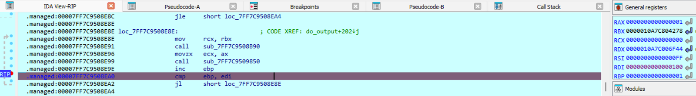<figcaption></figcaption></figure>

<figure>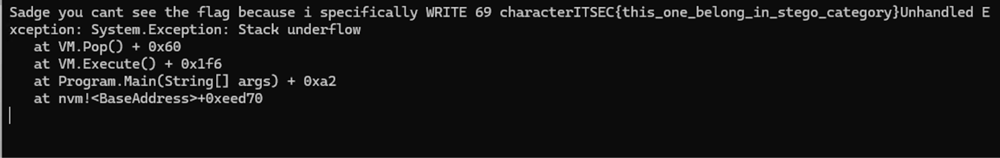<figcaption></figcaption></figure>

Flag: ITSEC{this\_one\_belong\_in\_stego\_category}

## BabyV8

### Description

\-

### Solution

Given following files

<figure>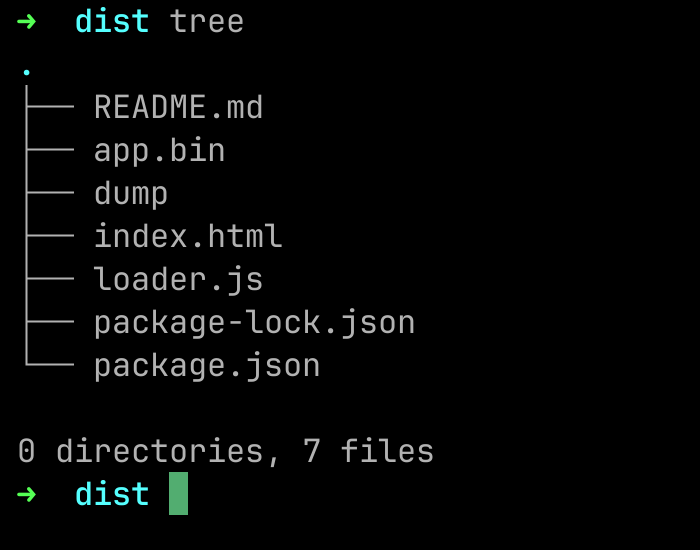<figcaption></figcaption></figure>

The `README.md` file contains a tutorial on how to run the application. So, the application can be run with `NWJS`, and the original JavaScript code has been compiled into `native code` in `app.bin`. To solve this challenge, we downloaded the NWJS SDK with the same version, `0.100.0`. Copy all files to the NWJS SDK directory, then change `loader.js` to the following code

```javascript
  try {
        nw.Window.get().evalNWBin(null, 'app.bin');
        setTimeout(() => {
        try {
            const win = nw.Window.get();
            win.showDevTools('', () => {
                console.log('DevTools opened successfully');
            });
        } catch (devToolsError) {
            console.error('DevTools error:', devToolsError);
        }
    }, 1000);
    } catch (error) {
        console.error('Failed to load binary:', error);
    }
```

Through the data from app.bin we can see several variables such as `correctPositions` and `secret`. Lets print it through console.

<figure>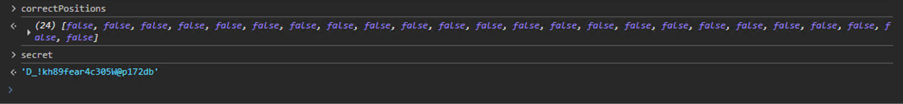<figcaption></figcaption></figure>

As we can see the length of secret corresponds to the length of `correctPositions`. When we try to input 'a' 24 times, we can see the change in `correctPositions`.

<figure>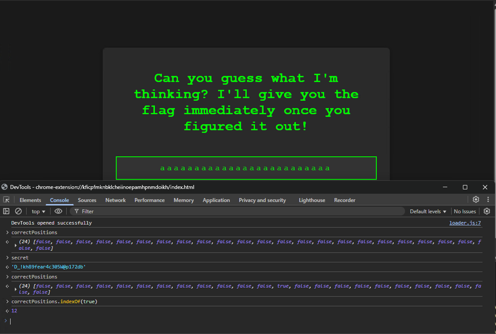<figcaption></figcaption></figure>

We can see that the value changes from false to true at `index 12` after we input the value 'a'. From this, we can see that the correctPositions value will change according to the input we enter. If the value at that index is true, the correctPositions value at that index will also change. Here's the script we use to dump the correctPositions for each value in the secret.

```javascript
async function simulateHumanTyping(inp) {
    const input = passwordInput;
    input.focus();
    input.value = '';
   
    const text = inp.repeat(24);
   
    for (let i = 0; i < text.length; i++) {
        const char = text[i];
       
        await new Promise(resolve => setTimeout(resolve, Math.random() * 100 + 80));
       
        ['keydown', 'keypress'].forEach(eventType => {
            input.dispatchEvent(new KeyboardEvent(eventType, {
                key: char,
                code: `Key${char.toUpperCase()}`,
                keyCode: char.charCodeAt(0),
                which: char.charCodeAt(0),
                bubbles: true,
                cancelable: true
            }));
        });
       
        const pos = input.selectionStart;
        input.value = input.value.slice(0, pos) + char + input.value.slice(input.selectionEnd);
        input.setSelectionRange(pos + 1, pos + 1);
       
        input.dispatchEvent(new Event('input', { bubbles: true }));
       
        await new Promise(resolve => setTimeout(resolve, Math.random() * 30 + 20));
        input.dispatchEvent(new KeyboardEvent('keyup', {
            key: char,
            code: `Key${char.toUpperCase()}`,
            keyCode: char.charCodeAt(0),
            bubbles: true
        }));
    }
   
    console.log(`inp['${inp}'] = [${correctPositions}]`);
    correctPositions = [false, false, false, false, false, false, false, false, false, false, false, false, false, false, false, false, false, false, false, false, false, false, false, false];
}

const characters = "D_!kh89fear4c305W@p172db".split('');
for (var i = 0; i < characters.length; i++) {
    await simulateHumanTyping(characters[i]);   
}
```

<figure>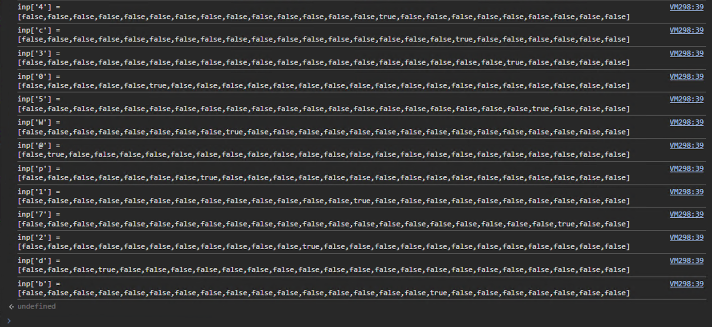<figcaption></figcaption></figure>

Next, copy and make a few corrections because the value of 'h' should be at index 0. Following is the solver we use to map the correct input.

```python
key = 'D_!kh89fear4c305W@p172db'

inp = {}
inp['D'] = [False,False,False,False,False,False,True,False,False,False,False,False,False,False,False,False,False,False,False,False,False,False,False,False]
inp['_'] = [False,False,False,False,False,False,False,False,False,False,True,False,False,False,False,False,False,False,False,False,False,False,False,False]
inp['!'] = [False,False,False,False,False,False,False,False,False,True,False,False,False,False,False,False,False,False,False,False,False,False,False,False]
inp['k'] = [False,False,False,False,True,False,False,False,False,False,False,False,False,False,False,False,False,False,False,False,False,False,False,False]
inp['h'] = [False,False,False,False,False,False,False,False,False,False,False,False,False,False,False,False,False,False,False,False,False,False,False,False]
inp['8'] = [False,False,False,False,False,False,False,False,False,False,False,False,False,False,False,False,False,False,False,False,False,False,False,True]
inp['9'] = [False,False,False,False,False,False,False,False,False,False,False,False,False,False,False,False,False,False,False,False,False,False,True,False]
inp['f'] = [False,False,False,False,False,False,False,False,False,False,False,False,False,False,False,True,False,False,False,False,False,False,False,False]
inp['e'] = [False,False,False,False,False,False,False,False,False,False,False,False,False,False,False,False,False,False,True,False,False,False,False,False]
inp['a'] = [False,False,False,False,False,False,False,False,False,False,False,False,True,False,False,False,False,False,False,False,False,False,False,False]
inp['r'] = [False,False,True,False,False,False,False,False,False,False,False,False,False,False,False,False,False,False,False,False,False,False,False,False]
inp['4'] = [False,False,False,False,False,False,False,False,False,False,False,False,False,False,True,False,False,False,False,False,False,False,False,False]
inp['c'] = [False,False,False,False,False,False,False,False,False,False,False,False,False,False,False,False,False,True,False,False,False,False,False,False]
inp['3'] = [False,False,False,False,False,False,False,False,False,False,False,False,False,False,False,False,False,False,False,True,False,False,False,False]
inp['0'] = [False,False,False,False,False,True,False,False,False,False,False,False,False,False,False,False,False,False,False,False,False,False,False,False]
inp['5'] = [False,False,False,False,False,False,False,False,False,False,False,False,False,False,False,False,False,False,False,False,True,False,False,False]
inp['W'] = [False,False,False,False,False,False,False,False,True,False,False,False,False,False,False,False,False,False,False,False,False,False,False,False]
inp['@'] = [False,True,False,False,False,False,False,False,False,False,False,False,False,False,False,False,False,False,False,False,False,False,False,False]
inp['p'] = [False,False,False,False,False,False,False,True,False,False,False,False,False,False,False,False,False,False,False,False,False,False,False,False]
inp['1'] = [False,False,False,False,False,False,False,False,False,False,False,False,False,True,False,False,False,False,False,False,False,False,False,False]
inp['7'] = [False,False,False,False,False,False,False,False,False,False,False,False,False,False,False,False,False,False,False,False,False,True,False,False]
inp['2'] = [False,False,False,False,False,False,False,False,False,False,False,True,False,False,False,False,False,False,False,False,False,False,False,False]
inp['d'] = [False,False,False,True,False,False,False,False,False,False,False,False,False,False,False,False,False,False,False,False,False,False,False,False]
inp['b'] = [False,False,False,False,False,False,False,False,False,False,False,False,False,False,False,False,True,False,False,False,False,False,False,False]
nice = ['?' for _ in range(24)]
for i in key:
tmp = inp[i]
for j in range(len(tmp)):
if tmp[j] == True:
nice[j] = i
nice[0] = 'h'

print(''.join(nice))

```

<figure>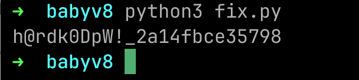<figcaption></figcaption></figure>

<figure>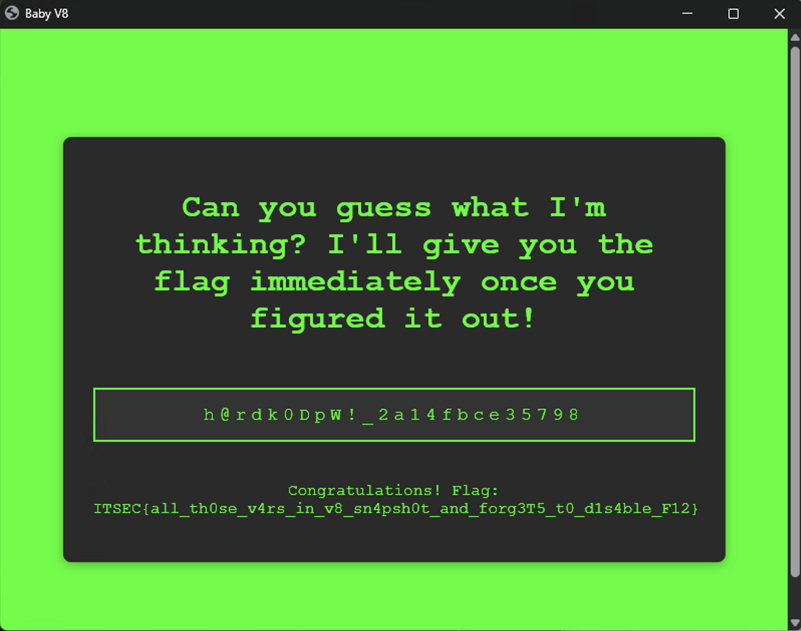<figcaption></figcaption></figure>

Flag: ITSEC{all\_th0se\_v4rs\_in\_v8\_sn4psh0t\_and\_forg3T5\_t0\_d1s4ble\_F12}

## nvm-hard

### Description

\-

### Solution

Given the same executable as `nvm-easy`, but a different VM code file, hard.vm.bin. In the nvm-easy problem, we successfully found a function that writes to the console, but we don't yet know how it generates the string before writing it to the console.

To make the analysis easier, we need to create a simple struct based on some information that we know.

```cpp
struct DynamicArray
{
  void *vtable;
  void *data;
  int count;
  int capacity;
  int field_18;
  int stats_counter;
};

struct OpcodeLookupTable
{
  void *vtable;
  void *opcodes_array;
  int count;
  int opcode_0;
  int opcode_1;
  int opcode_2;
  int opcode_3;
  int opcode_4;
  int opcode_5;
  int opcode_6;
  int opcode_7;
};


struct VMContext
{
  char padding_00[16];
  struct DynamicArray *bytecode;
  struct OpcodeLookupTable *opcodes;
  struct DynamicArray *mem;
  struct DynamicArray *stack;
  char padding_30[72];
  int program_counter;
  char padding_7C[4];
};
```

Since a1 in the `sub_140068CA0` function has a `VMContext` data type, there aren't many functions called in `sub_140068CA0`. We can perform static analysis to determine their use. Rename the function, and here's the decompiled result for the `sub_140068CA0` function.

```cpp
__int64 __fastcall maybe_main_vm(VMContext *a1)
{
  struct DynamicArray *bytecode; // rcx
  __int64 program_counter; // rax
  unsigned int count; // r8d
  unsigned __int64 data; // rcx
  int v6; // esi
  __int64 v7; // rdx
  unsigned int v8; // edi
  struct OpcodeLookupTable *opcodes; // rcx
  struct DynamicArray *stack_pointer_1; // rcx
  _DWORD *stack_data_1; // rdx
  unsigned int v12; // eax
  struct OpcodeLookupTable *v13; // rcx
  struct OpcodeLookupTable *v14; // rcx
  struct OpcodeLookupTable *v15; // rcx
  struct DynamicArray *stack_pointer_2; // rcx
  _DWORD *stack_data_2; // rdx
  unsigned int v18; // eax
  struct OpcodeLookupTable *v19; // rax
  _DWORD *opcodes_array; // rax
  signed int i; // ebp
  int v22; // eax
  struct DynamicArray *mem_pointer_1; // rcx
  _DWORD *mem_data_1; // rdx
  unsigned int v25; // r8d
  struct OpcodeLookupTable *v26; // rcx
  signed int j; // ebp
  unsigned __int16 v28; // ax
  struct OpcodeLookupTable *v29; // rcx
  struct DynamicArray *mem; // rcx
  int v31; // edx
  struct DynamicArray *stack_pointer_3; // rcx
  _DWORD *stack_data_3; // rax
  unsigned int v34; // r8d
  struct OpcodeLookupTable *v35; // rcx
  struct DynamicArray *mem_pointer_2; // rcx
  _DWORD *mem_data_2; // rdx
  unsigned int v38; // eax
  int v39; // ecx

  if ( a1->program_counter < a1->bytecode->count )// length 0xdb6
  {
    do
    {
      bytecode = a1->bytecode;
      program_counter = (unsigned int)a1->program_counter;
      count = bytecode->count;
      if ( (unsigned int)program_counter >= count )
        goto LABEL_58;
      data = (unsigned __int64)bytecode->data;
      if ( (unsigned int)program_counter >= *(_DWORD *)(data + 8) )
        goto LABEL_59;
      v6 = *(_DWORD *)(data + 4 * program_counter + 16);
      v7 = (unsigned int)(a1->program_counter + 1);
      if ( (unsigned int)v7 >= count )
        goto LABEL_58;
      if ( (unsigned int)v7 >= *(_DWORD *)(data + 8) )
        goto LABEL_59;
      v8 = *(_DWORD *)(data + 4 * v7 + 16);
      opcodes = a1->opcodes;
      if ( !opcodes->count )
        goto LABEL_58;
      data = (unsigned __int64)opcodes->opcodes_array;
      if ( !*(_DWORD *)(data + 8) )
        goto LABEL_59;
      if ( v6 == *(_DWORD *)(data + 16) )
      {
        stack_pointer_1 = a1->stack;
        ++stack_pointer_1->capacity;
        stack_data_1 = stack_pointer_1->data;
        v12 = stack_pointer_1->count;
        if ( stack_data_1[2] <= v12 )
        {
          push_a2_to_a1((__int64)stack_pointer_1, v8);
        }
        else
        {
          stack_pointer_1->count = v12 + 1;
          stack_data_1[v12 + 4] = v8;
        }
      }
      v13 = a1->opcodes;
      if ( v13->count <= 1u )
        goto LABEL_58;
      data = (unsigned __int64)v13->opcodes_array;
      if ( *(_DWORD *)(data + 8) <= 1u )
        goto LABEL_59;
      if ( v6 == *(_DWORD *)(data + 20) )
        table_lookup(a1, v8);
      v14 = a1->opcodes;
      if ( v14->count <= 2u )
        goto LABEL_58;
      data = (unsigned __int64)v14->opcodes_array;
      if ( *(_DWORD *)(data + 8) <= 2u )
        goto LABEL_59;
      if ( v6 == *(_DWORD *)(data + 24) && (unsigned int)stack_pop(a1) )
        a1->program_counter = 2 * v8 - 2;
      v15 = a1->opcodes;
      if ( v15->count <= 3u )
        goto LABEL_58;
      data = (unsigned __int64)v15->opcodes_array;
      if ( *(_DWORD *)(data + 8) <= 3u )
        goto LABEL_59;
      if ( v6 == *(_DWORD *)(data + 28) )
      {
        a1->program_counter = a1->bytecode->count;
        stack_pointer_2 = a1->stack;
        ++stack_pointer_2->capacity;
        stack_data_2 = stack_pointer_2->data;
        v18 = stack_pointer_2->count;
        if ( stack_data_2[2] <= v18 )
        {
          push_a2_to_a1((__int64)stack_pointer_2, v8);
        }
        else
        {
          stack_pointer_2->count = v18 + 1;
          data = v18;
          stack_data_2[v18 + 4] = v8;
        }
      }
      v19 = a1->opcodes;
      if ( v19->count <= 4u )
        goto LABEL_58;
      opcodes_array = v19->opcodes_array;
      if ( opcodes_array[2] <= 4u )
        goto LABEL_59;
      if ( v6 == opcodes_array[8] )
      {
        for ( i = 0; i < (int)v8; ++i )
        {
          v22 = System_Console_System_Console__Read();
          if ( v22 == -1 )
            break;
          mem_pointer_1 = a1->mem;
          ++mem_pointer_1->capacity;
          mem_data_1 = mem_pointer_1->data;
          v25 = mem_pointer_1->count;
          if ( mem_data_1[2] <= v25 )
          {
            push_a2_to_a1((__int64)mem_pointer_1, v22);
          }
          else
          {
            mem_pointer_1->count = v25 + 1;
            mem_data_1[v25 + 4] = v22;
          }
        }
      }
      v26 = a1->opcodes;
      if ( v26->count <= 5u )
        goto LABEL_58;
      data = (unsigned __int64)v26->opcodes_array;
      if ( *(_DWORD *)(data + 8) <= 5u )
        goto LABEL_59;
      if ( v6 == *(_DWORD *)(data + 36) )
      {
        for ( j = 0; j < (int)v8; ++j )         // easy nvm
        {
          v28 = stack_pop(a1);
          write_onebyte(v28);
        }
        write_newline();
      }
      v29 = a1->opcodes;
      if ( v29->count <= 6u )
LABEL_58:
        exception_1();
      data = (unsigned __int64)v29->opcodes_array;
      if ( *(_DWORD *)(data + 8) <= 6u )
        goto LABEL_59;
      if ( v6 == *(_DWORD *)(data + 40) )
      {
        mem = a1->mem;
        if ( v8 >= mem->count )
          goto LABEL_58;
        data = (unsigned __int64)mem->data;
        if ( v8 >= *(_DWORD *)(data + 8) )
          goto LABEL_59;
        v31 = *(_DWORD *)(data + 4LL * v8 + 16);
        stack_pointer_3 = a1->stack;
        ++stack_pointer_3->capacity;
        stack_data_3 = stack_pointer_3->data;
        v34 = stack_pointer_3->count;
        if ( stack_data_3[2] <= v34 )
        {
          push_a2_to_a1((__int64)stack_pointer_3, v31);
        }
        else
        {
          stack_pointer_3->count = v34 + 1;
          stack_data_3[v34 + 4] = v31;          // input copied here
        }
      }
      v35 = a1->opcodes;
      if ( v35->count <= 7u )
        goto LABEL_58;
      data = (unsigned __int64)v35->opcodes_array;
      if ( *(_DWORD *)(data + 8) <= 7u )
LABEL_59:
        S_P_CoreLib_Internal_NativeFormat_NativePrimitiveDecoder__ThrowBadImageFormatException_14(data);
      if ( v6 == *(_DWORD *)(data + 44) )
      {
        mem_pointer_2 = a1->mem;
        ++mem_pointer_2->capacity;
        mem_data_2 = mem_pointer_2->data;
        v38 = mem_pointer_2->count;
        if ( mem_data_2[2] <= v38 )
        {
          push_a2_to_a1((__int64)mem_pointer_2, v8);
        }
        else
        {
          mem_pointer_2->count = v38 + 1;
          mem_data_2[v38 + 4] = v8;
        }
      }
      v39 = a1->program_counter + 2;
      a1->program_counter = v39;
    }
    while ( v39 < a1->bytecode->count );
  }
  return stack_pop(a1);
}
```

From the dynamic analysis, the program flow is as follows:&#x20;

* Receive input via console read&#x20;
  * Save the user value in memory&#x20;
* Copy the value from memory to the stack&#x20;
* Process the value from the stack using the `lookup_table` function.  In the `lookup_table`, there are two data items processed:&#x20;
  * User input with a predetermined index&#x20;
  * Static value&#x20;
* After 8 bytes of input are processed, the stack value is checked.&#x20;
  * If the stack pop value == 0, `continue`.&#x20;
  * If the stack pop value == 1, `stop`.

Following is code to do the table lookup

```cpp
_DWORD *__fastcall maybe_table_lookup(VMContext *a1, int a2)
{
  int val1; // edi
  __int64 val2; // rcx
  __int64 v6; // r8
  signed int v7; // r10d
  __int64 v8; // rdx
  __int64 v9; // rax
  __int64 v10; // rdx
  __int64 v11; // rdx
  int processed_val; // edx
  struct DynamicArray *stack_pointer; // rcx
  _DWORD *stack_data; // rax
  unsigned int count; // r8d

  val1 = stack_pop(a1);                         // 0x41
  val2 = (unsigned int)stack_pop(a1);           // 0x2b
  v6 = *(_QWORD *)a1->padding_30;
  v7 = *(_DWORD *)(v6 + 16);
  v8 = (unsigned int)(a2 >> 31);
  LODWORD(v8) = a2 % v7;
  if ( a2 % v7 >= (unsigned int)v7 )
    goto LABEL_8;
  v9 = *(_QWORD *)(v6 + 8);
  if ( (unsigned int)v8 >= *(_DWORD *)(v9 + 8) )
    goto LABEL_9;
  v10 = *(_QWORD *)(v9 + 8 * v8 + 16);
  val2 = (unsigned int)(val1 + ((_DWORD)val2 << 8));// 0x2b41
  if ( (unsigned int)val2 >= *(_DWORD *)(v10 + 16) )
LABEL_8:
    exception_1();
  v11 = *(_QWORD *)(v10 + 8);
  if ( (unsigned int)val2 >= *(_DWORD *)(v11 + 8) )
LABEL_9:
    S_P_CoreLib_Internal_NativeFormat_NativePrimitiveDecoder__ThrowBadImageFormatException_14(val2);
  processed_val = *(_DWORD *)(v11 + 4 * val2 + 16);// data[0x2b41] == 0xea
  stack_pointer = a1->stack;
  ++stack_pointer->capacity;
  stack_data = stack_pointer->data;
  count = stack_pointer->count;
  if ( stack_data[2] <= count )
    return (_DWORD *)push_a2_to_a1((__int64)stack_pointer, processed_val);
  stack_pointer->count = count + 1;
  stack_data[count + 4] = processed_val;
  return stack_data;
}
```

It can be seen that the lookup table implements the following operations

```python
stack_push(data[(val2 << 8) + val1])
```

The next process does the same thing: get the static value, process the input at a specific index, perform a lookup, and so on. So here we can dump all the data needed to reproduce the program's logic.

First set a breakpoint at the following address

* maybe\_main\_vm+FE
* table\_lookup+47
* table\_lookup+57

```python
import idaapi
import idc

def memdump(ea, size, file):
    data = idaapi.get_bytes(ea, size)
    with open(file, "wb") as fp:
        fp.write(data)
        print("Memdump Success!")

all_edi = []
all_ecx = []
all_edx = []
all_rdx = []

list_edi = []
list_ecx = []
list_edx = []
list_rdx = []

list_eax = []

for i in range(864):
    print(i)
   
    rv = idaapi.regval_t()
    idaapi.get_reg_val('rip', rv)
    rip = rv.ival

    inst = idc.print_insn_mnem(rip)
    if inst == 'test':
        rv = idaapi.regval_t()
        idaapi.get_reg_val('eax', rv)
        eax = rv.ival
        list_eax.append(eax)

        rv = idaapi.regval_t()
        rv.ival = 0x0
        idaapi.set_reg_val("eax", rv)

        all_ecx.append(list_ecx)
        all_edx.append(list_edx)
        all_edi.append(list_edi)
        all_rdx.append(list_rdx)

        list_edi = []
        list_ecx = []
        list_edx = []
        list_rdx = []


        idaapi.continue_process()
        idaapi.wait_for_next_event(idaapi.WFNE_SUSP, -1)
    elif inst == 'call':
        break
    else:
        rv = idaapi.regval_t()
        idaapi.get_reg_val('ecx', rv)
        ecx = rv.ival
        list_ecx.append(ecx)

        rv = idaapi.regval_t()
        idaapi.get_reg_val('edi', rv)
        edi = rv.ival
        list_edi.append(edi)

        idaapi.continue_process()
        idaapi.wait_for_next_event(idaapi.WFNE_SUSP, -1)

        rv = idaapi.regval_t()
        idaapi.get_reg_val('rdx', rv)
        rdx = rv.ival
        list_rdx.append(rdx)

        idaapi.step_into()
        idaapi.wait_for_next_event(idaapi.WFNE_SUSP, -1)

        rv = idaapi.regval_t()
        idaapi.get_reg_val('edx', rv)
        edx = rv.ival
        list_edx.append(edx)

        idaapi.continue_process()
        idaapi.wait_for_next_event(idaapi.WFNE_SUSP, -1)


print(all_edi)
print(all_ecx)
print(all_edx)
print(all_rdx)
print(list_eax)

uniq_rdx = []
for i in all_rdx:
    for j in i:
        if j not in uniq_rdx:
            uniq_rdx.append(j)


print(uniq_rdx)

for i in range(len(uniq_rdx)):
    address = uniq_rdx[i]
    size = 262140 + 0x20 # add little junk
    file = f"C:\\Users\\Intel NUC\\ctf\\itsec\\re\\nvmhard\\dump{i}.bin"
    memdump(address, size, file)
```

Next, we can check the values that were validated and we get the following pattern.

```python
from Crypto.Util.number import *
import string
from itertools import product

all_edi = <output from ida>
all_ecx = <output from ida>
all_edx = [<output from ida>

used_dump = <output from ida>
index_dump = <output from ida>

all_dumps = []
for i in range(len(index_dump)):
	f = open(f"dump/dump{i}.bin", "rb").read()
	f = f[0x10:]
	data = []
	for j in range(0, len(f), 4):
		data.append(bytes_to_long(f[j:j+4][::-1]))
	all_dumps.append(data)

inp = b"0123456789abcdefghijklmnopqrstuvwxyzABCDEFGHIJKL"

all_mapped = []
for i in all_edi:
	mapped_index = []
	for j in range(0, len(i) - 2, 2):
		mapped_index.append(inp.index(i[j]))
	assert len(mapped_index) == 8
	all_mapped.append(mapped_index)

for i in all_mapped:
	print(i)
```

<figure>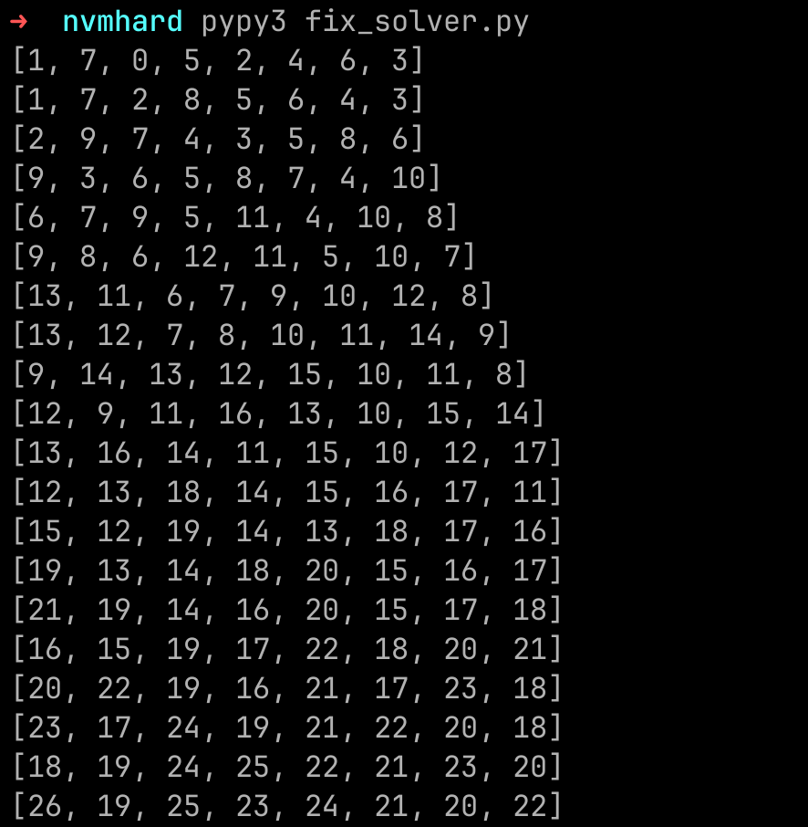<figcaption></figcaption></figure>

It can be seen that there is a pattern for each check.

* For the first check, there is an additional check byte, `index 8`.
* For the second check, there is an additional check byte, `index 9`.
* And so on.

Since we already have the first 6 bytes, `ITSEC{`, we need to bruteforce `2 bytes` on the first check, but on subsequent checks we only need `1 byte`. The problem is that there are multiple valid values for some of the initial checks, such as for the first 8 bytes there is more than 1 valid value. However, we can `eliminate` the possibilities that have been found in subsequent iterations and finally get only 1 valid value, namely `flag`. Following is the solver we used

```python
from Crypto.Util.number import *
import string
from itertools import product

all_edi = <output from ida>
all_ecx = <output from ida>
all_edx = <output from ida>

used_dump = <output from ida>
index_dump = <output from ida>

all_dumps = []
for i in range(len(index_dump)):
	f = open(f"dump/dump{i}.bin", "rb").read()
	f = f[0x10:]
	data = []
	for j in range(0, len(f), 4):
		data.append(bytes_to_long(f[j:j+4][::-1]))
	all_dumps.append(data)

inp = b"0123456789abcdefghijklmnopqrstuvwxyzABCDEFGHIJKL"

all_mapped = []
for i in all_edi:
	mapped_index = []
	for j in range(0, len(i) - 2, 2):
		mapped_index.append(inp.index(i[j]))
	assert len(mapped_index) == 8
	all_mapped.append(mapped_index)

ori = b"\x00" * 48
ori = list(ori)
known = b"ITSEC{"

for i in range(len(known)):
	ori[i] = known[i]

list_char = string.printable[:-6].encode()
list_char = list(list_char)
poss = [ori]

for i in range(len(all_mapped)):
	new_poss = []
	for tmp_inp in poss:
		unknown = []
		for unk in all_mapped[i]:
			if tmp_inp[unk] == 0:
				unknown.append(unk)
		length_unknown = len(unknown)
		for bf in product(list_char, repeat=length_unknown):
			
			inp = tmp_inp[:]
			for k in range(length_unknown):
				inp[unknown[k]] = bf[k]
			init = all_ecx[i][0]
			
			counter = 0
			for j in range(len(all_mapped[i])):
				init += inp[all_mapped[i][j]]
				data = all_dumps[index_dump.index(used_dump[i][counter])]
				counter += 1
				init = data[init]
				init <<= 8
				init += all_edi[i][j*2 + 1]
				data = all_dumps[index_dump.index(used_dump[i][counter])]
				counter += 1
				init = data[init]
				init <<= 8
			data = all_dumps[index_dump.index(used_dump[i][counter])]
			init += all_edi[i][16]
			init = data[init]
			
			if init == 0:
				new_poss.append(inp)
	
	poss = new_poss[:]

for i in poss:
	print(bytes(i))
```

And it only takes 0.09 seconds to get the whole flag

<figure>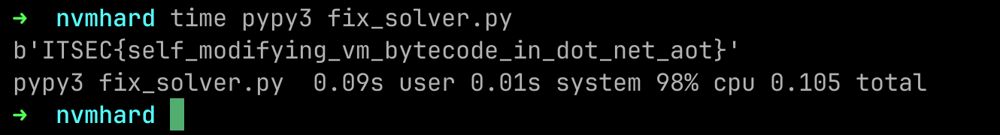<figcaption></figcaption></figure>

Flag: ITSEC{self\_modifying\_vm\_bytecode\_in\_dot\_net\_aot}

## minesweeper

### Description

\-

### Solution

Given the executable file and assets, run the executable file and you'll see a Minesweeper game. Just like in a typical Minesweeper game, if you hit the wrong block, you lose.

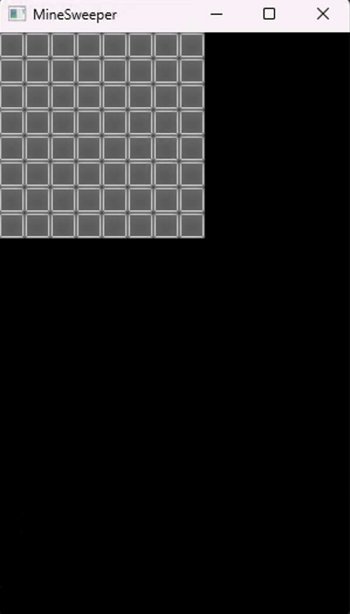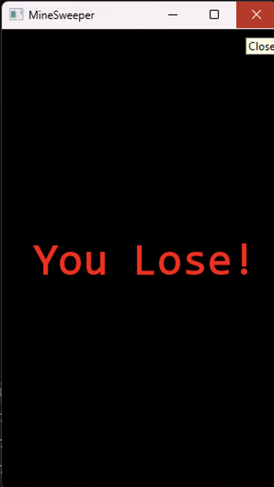

\
Decompile with IDA, and we'll initiate the win message in the main function, `"You win!!"`. Entering the `sub_6D38B0` function, we'll see the asset initiation process, or the function to load assets. Next, we'll find the following code snippet

```cpp
while ( (unsigned __int8)sub_42B360(v19[2]) )
  {
    sub_403F80(v19);
    sub_404180(v6, v10);
  }
```

By placing a breakpoint in the code above, we can see that this piece of code represents the game's logic and will stop when a win or loss condition is reached. The `sub_42B360` function checks whether a property has a value other than 0. If so, the loop continues.&#x20;

In the `sub_403F80` function, we can focus on one of the functions called, `sub_402220`, which checks whether a block is mined. `sub_402220` has three arguments, the second is the `x-coordinate` and the third is the `y-coordinate`. The first argument contains game information and constants needed to detect whether a coordinate is mined. The first argument also stores a value that will later be used to validate whether we won the game. `sub_404180` checks whether we lost, are still playing, or won.&#x20;

If we win, the process of validating the win and decrypting the flag is performed; this function is called `sub_401BF0`. The `sub_401BF0` function accepts the same first argument as the `mine detection function`. To simplify our process, let's create a struct based on the information we know.

```cpp
struct MineCell
{
  char has_mine;
  char is_revealed;
  char is_flagged;
  char padding;
  int adjacent_mine_count;
};

struct GameContext
{
  unsigned int grid_width;
  unsigned int grid_height;
  unsigned int unknown_08;
  unsigned int multiplier;
  MineCell *mine_field_ptr;
  unsigned int unknown_14[10];
  unsigned int constant_1;
  unsigned int rng_seed;
  unsigned int grid_param1;
  unsigned int grid_param2;
  unsigned int unknown_48;
  unsigned int queue_head;
  unsigned int queue_tail;
  unsigned int *queue_begin;
  unsigned int *queue_end;
};

struct MineSweeper
{
  void *unknown_0[2];
  void *handler_ptr;
  char unknown_12[12];
  char ui_data[284];
  char game_data[183];
  GameContext *game_context;
  unsigned __int8 game_over;
  unsigned __int8 win_state_initialized;
  char win_message[100];
  int grid_width;
  int grid_height;
  char unknown_500[8];
  void *mine_field;
  char unknown_512[56];
  int remaining_count;
  char unknown_572[12];
  unsigned __int8 state_flag;
  char unknown_585[100];
};
```

And following is the decompiled results of `mine_detection` after we rename and implement the struct

```cpp
int __thiscall mine_detection(GameContext *game_context, int x, int y)
{
  MineCell *result; // eax
  int v4; // ebx
  unsigned int v5; // esi
  signed int v6; // edi
  MineCell *v7; // ebx
  int v8; // edi
  signed int v9; // esi
  MineCell *v10; // ebx
  MineCell *v11; // ebx
  int v12; // edi
  signed int v13; // esi
  int v14; // edx
  signed int v15; // edi
  int v16; // edx
  signed int v17; // [esp+Ch] [ebp-Ch]
  signed int v18; // [esp+10h] [ebp-8h]
  int v19; // [esp+10h] [ebp-8h]
  int v20; // [esp+14h] [ebp-4h]

  if ( x >= 0 )
  {
    v4 = y;
    if ( y >= 0 && x < (signed int)game_context->grid_width && y < (signed int)game_context->grid_height )
    {
      result = game_context->mine_field_ptr;
      v5 = y + x * game_context->grid_width;
      if ( !result[v5].is_revealed && !result[v5].is_flagged )
      {
        result[v5].is_revealed = 1;
        v6 = game_context->rng_seed * game_context->grid_param1 + 1;
        v18 = v4 + x * game_context->grid_width;
        if ( (signed int)game_context->constant_1 % v6
          * ((signed int)game_context->constant_1 % v6 * (v18 % v6) % v6 % v6)
          % v6 < 48 )
        {
          result = game_context->mine_field_ptr;
          result[v18].has_mine = 1;
          LOBYTE(result) = 1;
          return (int)result;
        }
        v19 = -1;
        v20 = x - 1;
        while ( 1 )
        {
          v7 = &game_context->mine_field_ptr[v4 + x * game_context->grid_width];
          v8 = (signed int)game_context->constant_1
            % (signed int)(game_context->rng_seed * game_context->grid_param1 + 1);
          v9 = game_context->rng_seed * game_context->grid_param1 + 1;
          v7->adjacent_mine_count += v8 * (v8 * ((signed int)(v20 * game_context->grid_width + y - 1) % v9) % v9 % v9)
                                  % v9 < 48;
          if ( v19 )
          {
            v17 = game_context->rng_seed * game_context->grid_param1 + 1;
            v10 = &game_context->mine_field_ptr[y + x * game_context->grid_width];
            v10->adjacent_mine_count += (signed int)game_context->constant_1 % v17
                                      * ((signed int)game_context->constant_1 % v17
                                      * ((signed int)(y + v20 * game_context->grid_width) % v17)
                                      % v17
                                      % v17)
                                      % v17 < 48;
          }
          v11 = &game_context->mine_field_ptr[y + x * game_context->grid_width];
          v12 = (signed int)game_context->constant_1
              % (signed int)(game_context->rng_seed * game_context->grid_param1 + 1);
          v13 = game_context->rng_seed * game_context->grid_param1 + 1;
          v14 = v12 * (v12 * ((signed int)(v20 * game_context->grid_width + y + 1) % v13) % v13 % v13) % v13;
          ++v20;
          v11->adjacent_mine_count += v14 < 48;
          if ( ++v19 > 1 )
            break;
          v4 = y;
        }
        v15 = game_context->rng_seed * game_context->grid_param1 + 1;
        v16 = (signed int)game_context->constant_1 % v15 * ((signed int)(y + x * game_context->grid_width) % v15) % v15;
        result = (MineCell *)game_context->queue_tail;
        y = v16;
        if ( result != (MineCell *)game_context->queue_begin )
        {
          *(_DWORD *)&result->has_mine = v16;
          game_context->queue_tail += 4;
          LOBYTE(result) = 0;
          return (int)result;
        }
        result = (MineCell *)sub_6D25F0((const void **)&game_context->queue_head, result, &y);
      }
    }
  }
  LOBYTE(result) = 0;
  return (int)result;
}
```

The next step is to convert the code to get a `map of the mine` so we can find out which coordinates have mines.

```python
import sys
from typing import List, Tuple, Optional

class MinePredictor:   
    def __init__(self, grid_width: int, grid_height: int, rng_seed: int,
                grid_param1: int, grid_param2: int, constant: int):
        self.grid_width = grid_width
        self.grid_height = grid_height
        self.rng_seed = rng_seed
        self.grid_param1 = grid_param1
        self.grid_param2 = grid_param2
        self.constant = constant
       
        self.modulus = rng_seed * grid_param1 + 1
       
        self.rng_multiplier = constant % self.modulus
       
        self.MINE_THRESHOLD = 48
   
    def is_mine_at(self, x: int, y: int) -> bool:
        if x < 0 or y < 0 or x >= self.grid_width or y >= self.grid_height:
            return False
       
        position = y + x * self.grid_width
       
        modulus = self.rng_seed * self.grid_param1 + 1
       
        multiplier = self.constant % modulus
       
        pos_mod = position % modulus
        inner_calc = (multiplier * pos_mod) % modulus
        inner_calc = inner_calc % modulus  # Double modulus
        rng_result = (multiplier * inner_calc) % modulus
       
        return rng_result < self.MINE_THRESHOLD
   
    def print_mine_map(self, show_numbers: bool = False):
        print()
        print("   ", end="")
        for x in range(self.grid_width):
            print(f"{x:2d}", end="")
        print()
       
        # Print rows
        nice = []
        for y in range(self.grid_height):
            print(f"{y:2d} ", end="")
            for x in range(self.grid_width):
                if self.is_mine_at(x, y):
                    print(" *", end="")
                else:
                    print(" .", end="")
                    nice.append([x, y])
            print()
        print()
        print(f"coordinates = {nice}")


width = 8
height = 8 
seed = 8
param1 = 8
param2 = 8
constant = 88403651
predictor = MinePredictor(width, height, seed, param1, param2, constant)
predictor.print_mine_map()
```

<figure>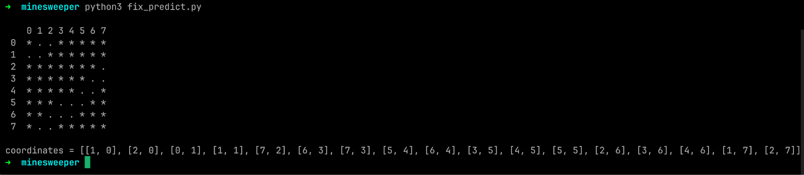<figcaption></figcaption></figure>

Now we know which coordinates to open. However, we can't get the flag simply by opening the correct coordinates; we also need to open the coordinates in the `correct order`. We can determine this from the program's decrypt and validation functions, namely `sub_6D1BF0` (the base address changes to `0x6D0000`).

```cpp
void *__userpurge validate_and_decrypt@<eax>(GameContext *a1@<ecx>, int a2@<ebp>, void *a3)
{
  GameContext *v3; // edx
  unsigned int *p_queue_head; // edi
  char *v5; // ecx
  int v6; // eax
  int v7; // edx
  int v8; // esi
  _DWORD *v9; // ecx
  int v10; // kr00_4
  unsigned int v11; // eax
  int v12; // ecx
  int multiplier; // esi
  int v14; // edi
  unsigned int v15; // ecx
  int v16; // edi
  unsigned __int64 v17; // kr08_8
  int v18; // eax
  int v19; // eax
  void *index_3; // eax
  int v21; // edi
  int v22; // ecx
  int v23; // esi
  int v24; // edx
  _BYTE *v25; // eax
  _BYTE *v26; // edx
  int i; // ecx
  GameContext *queue_end; // esi
  int v29; // edi
  bool v30; // zf
  int v31; // edi
  int v32; // eax
  unsigned int v33; // edi
  unsigned int v34; // edx
  unsigned int v35; // ecx
  GameContext *v36; // esi
  unsigned int j; // eax
  int v38; // edx
  int v39; // edx
  int v40; // edx
  int v41; // edx
  int v42; // edi
  GameContext *v43; // eax
  int index_1; // [esp-148h] [ebp-154h]
  int v45; // [esp-144h] [ebp-150h]
  int v46; // [esp-140h] [ebp-14Ch]
  int v47; // [esp-128h] [ebp-134h]
  int v48; // [esp-128h] [ebp-134h]
  _DWORD v49[3]; // [esp-124h] [ebp-130h] BYREF
  __int128 v50; // [esp-118h] [ebp-124h]
  __int16 v51; // [esp-108h] [ebp-114h]
  GameContext *v52; // [esp-104h] [ebp-110h]
  int index_0; // [esp-100h] [ebp-10Ch]
  int v54; // [esp-FCh] [ebp-108h]
  int v55; // [esp-C8h] [ebp-D4h]
  int v56; // [esp-C4h] [ebp-D0h]
  _BYTE v57[64]; // [esp-B8h] [ebp-C4h]
  int v58; // [esp-78h] [ebp-84h]
  _BYTE v59[32]; // [esp-70h] [ebp-7Ch] BYREF
  _BYTE v60[36]; // [esp-50h] [ebp-5Ch] BYREF
  __int128 v61; // [esp-2Ch] [ebp-38h]
  int v62; // [esp-1Ch] [ebp-28h] BYREF
  _DWORD v63[5]; // [esp-18h] [ebp-24h] BYREF
  int v64; // [esp-4h] [ebp-10h]
  int v65; // [esp+0h] [ebp-Ch]
  void *v66; // [esp+4h] [ebp-8h]
  int v67; // [esp+8h] [ebp-4h] BYREF
  void *retaddr; // [esp+Ch] [ebp+0h]

  v65 = a2;
  v66 = retaddr;
  v64 = -1;
  v63[4] = &loc_770F1D;
  v63[3] = NtCurrentTeb()->NtTib.ExceptionList;
  v63[2] = &v67;
  v3 = a1;
  v52 = a1;
  p_queue_head = &a1->queue_head;
  v5 = 0;
  v6 = (int)(p_queue_head[1] - *p_queue_head) >> 2;
  index_0 = 0;
  v63[0] = p_queue_head;
  if ( v6 )
  {
    do
    {
      v7 = 0;
      v54 = (int)(v5 + 4);
      v8 = (int)v5;
      if ( !__OFSUB__(v5, v5 + 4) )
      {
        do
        {
          v9 = (_DWORD *)(*p_queue_head + 4 * v8++);
          v7 = *v9 | (v7 << 8);
          *v9 = (unsigned __int8)*v9;
        }
        while ( v8 < v54 );
        v5 = (char *)index_0;
      }
      v10 = (int)v5;
      v5 = (char *)v54;
      *((_DWORD *)&v61 + v10 / 4) = v7;
      v11 = (int)(p_queue_head[1] - *p_queue_head) >> 2;
      index_0 = (int)v5;
    }
    while ( (unsigned int)v5 < v11 );
    v3 = v52;
  }
  v12 = 10;
  multiplier = v3->multiplier;
  v14 = v3->rng_seed * v3->grid_param1 + 1;
  v45 = v14;
  v47 = (signed int)v3->constant_1 % v14;
  do
  {
    v46 = v12 - 1;
    v15 = 0xABFDFFBD;
    do
    {
      multiplier = v47 * (multiplier % v14) % v14;
      --v15;
    }
    while ( v15 );
    index_0 = DWORD2(v61);
    v17 = *(_QWORD *)((char *)&v61 + 4);
    LODWORD(v50) = HIDWORD(v17);
    v16 = v17;
    v18 = calc_1(SDWORD1(v61), multiplier);
    index_1 = v61 ^ v18;
    DWORD1(v50) = v61 ^ v18;
    v54 = (int)(v61
              - 1123996597
              * (((int)((unsigned __int64)(512866991LL * (int)v61) >> 32) >> 27)
              + ((unsigned int)((unsigned __int64)(512866991LL * (int)v61) >> 32) >> 31))) >> 31;
    DWORD2(v50) = (int)(index_0
                      - 1123996597
                      * (((int)((unsigned __int64)(512866991LL * index_0) >> 32) >> 27)
                      + ((unsigned int)((unsigned __int64)(512866991LL * index_0) >> 32) >> 31)))
                * (__int64)(int)(v61
                              - 1123996597
                              * (((int)((unsigned __int64)(512866991LL * (int)v61) >> 32) >> 27)
                                + ((unsigned int)((unsigned __int64)(512866991LL * (int)v61) >> 32) >> 31)))
                % 1123996597
                * ((v16 + (__int64)SHIDWORD(v61)) % 1123996597)
                % 1123996597;
    v19 = calc_1(index_0, multiplier);
    index_3 = (void *)(DWORD1(v61) ^ v19);
    v12 = v46;
    HIDWORD(v50) = index_3;
    v61 = v50;
    v14 = v45;
  }
  while ( v46 );
  if ( index_0 == 342066253 && index_1 == 686880041 && DWORD2(v50) == 828922036 && index_3 == (void *)509868183 )
  {
    v21 = v63[0];
    v22 = 0;
    v54 = 0;
    do
    {
      v23 = v52->grid_param1 * v52->rng_seed + 1;
      v24 = (signed int)v52->constant_1 % v23 * (*(_DWORD *)(v22 + *(_DWORD *)v21) % v23) % v23;
      v25 = *(_BYTE **)(v21 + 4);
      v63[0] = v24;
      if ( v25 == *(_BYTE **)(v21 + 8) )
      {
        sub_6D25F0((const void **)v21, v25, v63);
      }
      else
      {
        *(_DWORD *)v25 = v24;
        *(_DWORD *)(v21 + 4) += 4;
      }
      v22 = v54 + 4;
      v54 = v22;
    }
    while ( v22 < 64 );
    v26 = *(_BYTE **)v21;
    for ( i = 0; i < 32; i += 4 )
    {
      v60[i] = v26[4 * i];
      v60[i + 1] = v26[4 * i + 4];
      v60[i + 2] = v26[4 * i + 8];
      v60[i + 3] = v26[4 * i + 12];
    }
    v62 = 915433456;
    v63[0] = 392537330;
    *(_QWORD *)((char *)&v61 + 4) = 0LL;
    v49[0] = 2078981252;
    v49[1] = 406946880;
    v49[2] = -607402235;
    *(_QWORD *)&v50 = 0x9185733C62E8F422uLL;
    *((_QWORD *)&v50 + 1) = 0x4DCD4172D214DB83LL;
    v51 = 200;
    HIDWORD(v61) = 0;
    v52 = 0;
    index_0 = (int)operator new(0x1Eu);
    queue_end = (GameContext *)index_0;
    DWORD1(v61) = index_0;
    v54 = index_0 + 30;
    HIDWORD(v61) = index_0 + 30;
    memmove((void *)index_0, v49, 0x1Eu);
    DWORD2(v61) = v54;
    v29 = v54;
    v52 = queue_end;
    v64 = 0;
    sub_6D13A0(v60, &v62);
    v31 = v29 - (_DWORD)v52;
    v30 = v31 == 0;
    v32 = 64;
    v48 = v31;
    v58 = 64;
    v55 = 0;
    v56 = 0;
    v33 = 0;
    if ( !v30 )
    {
      v34 = v48;
      v35 = 64;
      v36 = v52;
      do
      {
        if ( v35 >= 0x40 )
        {
          sub_6D1530(v59);
          for ( j = 0; j < 0x40; j += 16 )
          {
            v38 = *(_DWORD *)&v59[j];
            *(_WORD *)&v57[j] = v38;
            v57[j + 2] = BYTE2(v38);
            v57[j + 3] = HIBYTE(v38);
            v39 = *(_DWORD *)&v59[j + 4];
            *(_WORD *)&v57[j + 4] = v39;
            v57[j + 6] = BYTE2(v39);
            v57[j + 7] = HIBYTE(v39);
            v40 = *(_DWORD *)&v59[j + 8];
            *(_WORD *)&v57[j + 8] = v40;
            v57[j + 10] = BYTE2(v40);
            v57[j + 11] = HIBYTE(v40);
            v41 = *(_DWORD *)&v59[j + 12];
            *(_WORD *)&v57[j + 12] = v41;
            v57[j + 14] = BYTE2(v41);
            v57[j + 15] = HIBYTE(v41);
          }
          v34 = v48;
          v32 = 0;
          v58 = 0;
        }
        *((_BYTE *)&v36->grid_width + v33++) ^= v57[v32];
        v32 = v58 + 1;
        v58 = v32;
        v35 = v32;
      }
      while ( v33 < v34 );
      queue_end = (GameContext *)index_0;
    }
    v42 = v54 - (_DWORD)queue_end;
    memcpy(a3, queue_end, v54 - (_DWORD)queue_end);
    index_3 = a3;
    *((_BYTE *)a3 + v42) = 0;
    if ( queue_end )
    {
      v43 = queue_end;
      if ( (unsigned int)(HIDWORD(v61) - (_DWORD)queue_end) >= 0x1000 )
      {
        queue_end = (GameContext *)queue_end[-1].queue_end;
        if ( (unsigned int)((char *)v43 - (char *)queue_end - 4) > 0x1F )
          invalid_parameter_noinfo_noreturn();
      }
      return (void *)sub_76F7E3(queue_end);
    }
  }
  return index_3;
}
```

The values processed by the `validate_and_decrypt` function are generated by the `mine_detection` function and placed in a queue. In the `validate_and_decrypt` function, these values are stored in `v61`. Therefore, we can reconstruct the conversion from coordinates to values in the queue later.&#x20;

The following code snippet is important to note, as it slows down the validation process

```cpp
    v15 = 0xABFDFFBD;
    do
    {
      multiplier = v47 * (multiplier % v14) % v14;
      --v15;
    }
    while ( v15 );
```

We can `optimize` this piece of code into the following equation

```python
((v47^v15 % v14) * multiplier) % v14
```

Next there is the `calc_1` function which looks like it has been `obfuscated`.

```cpp
__int64 __stdcall calc_1(int a1, int a2)
{
  unsigned int v2; // ecx

  v2 = 1123996597
    * (((int)((unsigned __int64)(512866991LL * a2) >> 32) >> 27)
      + ((unsigned int)((unsigned __int64)(512866991LL * a2) >> 32) >> 31));
  return ((int)(a2 - v2)
        * (__int64)(int)(a1
                      - 1123996597
                      * (((int)((unsigned __int64)(512866991LL * a1) >> 32) >> 27)
                        + ((unsigned int)((unsigned __int64)(512866991LL * a1) >> 32) >> 31)))
        + a2
        - 1123996597
        * ((int)(a2 - v2)
        * (__int64)(int)(a1
                        - 1123996597
                        * (((int)((unsigned __int64)(512866991LL * a1) >> 32) >> 27)
                        + ((unsigned int)((unsigned __int64)(512866991LL * a1) >> 32) >> 31)))
        / 1123996597))
      % 1123996597;
}
```

So we need to convert the above operations, here are the results

```python
import ctypes

def sub_6D1B60( a1: int, a2: int) -> int:
    MAGIC_DIVISOR = 512866991
    LARGE_PRIME = 1123996597
   
    a1 = ctypes.c_int32(a1).value
    a2 = ctypes.c_int32(a2).value
   
    mul_result_a2 = (MAGIC_DIVISOR * a2) & 0xFFFFFFFFFFFFFFFF
    high_32_a2 = (mul_result_a2 >> 32) & 0xFFFFFFFF
    term1_a2 = ctypes.c_int32(high_32_a2).value >> 27
    term2_a2 = (high_32_a2 >> 31) & 1
    v2 = LARGE_PRIME * (term1_a2 + term2_a2)
    mul_result_a1 = (MAGIC_DIVISOR * a1) & 0xFFFFFFFFFFFFFFFF
    high_32_a1 = (mul_result_a1 >> 32) & 0xFFFFFFFF
    term1_a1 = ctypes.c_int32(high_32_a1).value >> 27
    term2_a1 = (high_32_a1 >> 31) & 1
    adjusted_a1 = a1 - LARGE_PRIME * (term1_a1 + term2_a1)
    adjusted_a2 = a2 - v2
   
    product = adjusted_a2 * adjusted_a1
    division_result = product // LARGE_PRIME
    reduction_term = LARGE_PRIME * division_result
    result = (product + a2 - reduction_term) % LARGE_PRIME
    result = result & 0xFFFFFFFF
   
    return result
```

If we look at the pattern of values, we will see that many operations are actually just wrapping to GF(p). So we can simplify the above function to

```python
a1_mod = a1 % MOD
a2_mod = a2 % MOD       
result = (a2_mod * a1_mod + a2) % MOD
```

Continue to the next code

```cpp
DWORD2(v50) = (int)(index_0
                      - 1123996597
                      * (((int)((unsigned __int64)(512866991LL * index_0) >> 32) >> 27)
                      + ((unsigned int)((unsigned __int64)(512866991LL * index_0) >> 32) >> 31)))
                * (__int64)(int)(v61
                              - 1123996597
                              * (((int)((unsigned __int64)(512866991LL * (int)v61) >> 32) >> 27)
                                + ((unsigned int)((unsigned __int64)(512866991LL * (int)v61) >> 32) >> 31)))
                % 1123996597
                * ((v16 + (__int64)SHIDWORD(v61)) % 1123996597)
                % 1123996597;
```

In the same way we can `simplify` it to the following operation

```python
index_1_mod = index_1 % MOD
v60_low_mod = v60_low % MOD       
sum_mod = (v16 + v60_high) % MOD
result = (index_1_mod * v60_low_mod % MOD * sum_mod) % MOD
```

Next we reconstruct the entire function to produce the values that are compared in the program.

```python
def calc_1(a1, a2):
    MOD = 1123996597
   
    a1_mod = a1 % MOD
    a2_mod = a2 % MOD
   
    result = (a2_mod * a1_mod + a2) % MOD
   
    return result & 0xFFFFFFFF

def calc_2(index_1, v60_low, v60_high, v16):
    MOD = 1123996597
   
    index_1_mod = index_1 % MOD
    v60_low_mod = v60_low % MOD
   
    sum_mod = (v16 + v60_high) % MOD
   
    result = (index_1_mod * v60_low_mod % MOD * sum_mod) % MOD
   
    return result
   
def encrypt(game_context, vector_data):
    v13 = game_context['constant']
    v14 = game_context['grid_param1'] * game_context['grid_param2'] + 1
    v47 = game_context['rng_seed'] % v14
   
    state = vector_data
    current_seed = v13
    multiplier = 0xb
    v15 = 0x0ABFDFFBD

    for round_num in range(10):
       
        current_seed = (pow(multiplier, v15, v14) * current_seed) % v14
        temp1 = state[0] ^ calc_1(state[1], current_seed)
        v49 = calc_2(state[2], state[0], state[1], state[3])
        temp2 = calc_1(state[2], current_seed)
       
        new_state = [
            state[2], # done
            temp1,
            v49,
            state[1] ^ temp2 # done
        ]
        state = new_state
    return state
   

vector_data = [0x3A231C05,0x2F28113B,0x341D4029,0x35222E17,0x0B0D0DAB]

game_context = {
    'rng_seed': 8,
    'grid_param1': 8,
    'grid_param2': 8,
    'constant': 88403651
}

print(encrypt(game_context, vector_data))
```

After validating the program and getting the same results, we need to `reverse` the function because the operation appears to be `reversible`.

First, let's look at the `state` generated in each round.

```python
new_state = [
state[2],
temp1,
v49,
state[1] ^ temp2
]
```

From the resulting state, we can return the value to the `previous state`.

```python
old_state[2] = new_state[0]
old_state[1] = new_state[3] ^ calc_1(old_state[2], current_seed)
old_state[0] = new_state[1] ^ calc_1(old_state[1], current_seed)
```

From the above operation, only old\_state\[3] has not been returned. Old\_state\[3] is used in the calc\_2 function and its value is stored in new\_state\[2]. So we need to reverse `calc_2` using the known values, namely state\[0], state\[1], and state\[2].

```python
index_1_mod = index_1 % MOD
v60_low_mod = v60_low % MOD
tmp = index_1_mod * v60_low_mod
tmp %= MOD
tmp2 = (inverse(tmp, MOD) * result) % MOD
tmp2 -= v60_high
tmp2 %= MOD # old_state[3]
```

The next step is to create a decrypt function, here is the script we created

```python
from Crypto.Util.number import *

def rev_calc_2(index_1, v60_low, v60_high, result):
    MOD = 1123996597
    index_1_mod = index_1 % MOD
    v60_low_mod = v60_low % MOD
    tmp = index_1_mod * v60_low_mod
    tmp %= MOD
    tmp2 = (inverse(tmp, MOD) * result) % MOD
    tmp2 -= v60_high
    tmp2 %= MOD
    return tmp2

def calc_1(a1, a2):
    MOD = 1123996597
   
    a1_mod = a1 % MOD
    a2_mod = a2 % MOD
   
    result = (a2_mod * a1_mod + a2) % MOD
   
    return result & 0xFFFFFFFF

def calc_2(index_1, v60_low, v60_high, v16):
    MOD = 1123996597
   
    index_1_mod = index_1 % MOD
    v60_low_mod = v60_low % MOD
   
    sum_mod = (v16 + v60_high) % MOD
   
    result = (index_1_mod * v60_low_mod % MOD * sum_mod) % MOD
   
    return result
   
def encrypt(game_context, vector_data):
    v13 = game_context['constant']
    v14 = game_context['grid_param1'] * game_context['grid_param2'] + 1
    v47 = game_context['rng_seed'] % v14
   
    state = vector_data
    current_seed = v13
    multiplier = 0xb
    v15 = 0x0ABFDFFBD

    for round_num in range(10):
       
        current_seed = (pow(multiplier, v15, v14) * current_seed) % v14
        temp1 = state[0] ^ calc_1(state[1], current_seed)
        v49 = calc_2(state[2], state[0], state[1], state[3])
        temp2 = calc_1(state[2], current_seed)
       
        new_hash = [
            state[2], # done
            temp1,
            v49,
            state[1] ^ temp2 # done
        ]
        state = new_hash
    return state

def decrypt(game_context, last_state):
    v13 = game_context['constant']
    v14 = game_context['grid_param1'] * game_context['grid_param2'] + 1
    v47 = game_context['rng_seed'] % v14
   
    current_seeds = []
    current_seed = v13
    v15 = 0x0ABFDFFBD
    multiplier = 0xb
    for round_num in range(10):
        current_seed = (pow(multiplier, v15, v14) * current_seed) % v14
        current_seeds.append(current_seed)
   
    state = last_state
   
    for round_num in range(9, -1, -1):
        current_seed = current_seeds[round_num]
        old_2 = state[0]
       
        old_1 = state[3] ^ calc_1(old_2, current_seed)
        old_1 = old_1 & 0xFFFFFFFF
       
        old_0 = state[1] ^ calc_1(old_1, current_seed)
        old_0 = old_0 & 0xFFFFFFFF

        old_3 = rev_calc_2(old_2, old_0, old_1, state[2])
       
        state = [old_0, old_1, old_2, old_3]
   
    return state
   

vector_data = [0x3A231C05,0x2F28113B,0x341D4029,0x35222E17,0x0B0D0DAB]
game_context = {
    'rng_seed': 8,
    'grid_param1': 8,
    'grid_param2': 8,
    'constant': 88403651
}

last_state = encrypt(game_context, vector_data)

print("check", vector_data == decrypt(game_context, last_state))
```

After running the script above, we get a false value, it turns out that after we checked there was a `collision`/there were several valid values to produce a certain state, for example the following

```python
state = [0x2dca345e, 0xf342d60, 0x2b6a3410, 0x2824d71f]
print(hex(calc_2(state[2], state[0], state[1], state[3]))) # 0x3863bc89

state = [0x2dca345e, 0xf342d60, 0x2b6a3410, 0x6b23aad4]
print(hex(calc_2(state[2], state[0], state[1], state[3]))) # 0x3863bc89
```

Luckily, when we ran the decryption script, we got valid coordinates. To get the coordinates, we also needed to reverse the function that generated the v61 value.

```python
from Crypto.Util.number import *

def rev_calc_2(index_1, v60_low, v60_high, result):
    MOD = 1123996597
    index_1_mod = index_1 % MOD
    v60_low_mod = v60_low % MOD
    tmp = index_1_mod * v60_low_mod
    tmp %= MOD
    tmp2 = (inverse(tmp, MOD) * result) % MOD
    tmp2 -= v60_high
    tmp2 %= MOD
    return tmp2

def calc_1(a1, a2):
    MOD = 1123996597
   
    a1_mod = a1 % MOD
    a2_mod = a2 % MOD
   
    result = (a2_mod * a1_mod + a2) % MOD
   
    return result & 0xFFFFFFFF

def decrypt(game_context, last_state):
    v13 = game_context['constant']
    v14 = game_context['grid_param1'] * game_context['grid_param2'] + 1
    v47 = game_context['rng_seed'] % v14
   
    current_seeds = []
    current_seed = v13
    v15 = 0x0ABFDFFBD
    multiplier = 0xb
    for round_num in range(10):
        current_seed = (pow(multiplier, v15, v14) * current_seed) % v14
        current_seeds.append(current_seed)
   
    state = last_state
   
    for round_num in range(9, -1, -1):
        current_seed = current_seeds[round_num]
        old_2 = state[0]
       
        old_1 = state[3] ^ calc_1(old_2, current_seed)
        old_1 = old_1 & 0xFFFFFFFF
       
        old_0 = state[1] ^ calc_1(old_1, current_seed)
        old_0 = old_0 & 0xFFFFFFFF

        old_3 = rev_calc_2(old_2, old_0, old_1, state[2])
       
        state = [old_0, old_1, old_2, old_3]
   
    return state

def rev_conv(game_context, hash_value):
    grid_width = 8
    grid_height = 8 
    grid_param1 = game_context['grid_param1']
    rng_seed = game_context['rng_seed']
    constant = game_context['constant']
    modulus = rng_seed * grid_param1 + 1
    multiplier = constant % modulus
    inv = inverse(multiplier, modulus)
    tmp = (inv * hash_value) % modulus
    x = tmp // grid_width
    y = tmp % grid_width
    return [x, y]


game_context = {
    'rng_seed': 8,
    'grid_param1': 8,
    'grid_param2': 8,
    'constant': 88403651
}

target_state = [
        342066253,
        686880041,
        828922036,
        509868183
]

old_state = decrypt(game_context, target_state)
maps = []
for i in old_state:
    tmp = long_to_bytes(i)
    for j in tmp:
        maps.append(rev_conv(game_context, j))

print(maps)
```

<figure>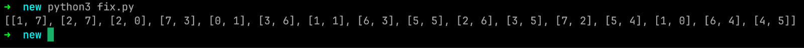<figcaption></figcaption></figure>

Once the coordinates are obtained, the next step is to `automatically` call the function and optimize it for authentication. Here's what you need to do:

* The base address changes to `0xda0000` during debugging.
* Set a breakpoint at `00DA440A`.
* Set RIP to `0DA4420`.
* Copy the ecx value from the `00DA1BF0` function call and place it in helper1.py.
  * Run helper1.py.
* Set breakpoints at `0DA1CED` and `0DA1D0E`.
  * Here, we'll automate the process to speed up iterations and provide the correct value for esi.
  * Run helper2.py.
* Set a breakpoint at `0DA1E33`.
  * Here, we'll ensure the values being compared are correct.
* Set a breakpoint at `0DA2182`.
  * To retrieve the address from the decrypted result.
  * Then disable it.
* Set a breakpoint at `00DA21AD`.
  * To get all decrypted values (flags).



```python
import ida_dbg

func_addr = 0x00DA2220

maps = [[1, 7], [2, 7], [2, 0], [7, 3], [0, 1], [3, 6], [1, 1], [6, 3], [5, 5], [2, 6], [3, 5], [7, 2], [5, 4], [1, 0], [6, 4], [4, 5]]

for i in maps:
args = [0x00FBFBD0, i[0], i[1]]
prototype = "int __thiscall func(void*, int, int);"
idc.SetType(func_addr, prototype)
func_callable = ida_idd.Appcall.proto(func_addr, prototype)
result = func_callable(args[0], args[1], args[2])
print(i, hex(result))
```





```python
import idaapi
import idc

arr_mul = [56, 31, 16, 46, 51, 41, 61, 21, 36, 6]
start = 0
list_eax = []
for i in range(10 - start):
    rv = idaapi.regval_t()
    rv.ival = 0x1
    idaapi.set_reg_val("ecx", rv)

    idaapi.continue_process()
    idaapi.wait_for_next_event(idaapi.WFNE_SUSP, -1)

    rv = idaapi.regval_t()
    rv.ival = arr_mul[start + i]
    idaapi.set_reg_val("esi", rv)

    idaapi.continue_process()
    idaapi.wait_for_next_event(idaapi.WFNE_SUSP, -1)

    rv = idaapi.regval_t()
    idaapi.get_reg_val('eax', rv)
    eax = rv.ival
    list_eax.append(hex(eax))

    idaapi.continue_process()
    idaapi.wait_for_next_event(idaapi.WFNE_SUSP, -1)
print(list_eax)
```



<figure>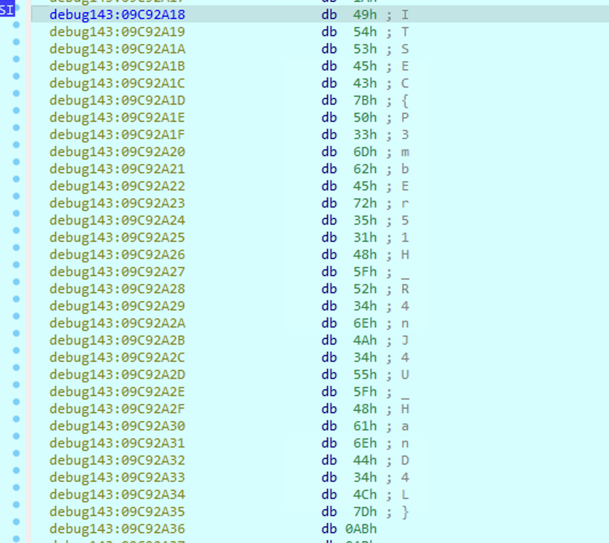<figcaption></figcaption></figure>

Flag: ITSEC{P3mbEr51H\_R4nJ4U\_HanD4L}
