# Reverse Engineering

<table><thead><tr><th width="347">Challenge</th><th>Topic</th></tr></thead><tbody><tr><td><a href="#ezpyracy-380-pts">EzPyracy</a> (380 pts) 🥈</td><td>PyArmor, Python DLL, License Validation</td></tr><tr><td><a href="#n3rv3_gl17ch-500-pts">N3RV3_GL17CH</a> (500 pts) - upsolve</td><td>Packed, Polynomial, Input Validation</td></tr></tbody></table>

## EzPyracy (380 pts)

### Description

\-

### Solution

Given PE32+ executable, decompile it using IDA. Through strings we can see that this executable compiled with `PyInstaller`.

<figure>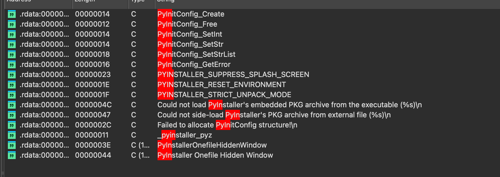<figcaption></figcaption></figure>

Extract using this [code](https://github.com/extremecoders-re/pyinstxtractor/blob/master/pyinstxtractor.py) , then we will see there is a .pyc file of the challenge. Using `pylingual` we can see that the decompiled result shows that the code is protected using `pyarmor`.

<figure>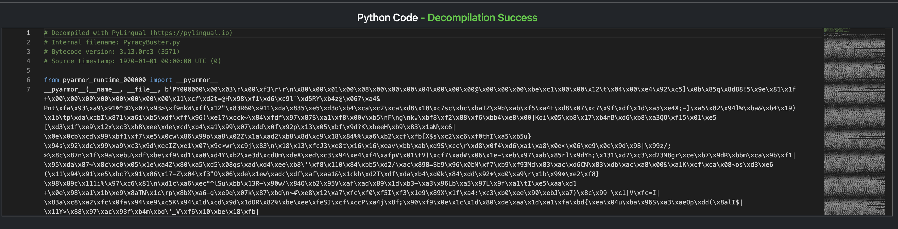<figcaption></figcaption></figure>

At first i tried well known method using <https://github.com/Svenskithesource/PyArmor-Unpacker/tree/main> but it failed, so i decided to reopening some notes I made in the past regarding pyarmor, because i've been solving several pyarmor challenges in past and also created a pyarmor challenge in past.

* [malware](/posts/write-up/2025/sas-ctf-quals/malware/#music-speed-changer)
* [reverse engineering application protected with pyarmor](/notes/research/2024/reverse-engineering-protected-python-application-with-pyarmor/#study-case-tfcctf-2024-mcknight)

I decided to use the same approach like the first link i show above, so using `pyinjector` to spawn `python shell`. Finding the main frame manually then we can do some enumeration and actually we can do disassembly for the running function. E.g

```python
import dis;dis.dis(list(sys._current_frames().values())[1].f_code)
```

<figure>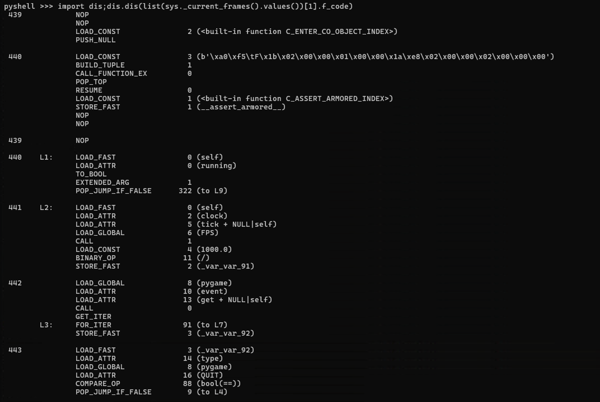<figcaption></figcaption></figure>

But we can't extract all function because most of functions are stay encrypted. If you look at code above, we can see that there is a call to a function named `C_ENTER_CO_OBJECT_INDEX`, we can utilize that to decrypt the encrypted functions and the constant passed to that function can be obtained also from `co_consts`.

<figure>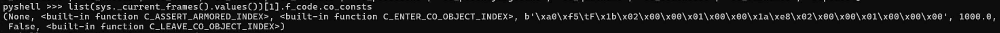<figcaption></figcaption></figure>

Okay now we just need to create a recursive function to decrypt all pyarmor packed modules and then dump the `pyc` file.&#x20;

```python
import dis
import marshal
import struct
import sys
import types
import time
import importlib.util

def find_enter_func(consts):
	for k in range(len(consts)):
		try:
			if consts[k].__name__ == "C_ENTER_CO_OBJECT_INDEX":
				return k
		except Exception as e:
			continue
	return -1

def recurs_dec(target):
	for i in range(len(target.co_consts)):
		tmp = target.co_consts[i]
		try:
			if "<frozen PyracyBuster>" in tmp.co_filename:
				index_func = find_enter_func(tmp.co_consts)
				if index_func != -1:
					print(f"found index {index_func} -> {tmp}")
					tmp.co_consts[index_func](tmp.co_consts[index_func + 1])
					recurs_dec(tmp)
		except Exception as e:
			continue


def dump_frame_to_pyc(code, output_path):
    def clean(consts):
        new_consts = []
        for c in consts:
            if isinstance(c, tuple):
                new_consts.append(tuple(clean(c)))
            elif isinstance(c, types.CodeType):
                new_consts.append(replace_consts(c)) 
            else:
                try:
                    marshal.dumps(c)
                    new_consts.append(c)
                except ValueError:
                    new_consts.append(None)
        return tuple(new_consts)

    def replace_consts(co):
        return co.replace(co_consts=clean(co.co_consts))

    final_code = replace_consts(code)

    magic = importlib.util.MAGIC_NUMBER
    header = bytearray(magic)
    if sys.version_info >= (3, 7):
        header.extend(struct.pack("<I", 0))
    header.extend(struct.pack("<I", int(time.time())))
    header.extend(struct.pack("<I", 0))

    with open(output_path, "wb") as f:
        f.write(header)
        marshal.dump(final_code, f)
    
    print(f"Dump to {output_path}")

   
target_frame = list(sys._current_frames().values())[1].f_back

recurs_dec(target_frame)

dump_frame_to_pyc(target_frame, "dumped_frame.pyc")

# dis.dis(target_frame)
```

<figure>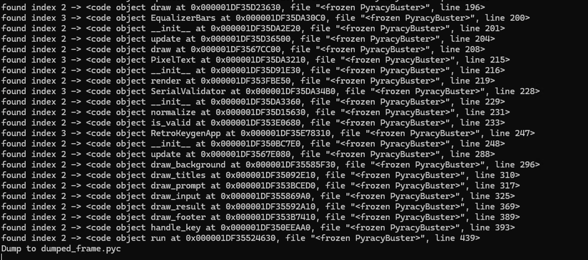<figcaption></figcaption></figure>

Next, we have several options with the pyc file&#x20;

* `pylingual` to decompile it
* `pycdas` or `dis.dis` to disassemble it

Through both output we can reconstruct the important part of the program

```python
import os
import sys
import time
import ctypes

LOG_PATH = os.path.join(os.path.dirname(__file__), "pyracy.log")

def _native_log(msg):
	ts = time.strftime("%Y-%m-%d %H:%M:%S")
	line = f"[{ts}] {msg}"
	try:
		with open(LOG_PATH, "a", encoding="utf-8") as f:
			f.write(line + "\n")
	except Exception:
		pass

class SerialValidator:

	def __init__(self):
		self.allowed = set("ABCDEFGHIJKLMNOPQRSTUVWXYZ0123456789")

	def normalize(self, s):
		return s.upper().strip()

	def is_valid(self, username, key, native_validate):
		if native_validate is None:
			_native_log(
				"validate() skipped: native_validate is None (DLL not available)"
			)
			return False

		try:
			user_bytes = username.encode("utf-8")

			normalized_key = self.normalize(key)
			key_bytes = normalized_key.encode("ascii", errors="ignore")

			_native_log(
				"calling validate: username='"
				+ username
				+ "' (len="
				+ str(len(user_bytes))
				+ "), key='"
				+ key
				+ "' (len="
				+ str(len(key_bytes))
				+ ")"
			)

			result = native_validate(user_bytes, key_bytes)

			_native_log("validate returned: " + str(result))

			return bool(result)

		except Exception as e:
			_native_log("validate exception: " + str(e))
			return False

class RetroKeygenApp:
	def __init__(self, dll_name = "pyracy.dll"):
		self.validator = SerialValidator()
		self._native = None

		dll_path = os.path.join(os.path.dirname(__file__), dll_name)

		_native_log(f"dll load attempt: path='{dll_path}'")

		if not os.path.exists(dll_path):
			_native_log("dll missing: pyracy.dll not found")
			print(
				"pyracy.dll not found next to the script. "
				"Please ensure pyracy.dll is present."
			)
			return

		try:
			native = ctypes.CDLL(dll_path)
			native.validate.argtypes = [ctypes.c_char_p, ctypes.c_char_p]
			native.validate.restype = ctypes.c_int
			self._native = native

			_native_log(
				"dll loaded successfully; validate(char*, char*) -> int bound"
			)
		except Exception as e:
			_native_log(f"dll load failed; exception: {e}")

	def validate(self, username, key):
		native_fn = None if self._native is None else self._native.validate
		return self.validator.is_valid(username, key, native_fn)


if __name__ == "__main__":
	username = "SecuriNets"

	app = RetroKeygenApp()
	serial = input(f"Enter serial for {username}: ").strip()

	if app.validate(username, serial):
		print("VALID")
	else:
		print("INVALID")

```

So basically the first part of defeating pyarmor protection is quite useless, since the validation is in `DLL` and the data passed to the DLL function from the python is actually "unprocessed" (also there is log lol). The next step is reverse engineering the DLL part, we can utilize IDA to decompile and debug it.

* Set breakpoint on validate function
* Set process options as following
  * Applications: `<python13_path\python.exe>`
  * Parameters: `test.py`

After we send input, breakpoint will hit and we can start debugging the DLL.

<figure>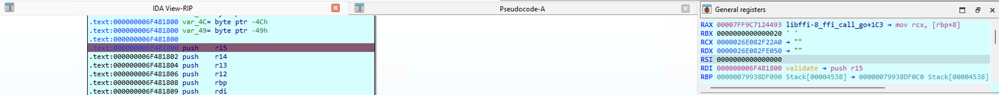<figcaption></figcaption></figure>

This program validate our license in format `BLOCK1-BLOCK2-BLOCK3-BLOCK4`. Validation is done by checking each block and relation for each block which is tied with username. Given username is `SecuriNets`, so our objective is to generate a valid license for username `SecuriNets`.

#### Block3

* Calculate hash for given username (`SecuriNets`)
* Block3 = hash(username) ^ 0x5a5a

#### Block1 and Block4

* Block1 and Block4 converted to base36
* Do comparation as following
  * `(to_base36(Block1) + to_base36(Block4)) & 0xFFFFF == (4 * hash(username) & 0xFFFFF)`
    * Looks like bruteforceable

#### Block2

* Compare derived 12 lower bits of Block2 with derived value from Block3
  * `((171 * username_length) ^ to_base36(Block2)) & 0xFFF == (Block3[0]<<6) | (2*Block3[1]) | (Block3[2]&1)`
    * Looks like bruteforceable

#### Block Relation Check

* Block4 first character
  * It must same as Sum of Block1 characters and username length
* Block4 and Block1 Block2
  * `Block4[1] + Block4[2] == (Block1[0] ^ Block2[3]) & 0x3F`
  * `(Block4[3] * Block2[0] + Block1[1]) % 37 == Sum of digits Block3`
* Vowel and digit counts comparation
  * The `count of digits` in the serial (mod 7) must match the `count of specific vowels` in the username (mod 7)

```python
import string

ALPHABET = string.digits + string.ascii_uppercase
VAL_MAP = {ch: idx for idx, ch in enumerate(ALPHABET)}

def to_base36(value, length=4):
    chars = []
    for _ in range(length):
        chars.append(ALPHABET[value % 36])
        value //= 36
    return "".join(reversed(chars))

def hash(username):
    acc = 0
    for idx, char in enumerate(username):
        byte = ord(char)
        base = 3 * (idx // 3)
        shift = 5 * (idx - base)
        acc += byte << shift
    return acc & 0xFFFF

def count_vowels(username):
    mask = 0x104111
    count = 0
    for char in username.upper():
        idx = ord(char) - 65
        if 0 <= idx <= 20 and ((mask >> idx) & 1):
            count += 1
    return count

def brute(username):
    user_hash = hash(username)
    user_len = len(username)
    
    val_b3 = user_hash ^ 0x5A5A
    B3 = f"{val_b3:04X}" 
    b3_vals = [VAL_MAP[c] for c in B3]

    b2_candidates = []
    
    target_12bit = (b3_vals[0] << 6) | (2 * b3_vals[1]) | (b3_vals[2] & 1)
    xor_prefix = (171 * user_len)
    required_lower_12 = (target_12bit ^ xor_prefix) & 0xFFF
    
    max_val = 36**4
    for high_part in range((max_val // 4096) + 2):
        val_b2 = (high_part << 12) | required_lower_12
        if val_b2 >= max_val: break
        
        b2_str = to_base36(val_b2)
        b2_candidates.append({
            'val': val_b2,
            'str': b2_str,
            'vals': [VAL_MAP[c] for c in b2_str]
        })


    target_sum = (4 * user_hash) & 0xFFFFF
    
    for val_b1 in range(max_val):
        B1 = to_base36(val_b1)
        b1_vals = [VAL_MAP[c] for c in B1]
        
        val_b4 = (target_sum - val_b1) & 0xFFFFF
        if val_b4 >= max_val: continue
        
        B4 = to_base36(val_b4)
        b4_vals = [VAL_MAP[c] for c in B4]

        sum_b1 = sum(b1_vals)
        w0 = b4_vals[0]
        left = w0 if B4[0].isdigit() else ((w0 ^ 7) % 31)
        right = (user_len + sum_b1) % 31
        if left != right: continue

        sum_inner = b4_vals[1] + b4_vals[2]
        if sum_inner >= 64: continue

        for cand in b2_candidates:
            b2_vals = cand['vals']
            
            if sum_inner != (b1_vals[0] ^ b2_vals[3]) & 0x3F:
                continue
            
            v18, v33 = b3_vals[0], 0
            for idx in range(1, 4):
                v33 = v18 + v33
                v18 = b3_vals[idx]
            target_mod37 = (v18 + v33) % 37

            lhs = (b4_vals[3] * b2_vals[0] + b1_vals[1]) % 37
            if lhs != target_mod37:
                continue

            serial = f"{B1}-{cand['str']}-{B3}-{B4}"
            digit_count = sum(c.isdigit() for c in serial)
            if digit_count % 7 == count_vowels(username) % 7:
                return serial

    return -1

USERNAME = "SecuriNets"
serial = brute(USERNAME)
print(f"User:   {USERNAME}")
print(f"Serial: {serial}")
```

Last, input serial to the program (GUI or reconstructed python script) to validate it.

<figure>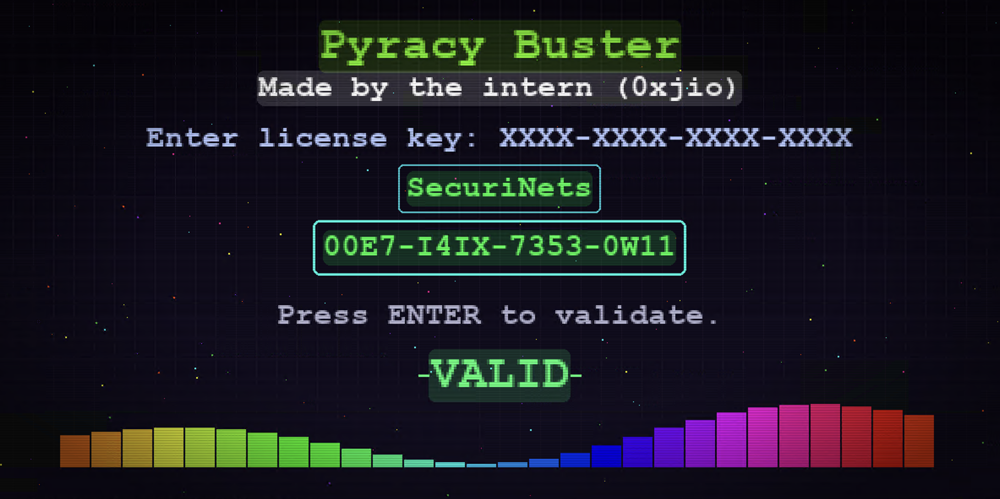<figcaption></figcaption></figure>

Flag: Securinets{00E7-I4IX-7353-0W11}

## N3RV3\_GL17CH (500 pts)

### Description

\-

### Solution

Given PE32 executable, open it using IDA.

<figure>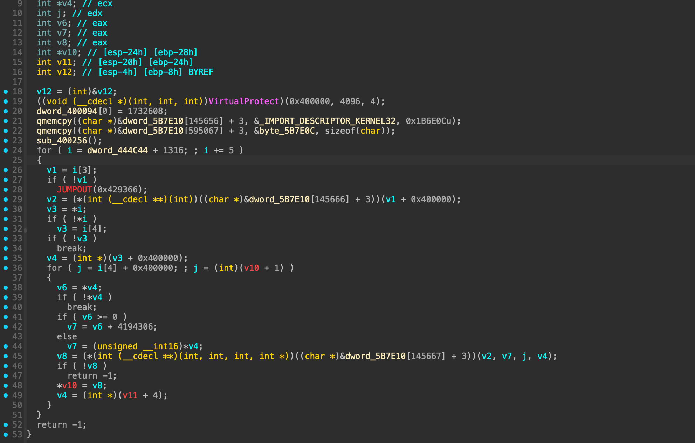<figcaption></figcaption></figure>

Through main function we can see that the program is packed, i don't know what kind of packer but I have seen similar packers several times so breakpoint at following `jmp eax` and the next instruction will be the real instruction.

```asm
HEADER:00400250 jmp     eax
```

During breakpoint on jmp eax, we can force IDA to reanalyze to make us easier to check the unpacked codes (or you can dump the the unpacked PE using scylla on x32dbg). If we continue the the process we'll see a GUI application and an input form as shown below

<figure><figcaption></figcaption></figure>

#### Input Conversion

So the first idea that came to my mind is setting up breakpoint at function that parse user input and i found that it is `user32_GetDlgItemTextA` . From microsoft documentation we know that the third argument will be the variable that store the value. So looking at the third argument in the end of `GetDlgItemTextA` function will show the value parsed. &#x20;

<div align="center" data-full-width="false"><figure>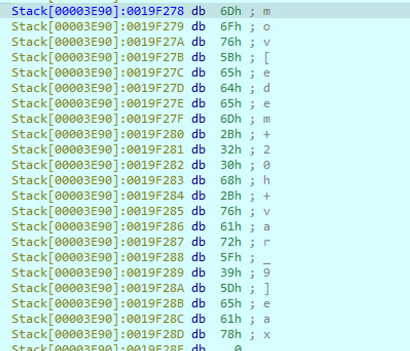<figcaption></figcaption></figure></div>

<div align="center"><figure>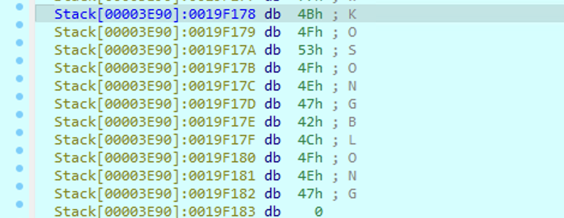<figcaption></figcaption></figure></div>

There are two value returned from `GetDlgItemTextA` , first one is static value which is `mov[edem+20h+var_9]eax` and the second one is our input. Let's setup hardware breakpoint on our input.

<figure>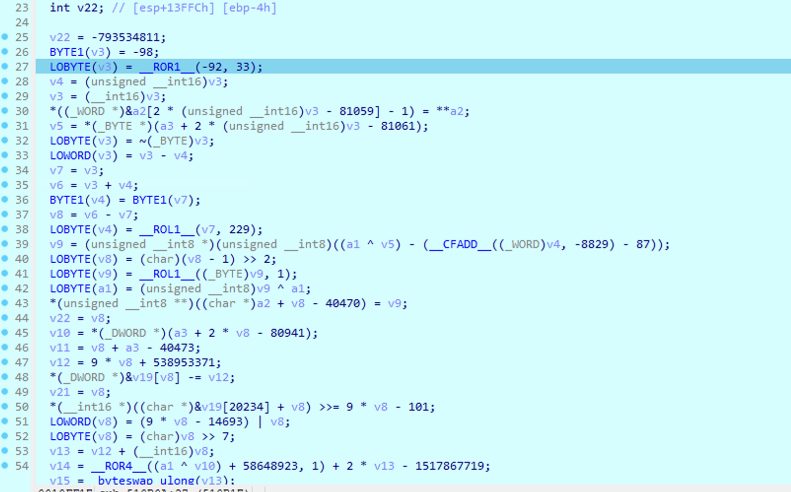<figcaption></figcaption></figure>

At first i tried to follow process above that process our input but in the end it does nothing to our input, then in the next hardware breakpoint we will see the actual code.

<figure>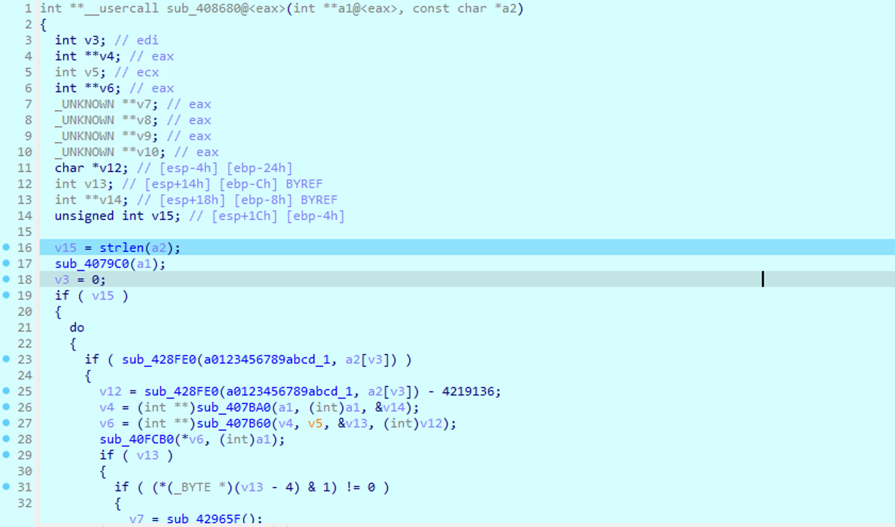<figcaption></figcaption></figure>

`sub_408680` basically do conversion as following

```python
def conv(inp):
	res = 0
	charset = "0123456789ABCDEFGHIJKLMNOPQRSTUVWXYZabcdefghijklmnopqrstuvwx"
	for i in inp:
		tmp = charset.index(i)
		res = res * 60 + tmp
	return res
```

To validate the result, breakpoint at following address and check ecx value

```asm
seg022:00409D1E call    sub_407A60
```

```asm
debug059:02725BE4 dd 1 ; length
debug059:02725BE8 dd 263h ; value
```

Return from function `sub_408680` (`sub_4087D0`) is the core process of this program, it does calculation and validation. To validate this assumption, i tried to modify the return for random input to 1 and now the program popup a message.

<figure><figcaption></figcaption></figure>

Okay now we can narrowing our focus to this function.

#### MD5 Function

```c
  v500 = 0x67452301;
  v501 = 0xEFCDAB89;
  v502 = 0x98BADCFE;
  v503 = 0x10325476;
  v504 = 0;
  v505 = 0;
  sub_40EC40((int)&v500, &v506, 0x48u);
  sub_40ED00(&v400, &v500);
  sub_41D0A0((int *)&v392);
  v378 = 16;
  v379 = &v400;
  v380 = v499;
```

In the end of function we can see some constant, through searching and validating through input output we know that this function is `MD5` hash.

* input (72 bytes) -> output (16 bytes)

<figure>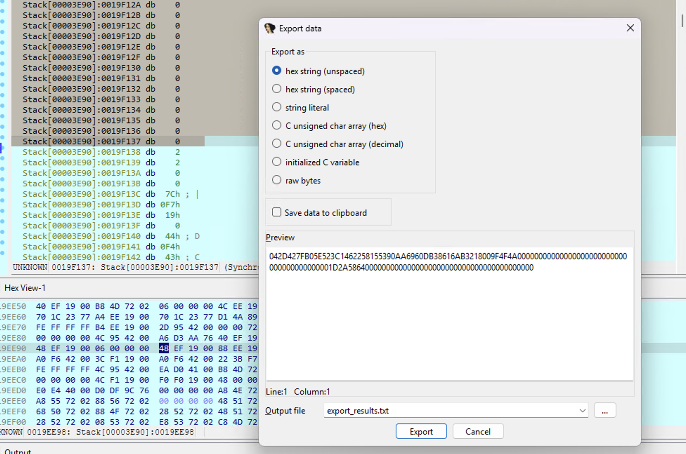<figcaption></figcaption></figure>

<figure>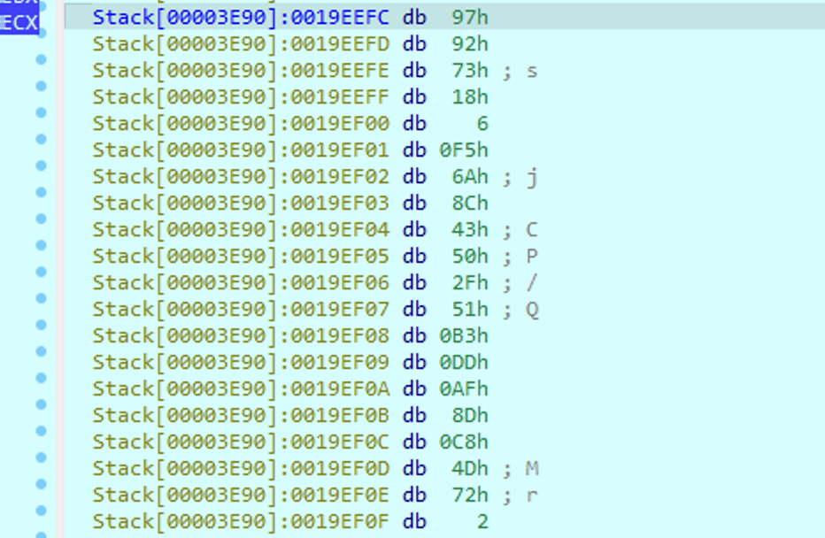<figcaption></figcaption></figure>

<figure>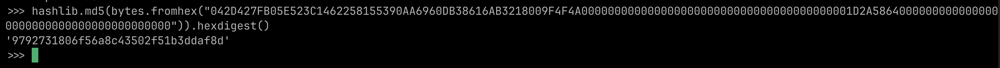<figcaption></figcaption></figure>

#### Big Integer Conversion

Now we know the plaintext passed to `MD5` function, which is `v506`. That variable are filled in following block

```c
  v368 = &v506;
  do
  {
    v369 = (int *)sub_415F10((int *)&v392, v367, (int)v366, v367);
    sub_407A20(v369, v368->m128i_i32);
    ++v367;
    v368 = (__m128i *)((char *)v368 + 4);
  }
```

Following is `sub_407A20` which is just another conversion right before `MD5` hash.

```c

int __usercall sub_407A20@<eax>(int *a1@<eax>, int *a2@<esi>)
{
  int result; // eax
  int v3; // edx
  int *v4; // ecx
  int v5; // edx

  result = *a1;
  if ( result )
  {
    v3 = *(_DWORD *)result;
    if ( *(int *)result < 0 )
      v3 = -v3;
    v4 = (int *)(result + 4 * v3);
    v5 = v3 - 1;
    for ( result = *v4; v5; --v5 )
      result = *--v4 + (result << 30);
    if ( *(v4 - 1) < 0 )
      result = -result;
    *a2 = result;
  }
  else
  {
    *a2 = 0;
  }
  return result;
}
```

Breakpoint at following address

```asm
seg022:0040E190 call    sub_407A20
```

`eax` is an array, so let's create a script to dump eax returned from `sub_407A20`.

```python
import ida_bytes
import ida_dbg

def dump_polys():
	all_arr = []
	for i in range(6):
		eax = ida_dbg.get_reg_val("eax")
		addr = ida_bytes.get_dword(eax)
		if addr == 0:
			all_arr.append([0])
			idaapi.continue_process()
			idaapi.wait_for_next_event(idaapi.WFNE_SUSP, -1)
		else:
			length = ida_bytes.get_dword(addr)
			arr = []
			for x in range(length):
				arr.append(ida_bytes.get_dword(addr + (x + 1) * 4))
			all_arr.append(arr)
			idaapi.continue_process()
			idaapi.wait_for_next_event(idaapi.WFNE_SUSP, -1)
	return all_arr

print(dump_polys())
```

```python
def conv2(arr):
    res = arr[-1] & MASK32
    for i in arr[-2::-1]:
        res = (i + ((res << 30) & MASK32 )) & MASK32
    return res

polys = [[1061301508, 1], [1012031152], [19227156, 2], [638204245, 2], [112397718, 2], [405973782]]

print(hex(conv2(polys[0])))
```

Validated it through second argument after sub\_407A20 called

```asm
Stack[00003E90]:0019F0F0 dd 7F422D04h
```

So basically this function do conversion from array that stores piece of big integer values (base `2^30`) to single integer value.

#### Polynomial Functions

With my limited knowledge of cryptography i tried to understand this stripped, no string library reference, and no constants reference functions.

At first, i tried to ask GPT to determine each function in this block but it failed and it can only show generic information about it. At least now i know that it is `polynomial` things (although some functions are misinterpreted).

<figure>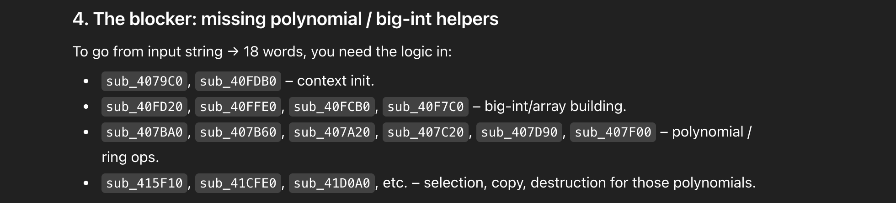<figcaption></figcaption></figure>

Until this step we know that the process as following

* Input `("AB")` -> convert to integer `(0x263)` -> polynomial things `([1061301508, 1], [1012031152]...)`->  convert to 72 bytes `(042D427FB05E523C1...)` -> MD5 hash `(9792731806F56...)`

The only left is the polynomial things which seems to be the one that plays the biggest role. If we take a look on the code, we can see that there is a pattern where in fact the entire code is several blocks of code repeated. Following is `one block`

```c
if ( sub_407A60(0, &v395) )
  {
    sub_415FD0(&v414);
    sub_415FD0(&v415);
    sub_415FD0(&v416);
    sub_415FD0(&v417);
    sub_41D0A0(&v407);
    sub_41D0A0(&v406);
    sub_41D0A0(&v405);
    sub_41D0A0(&v404);
    sub_41D0A0(&v403);
    sub_41D0A0(&v402);
    sub_41D0A0(&v401);
    sub_41D0A0(&v400);
  }
  else if ( sub_407A60(1, &v395) )
  {
    sub_41D0A0(&v407);
    sub_41D0A0(&v406);
    sub_41D0A0(&v405);
    sub_41D0A0(&v404);
    sub_41D0A0(&v403);
    sub_41D0A0(&v402);
    sub_41D0A0(&v401);
    sub_41D0A0(&v400);
  }
  else
  {
    sub_41CFE0(&v414, &v400);
    sub_41CFE0(&v415, &v401);
    sub_41CFE0(&v416, &v402);
    sub_41CFE0(&v417, &v403);
    if ( sub_4125D0(&v497, v395, 2) == 1 )
    {
      sub_41CFE0(&v414, &v404);
      sub_41CFE0(&v415, &v405);
      sub_41CFE0(&v416, &v406);
      sub_41CFE0(&v417, &v407);
    }
    else
    {
      sub_415FD0(&v404);
      sub_415FD0(&v405);
      sub_415FD0(&v406);
      sub_415FD0(&v407);
    }
    sub_4122F0(&v497, v395, 2, (int *)&v395);
    while ( sub_407AE0(0, &v395) )
    {
      sub_407C20(&v423, &v400);
      LOBYTE(v509) = 103;
      sub_407C20(&v393, &v401);
      LOBYTE(v509) = 104;
      sub_407C20(&v394, &v402);
      LOBYTE(v509) = 105;
      sub_407C20((int *)&v392, &v403);
      LOBYTE(v509) = 106;
      sub_41C2B0(&v480);
      LOBYTE(v509) = 107;
      sub_41C2B0(&v446);
      LOBYTE(v509) = 108;
      sub_41C2B0(&v451);
      LOBYTE(v509) = 109;
      sub_41C2B0(&v448);
      LOBYTE(v509) = 110;
      v98 = sub_407E90((int)v97, &v421, &v393);
      LOBYTE(v509) = 111;
      v99 = sub_407D90(&v411, a2, v98, (int *)&v392);
      LOBYTE(v509) = 112;
      v100 = sub_407D90(&v420, a2, v99, &v394);
      LOBYTE(v509) = 113;
      v101 = sub_407D90(&v413, a2, v100, &v423);
      LOBYTE(v509) = 114;
      sub_41CFE0(v101, &v400);
      sub_41D0A0(&v413);
      sub_41D0A0(&v420);
      sub_41D0A0((int *)&v411);
      LOBYTE(v509) = 110;
      sub_41D0A0(&v421);
      v102 = sub_407D90(&v445, a2, &v393, &v394);
      LOBYTE(v509) = 115;
      v103 = sub_407D90(&v428, a2, &v393, &v394);
      LOBYTE(v509) = 116;
      v104 = sub_407D90(&v425, a2, v103, v102);
      LOBYTE(v509) = 117;
      v105 = sub_407D90(&v430, a2, &v394, (int *)&v392);
      LOBYTE(v509) = 118;
      v106 = sub_407D90(&v426, a2, &v394, (int *)&v392);
      LOBYTE(v509) = 119;
      v107 = (int **)sub_407D90(&v427, a2, v106, v105);
      LOBYTE(v509) = 120;
      v418 = sub_407D90(&v429, a2, &v393, (int *)&v392);
      LOBYTE(v509) = 121;
      v108 = sub_407D90(&v431, a2, &v393, (int *)&v392);
      LOBYTE(v509) = 122;
      v109 = sub_407D90(&v434, a2, v108, v418);
      LOBYTE(v509) = 123;
      v110 = (int ***)sub_407D10(&v433, v109, v107);
      LOBYTE(v509) = 124;
      v111 = sub_407C90(&v432, v110, v104);
      LOBYTE(v509) = 125;
      sub_41CFE0(v111, &v401);
      sub_41D0A0(&v432);
      sub_41D0A0(&v433);
      sub_41D0A0(&v434);
      sub_41D0A0(&v431);
      sub_41D0A0(&v429);
      sub_41D0A0(&v427);
      sub_41D0A0(&v426);
      sub_41D0A0(&v430);
      sub_41D0A0(&v425);
      sub_41D0A0(&v428);
      LOBYTE(v509) = 110;
      sub_41D0A0(&v445);
      v112 = sub_407D90(&v482, a2, &v393, &v394);
      LOBYTE(v509) = 126;
      v113 = sub_407D90(&v461, a2, &v393, &v394);
      LOBYTE(v509) = 127;
      v114 = sub_407D90(&v476, a2, v113, v112);
      LOBYTE(v509) = 0x80;
      v115 = sub_407D90(&v463, a2, &v393, (int *)&v392);
      LOBYTE(v509) = -127;
      v116 = sub_407D90(&v486, a2, &v393, (int *)&v392);
      LOBYTE(v509) = -126;
      v117 = (int **)sub_407D90(&v465, a2, v116, v115);
      LOBYTE(v509) = -125;
      v418 = sub_407D90(&v478, a2, &v394, (int *)&v392);
      LOBYTE(v509) = -124;
      v118 = sub_407D90(&v437, a2, &v394, (int *)&v392);
      LOBYTE(v509) = -123;
      v119 = sub_407D90(&v439, a2, v118, v418);
      LOBYTE(v509) = -122;
      v120 = (int ***)sub_407D10(&v441, v119, v117);
      LOBYTE(v509) = -121;
      v121 = sub_407C90(&v443, v120, v114);
      LOBYTE(v509) = -120;
      sub_41CFE0(v121, &v402);
      sub_41D0A0(&v443);
      sub_41D0A0(&v441);
      sub_41D0A0(&v439);
      sub_41D0A0(&v437);
      sub_41D0A0(&v478);
      sub_41D0A0(&v465);
      sub_41D0A0(&v486);
      sub_41D0A0(&v463);
      sub_41D0A0(&v476);
      sub_41D0A0(&v461);
      LOBYTE(v509) = 110;
      sub_41D0A0(&v482);
      v122 = sub_407D90(&v436, a2, &v393, &v394);
      LOBYTE(v509) = -119;
      v123 = sub_407D90(&v450, a2, &v393, &v394);
      LOBYTE(v509) = -118;
      v96 = (int **)sub_407D90(&v454, a2, v123, v122);
      LOBYTE(v509) = -117;
      v124 = sub_407D90(&v456, a2, &v393, (int *)&v392);
      LOBYTE(v509) = -116;
      v125 = sub_407D90(&v453, a2, &v393, (int *)&v392);
      LOBYTE(v509) = -115;
      v97 = sub_407D90(&v471, a2, v125, v124);
      LOBYTE(v509) = -114;
      v418 = sub_407D90(&v455, a2, &v394, (int *)&v392);
      LOBYTE(v509) = -113;
      v126 = sub_407D90(&v488, a2, &v394, (int *)&v392);
      LOBYTE(v509) = -112;
      v127 = (int ***)sub_407D90(&v457, a2, v126, v418);
      LOBYTE(v509) = -111;
      v128 = sub_407C90(&v474, v127, v97);
      LOBYTE(v509) = -110;
      v129 = sub_407D10(&v459, v128, v96);
      LOBYTE(v509) = -109;
      sub_41CFE0(v129, &v403);
      sub_41D0A0(&v459);
      sub_41D0A0(&v474);
      sub_41D0A0(&v457);
      sub_41D0A0(&v488);
      sub_41D0A0(&v455);
      sub_41D0A0(&v471);
      sub_41D0A0(&v453);
      sub_41D0A0(&v456);
      sub_41D0A0(&v454);
      sub_41D0A0(&v450);
      sub_41D0A0(&v436);
      sub_41D0A0(&v448);
      sub_41D0A0(&v451);
      sub_41D0A0(&v446);
      sub_41D0A0(&v480);
      sub_41D0A0((int *)&v392);
      sub_41D0A0(&v394);
      sub_41D0A0(&v393);
      LOBYTE(v509) = 102;
      sub_41D0A0(&v423);
      if ( sub_4125D0(v96, v395, 2) == 1 )
      {
        sub_407C20(&v412, &v404);
        LOBYTE(v509) = -108;
        sub_407C20(&v410, &v405);
        LOBYTE(v509) = -107;
        sub_407C20(&v398, &v406);
        LOBYTE(v509) = -106;
        sub_407C20(&v397, &v407);
        LOBYTE(v509) = -105;
        sub_407C20(&v396, &v400);
        LOBYTE(v509) = -104;
        sub_407C20(&v399, &v401);
        LOBYTE(v509) = -103;
        sub_407C20(&v408, &v402);
        LOBYTE(v509) = -102;
        sub_407C20(&v409, &v403);
        LOBYTE(v97) = -101;
        LOBYTE(v509) = -101;
        v130 = sub_407D90(&v438, a2, &v398, &v396);
        LOBYTE(v509) = -100;
        v131 = sub_407D90(&v467, a2, v130, &v410);
        LOBYTE(v509) = -99;
        v132 = sub_407D90(&v440, a2, v131, &v409);
        LOBYTE(v509) = -98;
        v133 = sub_407D90(&v484, a2, &v397, &v399);
        LOBYTE(v509) = -97;
        v134 = sub_407D90(&v442, a2, v133, &v412);
        LOBYTE(v509) = -96;
        v135 = (int ***)sub_407D90(&v469, a2, v134, &v408);
        LOBYTE(v509) = -95;
        v136 = sub_407C90(&v444, v135, v132);
        LOBYTE(v509) = -94;
        sub_41CFE0(v136, &v404);
        sub_41D0A0(&v444);
        sub_41D0A0(&v469);
        sub_41D0A0(&v442);
        sub_41D0A0(&v484);
        sub_41D0A0(&v440);
        sub_41D0A0(&v467);
        LOBYTE(v509) = -101;
        sub_41D0A0(&v438);
        v137 = sub_407D90(&v479, a2, &v398, &v396);
        LOBYTE(v509) = -93;
        v138 = sub_407D90(&v481, a2, v137, &v412);
        LOBYTE(v509) = -92;
        v139 = (int **)sub_407D90(&v483, a2, v138, &v408);
        LOBYTE(v509) = -91;
        v140 = sub_407D90(&v485, a2, &v397, &v399);
        LOBYTE(v509) = -90;
        v141 = sub_407D90(&v487, a2, v140, &v410);
        LOBYTE(v509) = -89;
        v142 = sub_407D90(&v472, a2, v141, &v409);
        LOBYTE(v509) = -88;
        v143 = sub_407D10(&v452, v142, v139);
        LOBYTE(v509) = -87;
        sub_41CFE0(v143, &v405);
        sub_41D0A0(&v452);
        sub_41D0A0(&v472);
        sub_41D0A0(&v487);
        sub_41D0A0(&v485);
        sub_41D0A0(&v483);
        sub_41D0A0(&v481);
        LOBYTE(v509) = -101;
        sub_41D0A0(&v479);
        v144 = sub_407E10((int)v97, &v462, &v412);
        LOBYTE(v509) = -86;
        v145 = sub_407D90(&v464, a2, v144, &v410);
        LOBYTE(v509) = -85;
        v146 = sub_407D90(&v466, a2, v145, &v396);
        LOBYTE(v509) = -84;
        v147 = (int **)sub_407D90(&v468, a2, v146, &v399);
        LOBYTE(v509) = -83;
        v148 = sub_407D90(&v470, a2, &v397, &v398);
        LOBYTE(v509) = -82;
        v149 = sub_407D90(&v473, a2, v148, &v409);
        LOBYTE(v509) = -81;
        v150 = sub_407D90(&v475, a2, v149, &v408);
        LOBYTE(v509) = -80;
        v151 = sub_407D10(&v477, v150, v147);
        LOBYTE(v509) = -79;
        sub_41CFE0(v151, &v406);
        sub_41D0A0(&v477);
        sub_41D0A0(&v475);
        sub_41D0A0(&v473);
        sub_41D0A0(&v470);
        sub_41D0A0(&v468);
        sub_41D0A0(&v466);
        sub_41D0A0(&v464);
        LOBYTE(v509) = -101;
        sub_41D0A0(&v462);
        v152 = sub_407D90(&v419, a2, &v398, &v396);
        LOBYTE(v509) = -78;
        v153 = sub_407D90(&v422, a2, &v398, &v396);
        LOBYTE(v509) = -77;
        v96 = (int **)sub_407D90(&v447, a2, v153, v152);
        LOBYTE(v509) = -76;
        v97 = sub_407D90(&v449, a2, &v397, &v399);
        LOBYTE(v509) = -75;
        v154 = sub_407D90(&v424, a2, &v397, &v399);
        LOBYTE(v509) = -74;
        v155 = (int ***)sub_407D90(&v458, a2, v154, v97);
        LOBYTE(v509) = -73;
        v156 = sub_407C90(&v460, v155, (int *)v96);
        LOBYTE(v509) = -72;
        sub_41CFE0(v156, &v407);
        sub_41D0A0(&v460);
        sub_41D0A0(&v458);
        sub_41D0A0((int *)&v424);
        sub_41D0A0(&v449);
        sub_41D0A0(&v447);
        sub_41D0A0(&v422);
        sub_41D0A0(&v419);
        sub_41D0A0(&v409);
        sub_41D0A0(&v408);
        sub_41D0A0(&v399);
        sub_41D0A0(&v396);
        sub_41D0A0(&v397);
        sub_41D0A0(&v398);
        sub_41D0A0(&v410);
        LOBYTE(v509) = 102;
        sub_41D0A0(&v412);
      }
      sub_4122F0(v96, v395, 2, (int *)&v395);
    }
    sub_41CFE0(&v404, &v414);
    sub_41CFE0(&v405, &v415);
    sub_41CFE0(&v406, &v416);
    sub_41CFE0(&v407, &v417);
    sub_4085B0(&v404);
    sub_4085B0(&v400);
  }
```

In my analysis i renamed some function that do free memory to narrowing our focus only to poly related function, back to `sub_408680` that we already have the returned values, the output is array 2 dimension with length `6` as following, so we assume that this is polynomial with `degree = 6`.

During debugging, i found there are many data passed as argument that has same structure. E.g in following code

```c
sub_418170(a1, v4, a3);
```

If we take a look on above function call, we'll see several arguments passed and the values returned are written in `2nd` argument, we can know this because at initial the 2nd argument will be all zero and after function call it will be filled with different values based on arguments. Following is script to dump the values.



```python
import ida_bytes
import ida_dbg

def dump_arg(target, outer_length = 6):
	start = ida_bytes.get_dword(target)
	counter1 = 0
	all_arr = []
	for _ in range(outer_length):
		tmp = ida_bytes.get_dword(start + counter1 * 4)
		if tmp == 0xabababab or tmp == 0xBAADF00D:
			break
		else:
			length = ida_bytes.get_dword(tmp)
			arr = []
			for i in range(length):
				val = ida_bytes.get_dword(tmp + (i + 1) * 4)
				arr.append(val)
			all_arr.append(arr)
		counter1 += 1
	print(hex(target), all_arr)
	
esp = ida_dbg.get_reg_val("esp")

dump_arg(ida_bytes.get_dword(esp + 0x4))

ida_dbg.step_over()
ida_dbg.wait_for_next_event(ida_dbg.WFNE_SUSP, -1)

dump_arg(ida_bytes.get_dword(esp))
```



Output

* Arg3 (input)
  * 0x19eee0 \[\[408265793], \[591766954, 2], \[368106728, 3], \[54215304, 2], \[744138553, 3], \[90226521, 1]]
* Arg2 (output)
  * 0x19eeb8 \[\[816531586], \[109792089, 1], \[736213461, 2], \[108430613], \[414535287, 3], \[180453042, 2]]

Through converting it to single integer we can see that `sub_418170` looks like doubling the input. But there is something wrong

```python
inp =  [[408265793], [591766954, 2], [368106728, 3], [54215304, 2], [744138553, 3], [90226521, 1]]
out =  [[816531586], [109792089, 1], [736213461, 2], [108430613], [414535287, 3], [180453042, 2]]
conv_inp = [conv2(i) for i in inp]
conv_out = [conv2(i) for i in out]

for i in range(len(conv_inp)):
	print(hex(conv_inp[i]), hex(conv_out[i]), hex(2*conv_inp[i]), 2*conv_inp[i] == conv_out[i])
```

Some of values are showing False output

```
2739250602 1183533913 False
3589332200 2883697109 False
2201698952 108430613 False
3965364025 3635760759 False
```

Setting up breakpoint at Arg3 (input) we can see that there is big integer calculation as following

* Preparation

```asm
seg022:004117FD and     edx, 3FFFFFFFh
seg022:00411803 mov     [esi+4], edx
...
seg022:0041183A and     edx, 3FFFFFFFh
seg022:00411840 sub     eax, 1
seg022:00411843 mov     [esi+8], edx
seg022:00411846 mov     edx, eax
...
seg022:00411850 add     ecx, eax
seg022:00411852 mov     [esi+0Ch], ecx
```

* If we set breakpoint on `[esi+4]`, `[esi+8]`, or `[esi+0xc]` we can see how the prepared values processed

<figure>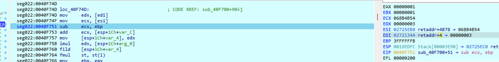<figcaption></figcaption></figure>

<figure>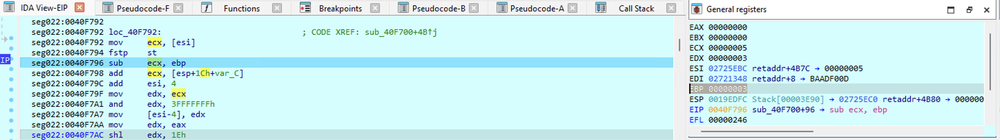<figcaption></figcaption></figure>

We can see that our input processed with value `[0x3FFFFFFB, 3]` which is same as `0xfffffffb`. If we check the operation (subtraction) and the function result we can see that the subtraction is part of `modulo` operation and this whole function do modulo to our doubled values. Let's rewrite our code.

```python
inp =  [[408265793], [591766954, 2], [368106728, 3], [54215304, 2], [744138553, 3], [90226521, 1]]
out =  [[816531586], [109792089, 1], [736213461, 2], [108430613], [414535287, 3], [180453042, 2]]
conv_inp = [conv2(i) for i in inp]
conv_out = [conv2(i) for i in out]

P = conv2([0x3FFFFFFB, 3])

for i in range(len(conv_inp)):
	print(hex(conv_inp[i]), hex(conv_out[i]), (2*conv_inp[i]) % P == conv_out[i])
```

```
0x1855a441 0x30ab4882 True
0xa345a5aa 0x468b4b59 True
0xd5f0dce8 0xabe1b9d5 True
0x833b4288 0x6768515 True
0xec5aa739 0xd8b54e77 True
0x4560bf59 0x8ac17eb2 True
```

So in context of this challenge, this operation is polynomial doubling or P(x) + P(x) andt he polynomial are over the finite field within `P = 0xfffffffb (2^32 - 5)`. Now we can continue to next function.

```c
sub_41A850((int *)(dword_443C44[73] + 4), a2, v5, a3, a4);
```

Modify `dump_arg.py` as following to dump `sub_41A850` argument and returned values

```python
esp = ida_dbg.get_reg_val("esp")

dump_arg(ida_bytes.get_dword(esp + 0x4))
dump_arg(ida_bytes.get_dword(esp + 0x8))
dump_arg(ida_dbg.get_reg_val("ecx"))

ida_dbg.step_over()
ida_dbg.wait_for_next_event(ida_dbg.WFNE_SUSP, -1)

dump_arg(ida_bytes.get_dword(esp))
```

Output&#x20;

* Arg1
  * 0x272159c \[\[401877261], \[319151251], \[448897956, 1], \[373083325], \[135070006], \[998919543, 1]]
* Arg4&#x20;
  * 0x19ef50 \[\[816531586], \[109792089, 1], \[736213461, 2], \[108430613], \[414535287, 3], \[180453042, 2]]
* Arg5
  * 0x19eedc \[\[780246396], \[323573734, 2], \[414923207], \[565161876], \[438396663], \[753613874, 2]]
* Arg3 (result)
  * 0x19eeb4 \[\[854080791, 2], \[475215032], \[872537324, 1], \[820548349, 1], \[298070272, 2], \[62262485, 2]]

In `sub_41A850`, you'll see that Arg1 is static and the value passed is not from stack (not started with `0x19...`) while the others are from stack. Because we already know how the polynomial in this executable works, we can do blackbox through input output and some debugging to determine what kind of operation of each polynomial functions. First, let's ask AI to create several function that do basic polynomial operation and combine it with our previous functions, then try it with arguments and result from `sub_41A850` .

```python
from __future__ import annotations

from typing import List, Tuple

P = 2**32 - 5
MASK32 = 2**32 - 1

Poly = List[int]

def conv(inp):
    res = 0
    charset = "0123456789ABCDEFGHIJKLMNOPQRSTUVWXYZabcdefghijklmnopqrstuvwx"
    for i in inp:
        tmp = charset.index(i)
        res = res * 60 + tmp
    return res

def conv2(arr):
    res = arr[-1] & MASK32
    for i in arr[-2::-1]:
        res = (i + ((res << 30) & MASK32 )) & MASK32
    return res

def arr_to_poly(arr):
    coeffs = [conv2(i) % P for i in arr]
    return poly_trim(coeffs)


def rev_conv2(value):
    w = value & MASK32
    l1 = w >> 30
    l0 = w & ((1 << 30) - 1)
    return [l0] if l1 == 0 else [l0, l1]


def poly_to_arr(poly, size = 6):
    coeffs = (poly + [0] * size)[:size]
    return [rev_conv2(c) for c in coeffs]


# ---------------------------------------------------------------------------
# Core field operations
# ---------------------------------------------------------------------------

def modp(x: int) -> int:
    return x % P


def poly_trim(poly: Poly) -> Poly:
    if not poly:
        return [0]
    i = len(poly) - 1
    while i > 0 and poly[i] == 0:
        i -= 1
    return poly[: i + 1]


def add(a: Poly, b: Poly) -> Poly:
    l = max(len(a), len(b))
    res = [0] * l
    for i in range(l):
        av = a[i] if i < len(a) else 0
        bv = b[i] if i < len(b) else 0
        res[i] = modp(av + bv)
    return poly_trim(res)


def sub(a: Poly, b: Poly) -> Poly:
    l = max(len(a), len(b))
    res = [0] * l
    for i in range(l):
        av = a[i] if i < len(a) else 0
        bv = b[i] if i < len(b) else 0
        res[i] = modp(av - bv)
    return poly_trim(res)


def neg(a: Poly) -> Poly:
    return [modp(-c) for c in a]


def scalar_mul(a: Poly, k: int) -> Poly:
    k = k % P
    if k == 0:
        return [0]
    return [modp(k * c) for c in a]


def poly_mul(a: Poly, b: Poly) -> Poly:
    if not a or not b:
        return [0]
    res = [0] * (len(a) + len(b) - 1)
    for i, av in enumerate(a):
        if av == 0:
            continue
        for j, bv in enumerate(b):
            if bv == 0:
                continue
            res[i + j] = modp(res[i + j] + av * bv)
    return poly_trim(res)


def poly_mod(f: Poly, mod_poly: Poly) -> Poly:
    f = poly_trim([modp(c) for c in f])
    m = poly_trim(mod_poly)
    deg_m = len(m) - 1
    if len(f) <= deg_m:
        return f
    while len(f) >= len(m):
        deg_f = len(f) - 1
        shift = deg_f - deg_m
        lead = f[-1]
        if lead != 0:
            for i in range(len(m)):
                f[shift + i] = modp(f[shift + i] - lead * m[i])
        f = poly_trim(f)
    return f


def poly_pow(base: Poly, exp: int, modulus: Poly) -> Poly:
    if exp < 0:
        raise ValueError("negative exponents not supported")
    result: Poly = [1]
    b = base[:]
    e = exp
    while e > 0:
        if e & 1:
            result = poly_mod(poly_mul(result, b), modulus)
        b = poly_mod(poly_mul(b, b), modulus)
        e >>= 1
    return poly_trim(result)


def poly_divmod(num: Poly, den: Poly) -> Tuple[Poly, Poly]:
    num = poly_trim(num)
    den = poly_trim(den)
    if den == [0]:
        raise ValueError("division by zero polynomial")
    if len(num) < len(den):
        return [0], num
    q = [0] * (len(num) - len(den) + 1)
    r = num[:]
    lead_d = den[-1]
    inv_lead_d = pow(lead_d, P - 2, P)
    for i in range(len(num) - len(den), -1, -1):
        lead_r = r[len(den) - 1 + i]
        factor = modp(lead_r * inv_lead_d)
        q[i] = factor
        if factor != 0:
            for j in range(len(den)):
                r[i + j] = modp(r[i + j] - factor * den[j])
    return poly_trim(q), poly_trim(r)


def poly_xgcd(a: Poly, b: Poly) -> Tuple[Poly, Poly, Poly]:
    x0, x1 = [1], [0]
    y0, y1 = [0], [1]
    aa, bb = poly_trim(a), poly_trim(b)
    while bb != [0]:
        q, r = poly_divmod(aa, bb)
        aa, bb = bb, r
        qx1 = poly_mul(q, x1)
        lx = max(len(x0), len(qx1))
        new_x = sub(x0 + [0] * (lx - len(x0)), qx1 + [0] * (lx - len(qx1)))
        x0, x1 = x1, new_x
        qy1 = poly_mul(q, y1)
        ly = max(len(y0), len(qy1))
        new_y = sub(y0 + [0] * (ly - len(y0)), qy1 + [0] * (ly - len(qy1)))
        y0, y1 = y1, new_y
    return aa, x0, y0


def poly_inv(a: Poly, mod_poly: Poly) -> Poly:
    g, x, _ = poly_xgcd(a, mod_poly)
    if len(g) != 1:
        raise ValueError("polynomials are not coprime; inverse does not exist")
    inv_g = pow(g[0], P - 2, P)
    return poly_trim([modp(c * inv_g) for c in x])

```

After some trial and debugging we found that `sub_41A850` do polynomial multiplication with `Arg1` as modulus polynomial.

```python
import poly_engine as pe

M = [[401877261], [319151251], [448897956, 1], [373083325], [135070006], [998919543, 1], [1]]
A = [[816531586], [109792089, 1], [736213461, 2], [108430613], [414535287, 3], [180453042, 2]]
B = [[780246396], [323573734, 2], [414923207], [565161876], [438396663], [753613874, 2]]
C = [[854080791, 2], [475215032], [872537324, 1], [820548349, 1], [298070272, 2], [62262485, 2]]

poly_M = pe.arr_to_poly(M)
poly_A = pe.arr_to_poly(A)
poly_B = pe.arr_to_poly(B)
poly_C = pe.arr_to_poly(C)

out = pe.poly_mod(pe.poly_mul(poly_A, poly_B), poly_M)

print(out == poly_C)
```

<figure>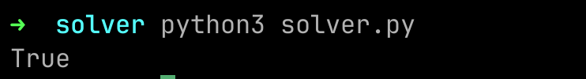<figcaption></figcaption></figure>

Do the same approach for rest function and following is my final `check` function.



#### Reconstructing Check Function

After renaming each function now we can see it clearly how this function works

* static\_value (probably a key)
  * MD5 -> simple calculation that convert hash to exponent -> compute polynomial (1 time using X as base value) -> polynomial multiplication inverse -> conv2 function ->  MD5
* user\_input
  * conv function -> use as exponent -> compute polynomial (3 times using Y as base value) -> compute polynomial from static value -> compute result from both polynomial -> polynomial multiplication inverse -> conv2 function -> MD5

Next, create a python script that reconstruct the whole check function.

```python
import hashlib
import poly_engine as pe

M = [[401877261], [319151251], [448897956, 1], [373083325], [135070006], [998919543, 1], [1]]
poly_M = pe.arr_to_poly(M)

def initial_state_1():
    poly1 = pe.arr_to_poly([[252305662], [508299242, 3], [30052375, 1], [16854297, 1], [713655053, 1], [963428347, 1]])
    poly2 = pe.arr_to_poly([[975451862, 3], [702540092, 1], [111323119], [867583149, 1], [577839734], [709038011, 1]])
    poly3 = pe.arr_to_poly([[509903447, 2], [528609605, 2], [996284764, 3], [823099800], [663246958, 2], [777151259, 1]])
    poly4 = pe.arr_to_poly([[1039352783, 2], [444081841, 3], [810801443, 3], [77215435, 2], [695846846], [1004961486, 3]])
    return poly1, poly2, poly3, poly4

def initial_state_2():
    poly1 = pe.arr_to_poly([[252305662], [508299242, 3], [30052375, 1], [16854297, 1], [713655053, 1], [963428347, 1]])
    poly2 = pe.arr_to_poly([[975451862, 3], [702540092, 1], [111323119], [867583149, 1], [577839734], [709038011, 1]])
    poly3 = pe.arr_to_poly([[509903447, 2], [528609605, 2], [996284764, 3], [823099800], [663246958, 2], [777151259, 1]])
    poly4 = pe.arr_to_poly([[1039352783, 2], [444081841, 3], [810801443, 3], [77215435, 2], [695846846], [1004961486, 3]])
    return poly1, poly2, poly3, poly4

def static_computed_values():
    poly1 = pe.arr_to_poly([[28146282, 2], [445605982, 2], [243109933, 3], [92868039, 2], [11574644, 2], [660303264, 3]])
    poly2 = pe.arr_to_poly([[965077009, 1], [662878243, 1], [824005428, 1], [1041827728, 1], [855050935], [580843271, 1]])
    poly3 = pe.arr_to_poly([[253238526, 2], [20971836, 1], [87551952, 3], [853121899], [423542159, 3], [289751934, 2]])
    poly4 = pe.arr_to_poly([[656614905, 2], [766898517], [439315492, 1], [521689061, 3], [314712125, 1], [374675777, 1]])
    return poly1, poly2, poly3, poly4


def mmul(a, b):
    return pe.poly_mod(pe.poly_mul(a, b), poly_M)

def mmul_i(a, b):
    inv_b = pe.poly_inv(b, poly_M)
    return pe.poly_mod(pe.poly_mul(a, inv_b), poly_M)

def mmul_s(a, b):
    return pe.poly_mod(pe.scalar_mul(a, b), poly_M)

def madd(a, b):
    return pe.poly_mod(pe.add(a, b), poly_M)

def msub(a, b):
    return pe.poly_mod(pe.sub(a, b), poly_M)

def print_hex(a1):
    arr = []
    for i in a1:
        arr.append(hex(i))
    print(arr)

def print_hex_poly(a1):
    arr = []
    for i in a1:
        tmp = []
        for j in i:
            tmp.append(hex(j))
        arr.append(tmp)
    print(arr)

def first_block(state):

    X, Y, Z, T = state

    v13 = madd(Y, Y)
    v14 = mmul(v13, T)
    v15 = mmul(v14, Z)
    X_new = mmul(v15, X)

    v17 = mmul(Y, Z)
    v18 = mmul(Y, Z)
    v19 = mmul(v18, v17)
    v20 = mmul(Z, T)
    v21 = mmul(Z, T)
    v22 = mmul(v21, v20)
    v423 = mmul(Y, T)
    v23 = mmul(Y, T)
    v24 = mmul(v23, v423)
    Y_new = madd(msub(v24, v22), v19)

    v27 = mmul(Y, Z)
    v28 = mmul(Y, Z)
    v29 = mmul(v28, v27)
    v30 = mmul(Y, T)
    v31 = mmul(Y, T)
    v32 = mmul(v31, v30)
    v423 = mmul(Z, T)
    v33 = mmul(Z, T)
    v34 = mmul(v33, v423)
    Z_new = madd(msub(v34, v32), v29)

    v37 = mmul(Y, Z)
    v38 = mmul(Y, Z)
    v39 = mmul(v38, v37)
    v40 = mmul(Y, T)
    v41 = mmul(Y, T)
    v42 = mmul(v41, v40)
    v423 = mmul(Z, T)
    v43 = mmul(Z, T)
    v44 = mmul(v43, v423)
    T_new = msub(madd(v44, v42), v39)

    return X_new, Y_new, Z_new, T_new


def second_block(acc_state, base_state):
    if acc_state is None:
        X = pe.arr_to_poly([[0], [0], [0], [0], [0], [0]])
        Y = pe.arr_to_poly([[1], [0], [0], [0], [0], [0]])
        Z = pe.arr_to_poly([[1], [0], [0], [0], [0], [0]])
        T = pe.arr_to_poly([[1], [0], [0], [0], [0], [0]])
    else:
        X, Y, Z, T = acc_state
    
    Xb, Yb, Zb, Tb = base_state

    v47 = mmul(Z, Xb)
    v48 = mmul(v47, Y)
    v49 = mmul(v48, Tb)
    v50 = mmul(T, Yb)
    v51 = mmul(v50, X)
    v52 = mmul(v51, Zb)
    X_new = madd(v52, v49)

    v54 = mmul(Z, Xb)
    v55 = mmul(v54, X)
    v56 = mmul(v55, Zb)
    v57 = mmul(T, Yb)
    v58 = mmul(v57, Y)
    v59 = mmul(v58, Tb)
    Y_new = msub(v59, v56)

    v61 = mmul_s(X, 2951558829)
    v62 = mmul(v61, Y)
    v63 = mmul(v62, Xb)
    v64 = mmul(v63, Yb)
    v65 = mmul(T, Z)
    v66 = mmul(v65, Tb)
    v67 = mmul(v66, Zb)
    Z_new = msub(v67, v64)

    v69 = mmul(Z, Xb)
    v70 = mmul(Z, Xb)
    v71 = mmul(v70, v69)
    v72 = mmul(T, Yb)
    v73 = mmul(T, Yb)
    v74 = mmul(v73, v72)
    T_new = madd(v74, v71)
    
    return X_new, Y_new, Z_new, T_new


def compute_plaintext(plaintext):
    n_value = pe.conv(plaintext)
    base = initial_state_1()
    for _ in range(3):
        result = None
        value = n_value
        if value & 1:
            result = tuple(poly[:] for poly in base)
        value >>= 1
        while value:
            base = first_block(base)
            if value & 1:
                result = second_block(result, base)
            value >>= 1
        base = result[:]

    base = static_computed_values()
    X, Y, Z, T = second_block(result, base)

    X = mmul_i(X, T)
    Y = mmul_i(Y, T)
    Z = mmul_i(Z, T)
    
    return X, Y, Z


def get_n_flag(key):
    tmp = hashlib.md5(key).digest()
    res = ""
    for i in tmp:
        res += chr(48 + (i % 10))
    return int(res)


def compute_flag(key):
    base_flag = initial_state_2()
    n_flag = get_n_flag(key)
    
    for _ in range(1):
        result = None
        value = n_flag
        if value & 1:
            result = tuple(poly[:] for poly in base_flag)
        value >>= 1
        while value:
            base_flag = first_block(base_flag)
            if value & 1:
                result = second_block(result, base_flag)
            value >>= 1
        base_flag = result[:]

    X, Y, Z, T = result
    
    X = mmul_i(X, T)
    Y = mmul_i(Y, T)
    Z = mmul_i(Z, T)

    return X, Y, Z 

def compute_hash(arr):
    res = b""
    for i in arr:
        tmp = i + [0] * (6 - len(i))
        for j in tmp:
            res += ((j & 0xFFFFFFFF).to_bytes(4, "little"))
    return hashlib.md5(res).hexdigest().upper()


plaintext = "AB"
key = b"mov[edem+20h+var_9]eax"

X1, Y1, Z1 = compute_flag(key)
X2, Y2, Z2 = compute_plaintext(plaintext)

print(compute_hash([X2, Y2, Z2]) == "9792731806F56A8C43502F51B3DDAF8D") # AB hash from executable
```

<figure>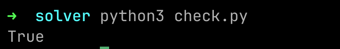<figcaption></figcaption></figure>

Until this step we've successfully recovered the whole `check` function.

#### Solving Crypto Part

Basically we just need to find a correct value that match value before last MD5, thus we can skip last MD5 process. We also can see that our input is used as an exponent, so maybe this challenge lead to discrete log problem. We can try to leverage AI to solve this challenge with a `DLP` approach, because this part is too crypto for me.

```python
import sys
from sage.groups.generic import discrete_log

# ------------------------------------------------------------------------------
# 1. FIELD & CONSTANTS
# ------------------------------------------------------------------------------
P_VAL = 2**32 - 5
F = GF(P_VAL)
R.<x> = PolynomialRing(F)
M_coeffs = [401877261, 319151251, 1522639780, 373083325, 135070006, 2072661367, 1]
M_poly = R(M_coeffs)
F6.<w> = GF(P_VAL**6, modulus=M_poly)

# Curve Parameter
a_val = F(2951558829)
d_param = a_val 

# ------------------------------------------------------------------------------
# 2. CURVE POINT CLASS
# ------------------------------------------------------------------------------
class CurvePoint:
    def __init__(self, x, y, z, t):
        self.coords = (x, y, z, t)
        self.normalized = self._normalize(x, y, z, t)

    def _normalize(self, x, y, z, t):
        if t == 0: return (F6(0), F6(1), F6(0), F6(0))
        if t == 1: return (x, y, z, t)
        inv = 1/t
        return (x*inv, y*inv, z*inv, F6(1))

    def __eq__(self, other):
        if not isinstance(other, CurvePoint): return False
        return self.normalized == other.normalized

    def __hash__(self):
        return hash(self.normalized)

    def __repr__(self):
        return f"Pt(...)"

    def parent(self):
        return CurveParent()

    def __mul__(self, other):
        # P + Q
        return CurvePoint(*point_add_raw(self.coords, other.coords))

    def __pow__(self, k):
        # k * P
        k = int(k)
        if k < 0: return (~self) ** (-k)
        res = IDENTITY
        curr = self
        while k > 0:
            if k % 2 == 1:
                res = res * curr
            curr = curr * curr
            k //= 2
        return res

    def __invert__(self):
        # -P
        X, Y, Z, T = self.coords
        return CurvePoint(-X, Y, Z, T)

class CurveParent:
    def one(self): return IDENTITY
    def __eq__(self, other): return isinstance(other, CurveParent)

# Raw Logic
def point_add_raw(P1, P2):
    X, Y, Z, T = P1
    Xb, Yb, Zb, Tb = P2
    
    v47 = Z * Xb; v48 = v47 * Y; v49 = v48 * Tb
    v50 = T * Yb; v51 = v50 * X; v52 = v51 * Zb
    X_new = v52 + v49

    v54 = Z * Xb; v55 = v54 * X; v56 = v55 * Zb
    v57 = T * Yb; v58 = v57 * Y; v59 = v58 * Tb
    Y_new = v59 - v56

    v61 = X * d_param
    v62 = v61 * Y; v63 = v62 * Xb; v64 = v63 * Yb
    v65 = T * Z; v66 = v65 * Tb; v67 = v66 * Zb
    Z_new = v67 - v64

    v69 = Z * Xb; v70 = Z * Xb; v71 = v70 * v69
    v72 = T * Yb; v73 = T * Yb; v74 = v73 * v72
    T_new = v74 + v71
    
    return (X_new, Y_new, Z_new, T_new)

IDENTITY = CurvePoint(F6(0), F6(1), F6(1), F6(1))

# ------------------------------------------------------------------------------
# 3. LOAD DATA
# ------------------------------------------------------------------------------
def decode_poly(cells):
    coeffs = []
    for cell in cells:
        acc = 0
        for c in reversed(cell):
            acc = (c + (acc << 30)) & 0xFFFFFFFF
        coeffs.append(acc % P_VAL)
    return F6(coeffs)

def load_p(d1, d2, d3, d4):
    return CurvePoint(decode_poly(d1), decode_poly(d2), decode_poly(d3), decode_poly(d4))

# Base Point
b_d1 = [[252305662], [508299242, 3], [30052375, 1], [16854297, 1], [713655053, 1], [963428347, 1]]
b_d2 = [[975451862, 3], [702540092, 1], [111323119], [867583149, 1], [577839734], [709038011, 1]]
b_d3 = [[509903447, 2], [528609605, 2], [996284764, 3], [823099800], [663246958, 2], [777151259, 1]]
b_d4 = [[1039352783, 2], [444081841, 3], [810801443, 3], [77215435, 2], [695846846], [1004961486, 3]]
P_base = load_p(b_d1, b_d2, b_d3, b_d4)

# Static Point
s_d1 = [[28146282, 2], [445605982, 2], [243109933, 3], [92868039, 2], [11574644, 2], [660303264, 3]]
s_d2 = [[965077009, 1], [662878243, 1], [824005428, 1], [1041827728, 1], [855050935], [580843271, 1]]
s_d3 = [[253238526, 2], [20971836, 1], [87551952, 3], [853121899], [423542159, 3], [289751934, 2]]
s_d4 = [[656614905, 2], [766898517], [439315492, 1], [521689061, 3], [314712125, 1], [374675777, 1]]
P_stat = load_p(s_d1, s_d2, s_d3, s_d4)

# Target Point
t_d1 = [[928928044, 2], [220400846, 3], [728369118, 2], [763470564, 3], [575227527], [24090239, 1]]
t_d2 = [[450096597, 1], [0], [0], [0], [0], [0]]
t_d3 = [[539435782], [0], [0], [0], [0], [0]]

P_targ = CurvePoint(decode_poly(t_d1), decode_poly(t_d2), decode_poly(t_d3), F6(1))

# ------------------------------------------------------------------------------
# 4. ORDER & SOLVER
# ------------------------------------------------------------------------------
print("[*] Calculating Full Group Order N...")
E_cand = EllipticCurve(F6, [0, -(1+a_val), 0, a_val, 0])
FULL_ORDER = E_cand.order()
print(f"    N = {FULL_ORDER}")

print("[*] Refining to Exact Element Order L (Subgroup check)...")
L = FULL_ORDER
factors = list(factor(FULL_ORDER))
# Iteratively remove factors that are not part of P_base's order
for p, exponent in factors:
    for _ in range(exponent):
        candidate_L = L // p
        if P_base ** Integer(candidate_L) == IDENTITY:
            L = candidate_L
        else:
            break
print(f"[+] Exact Order L = {L}")

print("[*] Preparing Target...")
# Solve P_target = [n^3] P_base + P_static
# => [n^3] P_base = P_target - P_static
P_val = P_targ * (~P_stat)

print("[*] Solving Discrete Log (Pohlig-Hellman)...")
# Solve for k in [k] P_base = P_val mod L
k = discrete_log(P_val, P_base, ord=L, operation='*')
print(f"[+] Found k = {k}")

print("[*] Solving Modular Cubic Root: n^3 = k (mod L)...")
R_mod = Integers(L)
k_mod = R_mod(k)
try:
    # Find roots of x^3 = k in Z_L
    roots = k_mod.nth_root(3, all=True)
    print(f"[+] Found {len(roots)} roots.")
    
    b60_chars = "0123456789ABCDEFGHIJKLMNOPQRSTUVWXYZabcdefghijklmnopqrstuvwx"
    
    for r in roots:
        val = Integer(r)
        print(f"[+] Found: {val}")
        # Decode Base60
        rem = val
        res = ""
        if rem == 0: res = "0"
        while rem > 0:
            res = b60_chars[rem % 60] + res
            rem //= 60
        print(f"[+] INPUT: {res}")
        
except Exception as e:
    print(f"[-] Error finding roots: {e}")
```

<figure>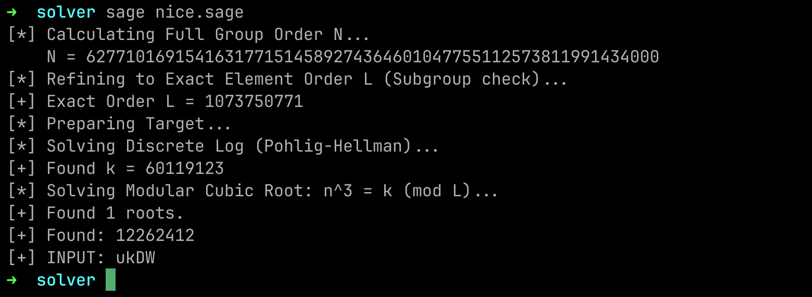<figcaption></figcaption></figure>

Trying the input with the executable we can ensure that it shows the same hash value which means it is correct.

<figure>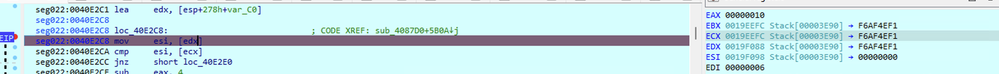<figcaption></figcaption></figure>

<figure>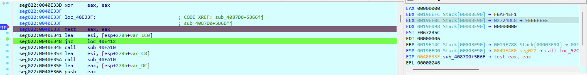<figcaption></figcaption></figure>

Talking with the author and he confirms that the input is intended to be varies as long as it is valid input then it will be one of valid flag. Besides that we also can generate bunch of valid flag, because we already know the order and n value.

```python
def rev_conv(n):
    charset = "0123456789ABCDEFGHIJKLMNOPQRSTUVWXYZabcdefghijklmnopqrstuvwx"
    if n == 0: return "0"
    res = ""
    while n > 0:
        res = charset[n % 60] + res
        n //= 60
    return res

def conv(inp):
    res = 0
    charset = "0123456789ABCDEFGHIJKLMNOPQRSTUVWXYZabcdefghijklmnopqrstuvwx"
    for i in inp:
        tmp = charset.index(i)
        res = res * 60 + tmp
    return res

PREFIX = "SecurinetsFinal"
TARGET_LEN = 33

val = 12262412        
L = 1073750771

prefix_val = conv(PREFIX)

remaining_chars = TARGET_LEN - len(PREFIX)
min_target_n = prefix_val * (60 ** remaining_chars)

start_i = (min_target_n - val) // L

for k in range(100000): 
    i = start_i + k
    tmp = val + i * L
    valid_input = rev_conv(tmp)
    
    if valid_input.startswith(PREFIX):
        print(f"[+] FOUND: {valid_input}")
        break
```

<figure>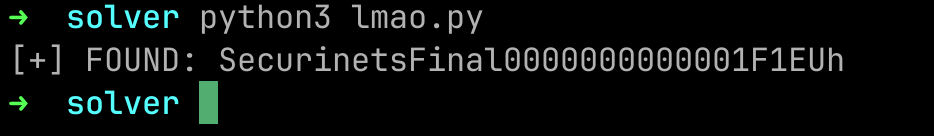<figcaption></figcaption></figure>

<figure>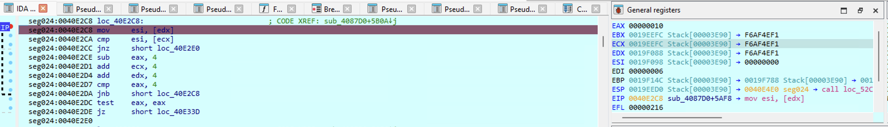<figcaption></figcaption></figure>

&#x20;Flag: Securinets{\<valid\_input>}
